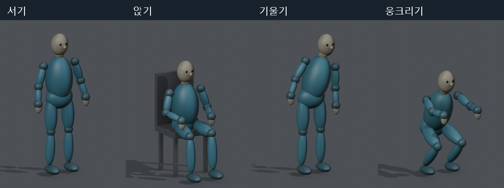

# Motion Reference Benchmark

졸업논문 「행동 사전 기반 LLM 모션 추론과 검증된 레퍼런스를 이용한 영상 생성의 행동 정확도 평가」의 실험 코드와 벤치마크 데이터이다.

이미지와 자연어 요청으로 영상을 생성할 때, LLM이 추론한 모션 레퍼런스를 추가로 제공하면 요청된 행동이 더 정확히 재현되는지를 평가한다. 레퍼런스의 오류로 결과가 악화되는 경우도 실패로 포함한다.

| 조건 | 입력과 처리 |
|---|---|
| A | 이미지 + 요청 → 직접 I2V |
| B | 동일 입력 + LLM이 생성한 최초 레퍼런스 → R2V |
| C | B와 동일한 최초 레퍼런스를 검토하고 필요 시 1회 수정 → R2V |

- 중간보고서: [docs/MIDTERM_REPORT.ko.md](docs/MIDTERM_REPORT.ko.md)
- 개발 실행 결과: [results/README.md](results/README.md)

## 벤치마크 구성

- **문항 규모**: 개발용 8문항, 보정용 4문항, 평가용 12문항으로 총 24문항이며, 문항마다 입력 이미지 1장이 있다.
- **평가용 문항**: 사전 관계(사전 내·조합·사전 외)와 초기 자세(서기·앉기·기울기·웅크리기)의 각 조합에 1문항씩 배정하였다.
- **입력 이미지**: Blender 기본 도형으로 제작한 절차적 마네킹이다. 외부 모션 데이터, 캐릭터 자산, 학습된 모델 가중치는 포함하지 않는다.
- **평가 전용 데이터**: `benchmark/evaluator/`의 채점 기준과 초기 관절 정답은 평가에만 사용하며, 생성 과정에는 제공하지 않는다.



## 저장소 구조

| 경로 | 내용 |
|---|---|
| `benchmark/` | 문항, 입력 이미지, 행동 사전, 평가 전용 채점 기준 |
| `motionbench/` | 실행 기록, LLM 계획기, 실루엣 정합, 애니메이션, 레퍼런스 검증, 영상 생성 어댑터, 익명 평가, 집계 |
| `tools/` | 입력 이미지 생성, Blender 렌더링 스크립트, 개발용 분석 도구 |
| `tests/` | 단위 시험 |
| `results/` | 개발 실행 결과 요약과 그림 |
| `docs/` | 중간보고서, 실험 프로토콜, 채점 기준, 파이프라인 설명, 출처 |

## 실행 환경

- **기본 기능**: Python 3.10 이상, 표준 라이브러리만 사용한다. 대상은 검증, 실행 기록, 채점이다.
- **레퍼런스 렌더링**: Blender 4.2와 ffmpeg가 필요하다.
- **LLM 호출**: Claude Code CLI(구독 경로) 또는 `anthropic` 패키지와 `ANTHROPIC_API_KEY`(API 경로) 중 하나가 필요하다.
- **최종 영상 생성**: fal.ai API 키(`FAL_KEY`)가 필요하다.

## 사용 방법

```bash
python -m motionbench validate                                              # 문항·이미지·해시 검증
python -m unittest discover -s tests                                        # 단위 시험
python -m motionbench plan --split development --repeats 1 --out runs/dev   # 실행 슬롯 생성
python -m motionbench pipeline --run runs/dev --model sonnet                # 자세 추정 → 정합 → 계획 → 렌더링 → 검증
python -m motionbench generate --run runs/dev                               # 최종 영상 생성 비용 추정 (모의 실행)
python -m motionbench package-review --run runs/dev --out review/pkg --mapping private/map.json
python -m motionbench summarize --run runs/dev                              # 집계
```

단계별 명령과 각 단계의 정보 접근 범위는 [docs/PIPELINE.md](docs/PIPELINE.md)에 정리하였다. 평가용 문항은 `freeze-pipeline`으로 코드·프롬프트·모델·비용 상한을 동결한 실행에서만 처리된다.

## 평가 원칙

- **성공 기준**: 모든 명시적 요구를 충족한 최종 영상만 성공으로 계수한다.
- **실패 처리**: 실패, 중단, 판정 불확실은 성공으로 계수하지 않으며, 분모에서도 제외하지 않는다.
- **판정 방식**: 평가자 2인이 조건을 모르는 상태에서 독립적으로 판정하고, 불일치는 제3자가 조정한다.
- **결측 처리**: 미실행 또는 미평가 슬롯이 남아 있으면 주 점수를 산출하지 않는다.

## 현황

- **완료**:
  - 벤치마크 문항과 입력
  - 레퍼런스 생성 파이프라인(LLM 계획, 실루엣 정합, 애니메이션, 렌더링, 검증)
  - 평가 및 집계 도구
- **미실시**: 최종 영상 생성(조건 A/B/C)과 사람 평가. 따라서 제안 방법의 효과는 아직 판단할 수 없다.

## 문서

- [중간보고서](docs/MIDTERM_REPORT.ko.md)
- [실험 프로토콜](docs/PROTOCOL.md)
- [채점 기준](docs/RUBRIC.md)
- [생성 파이프라인과 정보 경계](docs/PIPELINE.md)
- [출처와 재현 범위](docs/PROVENANCE.md)
