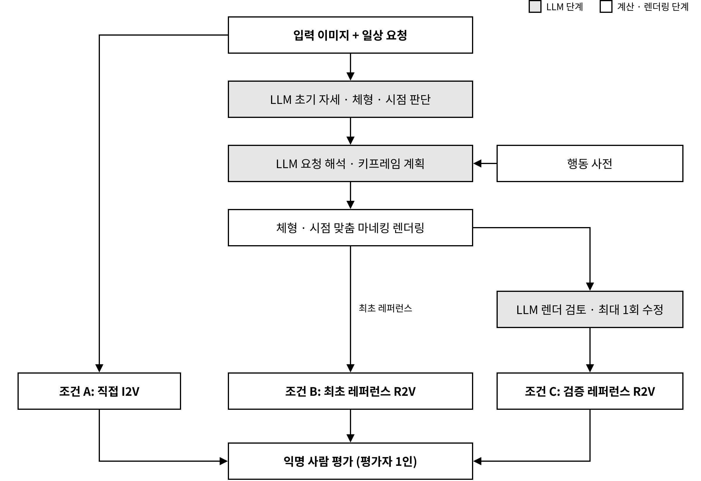
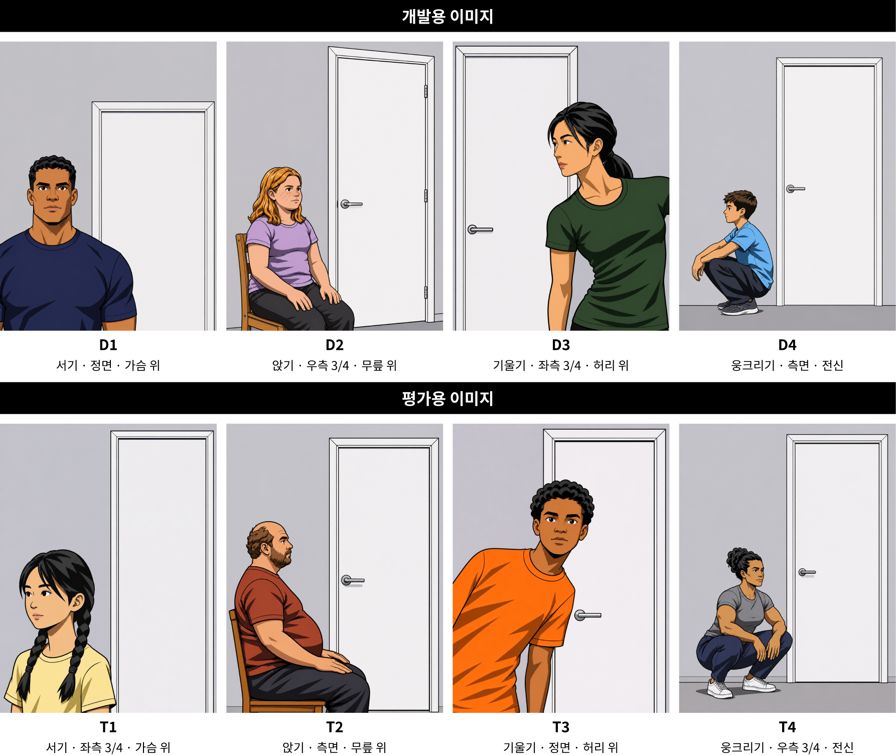
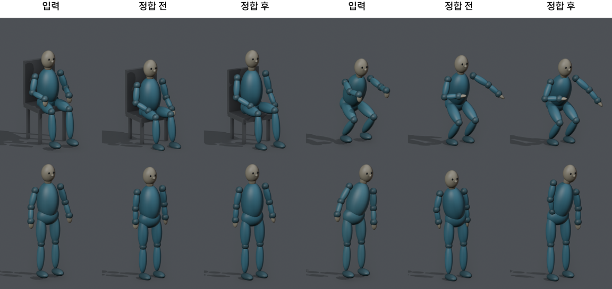
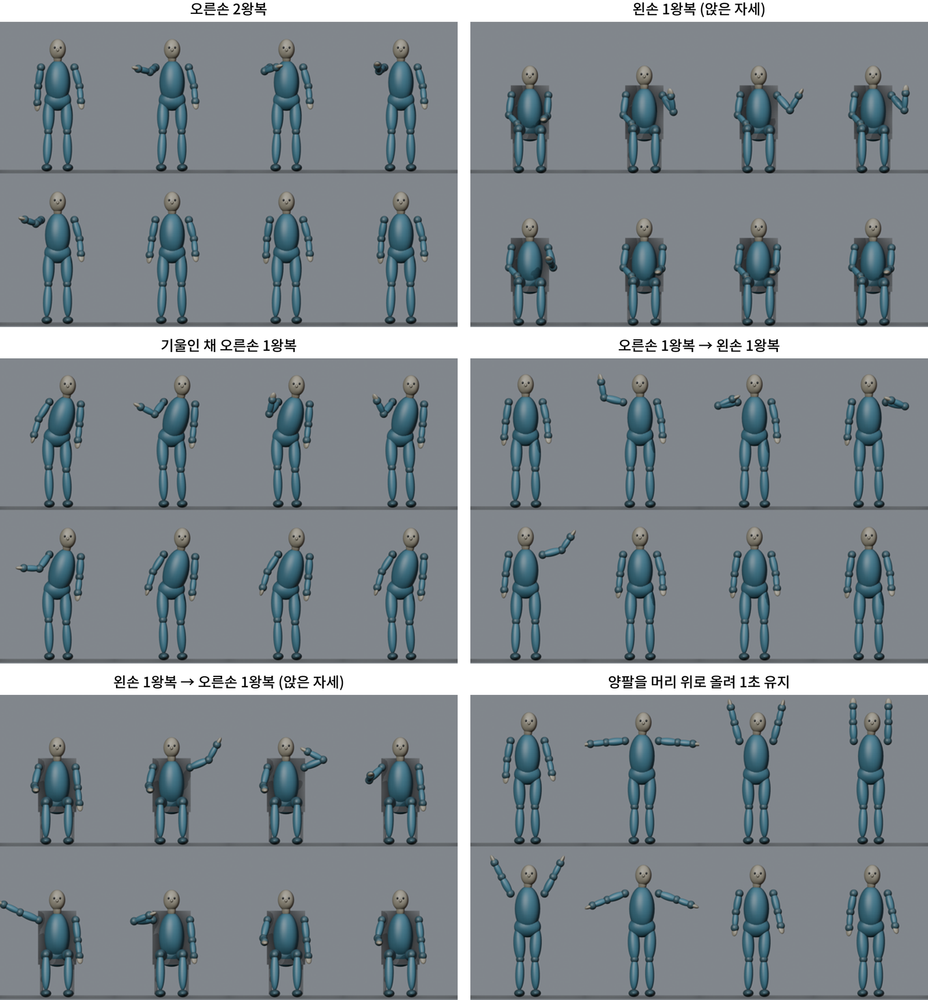

# 졸업논문 최종보고서

**제목: 행동 사전 기반 LLM 모션 추론과 검증된 레퍼런스를 이용한 영상 생성의 행동 정확도 평가**

- 작성일: 2026-11-26
- 코드 및 데이터: https://github.com/enggaa/motion-reference-benchmark

## 개요

### 연구 배경

확산 모델 기반 영상 생성 모델은 이미지 한 장과 짧은 문장만으로 사실적인 인물 영상을 생성할 수 있으며(image-to-video, I2V), 이를 캐릭터 애니메이션이나 광고 제작에 활용하려는 수요가 커지고 있다. 본 연구는 실무에서 I2V 모델을 사용하며 반복적으로 관찰한 문제에서 출발하였다. 생성된 영상이 지시와 다른 동작을 수행하거나, 요청한 동작 없이 숨을 쉬며 몸이 들썩이는 정도의 미미한 움직임만 보이는 경우가 잦았다. 본 연구는 이러한 실패를 "인사해", "일어나"처럼 사용자가 일상적으로 쓰는 짧은 요청에서 다루며, 앉거나 웅크린 인물이 그 자세에서 동작을 시작하는지도 함께 확인한다. 문장 해석, 동작 구성, 영상 합성이 하나의 생성 과정 안에서 동시에 일어나기 때문에 실패의 원인을 특정하기 어렵고, 사용자는 프롬프트를 바꾸어 다시 생성하는 것 외에 대처할 방법이 없다.

동작을 정밀하게 제어하려는 기존 연구는 크게 네 갈래로 나뉘며, 각각 한계가 있다. 첫째, MotionCtrl과 Motion-I2V 같은 움직임 제어 생성 연구는 궤적이나 움직임 장으로 움직임을 지정하지만, 팔다리의 동작은 표현하기 어렵고 중간 결과를 요청과 대조하기도 어렵다. 둘째, Animate Anyone과 Champ 같은 포즈 조건 애니메이션은 주어진 포즈 시퀀스를 정확히 따르지만, 그 포즈 시퀀스를 외부에서 별도로 요구한다. 셋째, MDM, MoMask, 그리고 LLM으로 핵심 자세를 계획하는 PRO-Motion 같은 텍스트-모션 생성 연구는 문장에서 3차원 동작을 만들지만, 학습 데이터의 동작과 선 자세에서 시작하는 동작에 맞추어져 있다. 넷째, VideoDirectorGPT와 LLM-grounded Video Diffusion은 LLM이 영상의 움직임을 계획하게 하였으나, 계획 단위가 객체 상자이므로 인체 내부의 동작은 다루지 못한다. 또한 VBench, T2V-CompBench, VBench-2.0 같은 영상 생성 벤치마크는 전반적 품질과 문장 일치를 주로 측정한다. 따라서 사용자의 요청을 입력 이미지의 자세에서 시작하는 동작 레퍼런스로 바꾸는 방법은 아직 부족하며, 레퍼런스를 추가하는 것이 실제로 행동 수행률을 높이는지 측정할 평가 체계도 마련되어 있지 않다.

### 제안 방법

본 연구는 한 번의 생성에 몰려 있던 실패 요인을 LLM 동작 계획, 레퍼런스 영상, 영상 생성의 세 단계로 분산한다. 분해만으로 전체 실패율이 바로 줄지는 않더라도, 각 단계의 중간 결과를 따로 확인하고 실패한 단계만 수정할 수 있게 된다. 여기에 프롬프트 설계와 행동(키프레임) 사전으로 단계별 오류를 줄여 전체 실패율을 낮추는 것이 본 연구의 목표이다.

첫 단계에서 대형 언어 모델(LLM)은 입력 이미지 속 인물의 초기 자세와 체형(키, 연령대, 체격), 카메라의 시점과 화면 구도를 판단하고, 일상적인 요청을 눈에 띄게 끝까지 수행되는 하나의 동작으로 해석한 뒤, 소규모 행동 사전을 참조하여 시간별 관절 키프레임으로 계획한다. 두 번째 단계에서는 키프레임 보간, 순기구학·역기구학, 뼈 길이 보존과 같은 고전적 컴퓨터 애니메이션 기법으로 이 계획을 마네킹 레퍼런스 영상으로 만든다. 마네킹은 판단한 체형에 맞추어 만들고 입력 이미지와 같은 시점과 구도로 렌더링하며, LLM 검토자가 렌더링된 프레임을 근거로 검토하여 최대 1회 수정한다. 마지막 단계에서는 완성된 레퍼런스를 참조 영상 기반 생성(reference-to-video, R2V) 모델에 조건으로 제공하여 최종 영상을 생성한다. 즉 본 연구는 LLM 기반 동작 계획과 포즈·참조 영상 기반 생성을 관절 키프레임이라는 해석 가능한 중간 표현으로 연결한다.

### 사용 모델

동작 계획과 레퍼런스 검토에는 Anthropic의 Claude Sonnet 5.5를, 최종 영상 생성에는 fal.ai를 통해 ByteDance의 Seedance 2.0을, 레퍼런스 렌더링에는 Blender를 사용한다. 모든 모델은 추론에만 사용하며 학습이나 미세조정은 수행하지 않는다.

### 실험 설계

평가를 위해 벤치마크 v0.2를 구축하였다. 입력은 AI로 생성한 가상 인물의 캐릭터 그림체(비실사) 이미지 8장이며, 8장 모두 성별·키·나이·체형이 다른 인물이다. 처음에는 실사풍 이미지를 사용하였으나 영상 생성 서비스가 실존 인물의 모습일 수 있다는 정책으로 거부하여, 같은 인물·자세·구도의 캐릭터 그림체로 다시 만들었다. 개발용 4장과 평가용 4장은 각각 서기·앉기·기울기·웅크리기 자세, 정면·좌우 3/4·측면 시점, 전신부터 가슴 위까지의 화면 구도를 한 장씩 나누어 맡는다. 요청은 "인사해", "박수 쳐", "팔짱 껴", "일어나"와 같은 일상적인 문장이며, 이미지 한 장에 요청 여러 개를 배정하여 개발용 8문항, 평가용 12문항을 구성하였다. 각 문항은 요청한 행동 하나를 판정하며, 행동이 눈에 보이게 끝까지 수행되어야 성공이고 거의 움직이지 않거나 행동 부위가 끝까지 화면 밖에 있으면 실패라는 공통 규칙을 적용한다. 같은 입력에서 세 조건을 비교한다. 조건 A는 직접 I2V, 조건 B는 검증하지 않은 레퍼런스를 사용한 R2V, 조건 C는 검증한 레퍼런스를 사용한 R2V이다. 주 지표는 요청한 행동을 수행한 것으로 판정된 영상의 비율이며, 평가자 1인(연구자)이 어느 조건에서 생성된 영상인지 모르는 상태에서 판정한다. 본 평가는 평가용 12문항 × 3조건 × 1회, 총 36개 영상이며, 전체 영상 생성 예산은 약 50달러이다.

### 결과

설계를 바꾸기 전의 예비 실험(파일럿)은 3D 기본 도형으로 만든 마네킹 이미지와 "오른손을 두 번 흔든다" 같은 관절 수준의 요청을 사용하였고, 개발용 8문항에서 레퍼런스 생성 단계까지 네 차례 실행하였다. 렌더링-비교 방식의 실루엣 정합을 적용하자 초기 자세의 평균 관절 오차가 0.113 m에서 0.068 m로 감소하였다. 자동 검증기는 반복 횟수와 같은 세밀한 요구에서 판정이 불안정하였으나, 반복 동작의 계획 규칙을 보강한 뒤에는 8건 모두에서 레퍼런스의 손 궤적이 요청된 왕복 수와 일치하였다. 이 8건의 레퍼런스를 사람이 평가한 결과 7건이 모든 요구를 충족하였고, 검증기와 사람의 요구 단위 판정은 37건 중 35건(94.6%)이 일치하였다. 그러나 마네킹 입력은 레퍼런스와 외형이 같아 R2V가 레퍼런스를 베끼기만 해도 성공하게 되고, 관절 수준의 요청은 실제 사용자의 문장이 아니라는 문제가 있어 입력과 요청을 v0.2로 바꾸었다.

v0.2에서는 개발용 8문항으로 레퍼런스를 생성·검증하고, 그중 3문항으로 세 조건의 최종 영상을 생성하는 기능 시험을 수행하였다. 검증기는 레퍼런스 5건을 통과시키고 3건을 차단하였는데, 차단된 3건은 마네킹에 손가락과 입이 없어 브이 사인과 하품을 표현하지 못한 경우였다. 이는 생성 과정을 단계로 나누면서 새로 생기는 실패 유형이다. 이어서 파이프라인을 동결하고 평가용 12문항으로 본 평가를 실행하였다. 12건의 레퍼런스가 모두 검증을 통과하였고(2건은 1회 수정 후 통과), 세 조건의 최종 영상 36개를 모두 생성하였다. 영상 생성 비용은 25.09달러, 영상 1개의 생성 지연은 132–355초였다.

평가자 1인(연구자)이 조건을 모르는 상태에서 36개 영상을 판정한 결과, 요청한 행동의 수행률(사례 평균)은 직접 I2V 0.917, LLM 레퍼런스 R2V 0.833, 검증 레퍼런스 R2V 0.917이었다. 세 조건 모두 실패 판정은 없었고, 통과하지 못한 영상은 모두 판단 불가였다. 즉 이 평가 세트와 Seedance 2.0에서는 연구 동기로 삼은 직접 I2V의 실패가 재현되지 않았으며, 레퍼런스 방식은 행동 수행률을 높이지 않았다. 자연스러움(1–5점) 평균은 각각 4.17, 2.75, 3.33으로 레퍼런스 조건에서 낮았다.

R1 실패 판정은 없었지만, 단계를 나누어도 실패가 사라지지 않고 그 유형이 바뀌었다. 레퍼런스 조건에서는 레퍼런스 단계에서 동작이 잘못 만들어진 경우(팔짱 끼기: T03은 B와 C 모두, T12는 B가 판단 불가)와 요청 동작 전후의 부자연스러운 전환·멈춤·템포가 두드러졌다. 직접 I2V에서는 요청한 동작에 그치지 않고 화면 밖으로 걸어 나가거나(T09) 점프 뒤 다시 쪼그려 앉는(T11) 것처럼 요청 이상의 행동을 하였다.

조건 B는 최초 레퍼런스를 검사 없이 사용하고 조건 C는 검증을 통과한 레퍼런스만 사용하지만, 12건 중 10건은 최초 레퍼런스가 그대로 검증을 통과하여 두 조건이 같은 레퍼런스를 사용하였다. 레퍼런스가 달랐던 것은 T06과 T11 두 건뿐이므로 이번 평가에서는 검증 단계의 효과가 사실상 측정되지 않았다. 또한 같은 레퍼런스를 쓴 T12(팔짱 껴)에서 B는 판단 불가·자연스러움 1점, C는 통과·5점으로 결과가 갈려, 생성 변동이 커서 1회 생성만으로 조건을 비교하는 데 한계가 있음을 보였다. 평가자 1인과 12사례의 결과이므로 신뢰구간이 넓으며, 조건 간 우열을 검정한 것이 아니다.

### 남은 과제

평가자를 늘리고 문항과 반복 생성(replicate)을 늘려 이 결과가 일반화되는지 확인해야 한다. 검증 단계의 효과를 측정하려면 최초 레퍼런스가 검증에 실패하는 사례를 충분히 확보해야 한다. 또한 레퍼런스의 전후 전환과 타이밍을 개선하고, 손 모양을 표현할 수 있도록 레퍼런스를 보강하며, v0.2 레퍼런스에 대한 검증기 판정을 사람 판정과 대조하여 검증기의 신뢰성을 확인해야 한다.

## 1. 서론

### 1.1 문제 상황

**연구의 계기:** 본 연구는 실무에서 I2V 모델을 사용하며 반복적으로 관찰한 두 가지 실패에서 출발하였다.
- **지시 불일치**: 생성된 영상이 요청한 동작과 다른 동작을 수행한다.
- **움직임 부족**: 요청한 동작은 나타나지 않고, 숨을 쉬며 몸이 들썩이는 정도의 미미한 움직임만 나타난다.

이러한 실패는 문장 해석, 동작 구성, 영상 합성이 하나의 생성 과정 안에서 동시에 일어나기 때문에 원인을 특정하기 어렵다. 실패한 영상을 보고 어느 부분이 잘못되었는지 알 수 없으므로, 사용자가 할 수 있는 일은 프롬프트를 바꾸어 다시 생성하는 것뿐이다. 본 연구는 이 문제를 해결하려면 실패 요인을 여러 단계로 분산해야 한다고 보았다. 이 관찰을 일반적인 연구 문제로 정리하면 다음과 같다.

**영상 생성 모델의 발전:** 영상 생성 모델은 확산 모델과 트랜스포머 구조를 기반으로 빠르게 발전하였다[1, 2, 3, 4]. 현재 상용 모델은 이미지 한 장과 짧은 문장만으로도 수 초 길이의 사실적인 인물 영상을 생성한다. 이에 따라 캐릭터 애니메이션, 광고, 사전 시각화와 같이 "이 인물이 이 동작을 하는 영상"이 필요한 작업에 생성 모델을 활용하려는 수요가 커지고 있다.

**일상 요청과 행동 수행의 문제:** 실제 사용자는 동작을 관절 단위로 설명하지 않고 "인사해", "박수 쳐", "일어나"처럼 짧게 요청한다. 이러한 요청에서도 다음과 같은 실패가 생길 수 있다.
- 요청한 행동을 시작만 하고 끝까지 수행하지 않는다(예: 손을 들기만 하고 흔들지 않음).
- 다른 행동을 수행한다(예: 팔짱 대신 손을 모음).
- 입력 이미지의 자세에서 시작하지 않는다(예: 앉은 인물이 첫 프레임 직후 선 자세로 바뀜).
- 행동하는 신체 부위가 화면 밖에 있어 행동이 보이지 않는다.

선행 연구도 이 어려움을 보고하였다.
- 조합적 영상 생성 벤치마크[5]: 여러 대상에 서로 다른 행동을 정확히 배정하는 일(action binding)과 지정된 움직임 궤적을 따르는 일(motion binding)이 현재 모델에게 어려운 범주로 나타났다.
- VBench-2.0[6]: 시각적 그럴듯함을 넘어 인체 해부학적 정확성과 같은 내재적 충실도를 평가해야 한다고 제기하였다.

**기존 대안의 한계:** 동작을 정밀하게 제어하는 대안은 있으나 각각 한계가 있다.
- **포즈 조건 애니메이션**[7, 8, 9]: 구동용 포즈 시퀀스를 주면 그 동작을 정확히 따른다. 그러나 사용자는 요청한 동작의 포즈 시퀀스를 갖고 있지 않으며, 이를 얻으려면 모션 캡처나 애니메이터의 작업이 필요하다.
- **텍스트-모션 생성 모델**[10, 11, 12]: 문장에서 3차원 동작을 생성한다. 그러나 학습 데이터셋[13, 14]에 있는 동작에 성능이 의존하고, 주로 선 자세에서 시작하는 동작을 생성한다. 앉거나 기울어진 입력 이미지의 자세에서 시작하는 동작은 다루기 어렵다.

**본 연구가 다루는 공백:** 정리하면 다음 두 가지가 비어 있다.
- **레퍼런스 확보 수단**: 입력 이미지의 자세에서 시작하고, 일상적인 요청을 알아볼 수 있는 동작으로 구체화하며, 학습 데이터에 없는 동작에도 적용할 수 있는 동작 레퍼런스를 얻는 방법이 없다.
- **평가 수단**: 기존 영상 생성 벤치마크[5, 6, 15]는 전반적인 품질과 의미 일치를 주로 측정한다. 초기 자세가 주어진 상황에서 요청한 행동이 실제로 끝까지 수행되었는지를 측정하지는 않는다.

또한 레퍼런스를 추가하는 것이 항상 이로운지도 확인되지 않았다. 잘못된 레퍼런스는 오히려 잘못된 동작을 강제할 수 있다.

### 1.2 연구 목적과 접근

**LLM 계획의 확장:** LLM은 일반 상식과 추론 능력을 바탕으로 문장 속 동작을 단계로 분해할 수 있다. 선행 연구는 LLM이 장면 배치나 객체 이동 경로를 계획하고, 영상 생성 모델이 이를 따르게 하는 방식을 제안하였다[16, 17]. 다만 이 연구들의 계획 단위는 객체 상자이며, 인체 관절 수준의 동작은 다루지 않는다.

**본 연구의 접근:** 본 연구는 LLM의 계획을 인체 관절 수준으로 확장하고, 단일 생성 과정을 다음 세 단계로 분해한다.
1. **LLM 동작 계획**: LLM이 초기 자세를 추정하고, 요청을 구체적인 동작으로 해석한 뒤, 소규모 행동 사전을 참조하여 관절 키프레임을 계획한다.
2. **레퍼런스 영상**: 고전적 애니메이션 기법이 계획을 레퍼런스 영상으로 만든다.
3. **영상 생성**: 이 레퍼런스를 R2V 모델에 제공하여 최종 영상을 생성한다.

**분해의 근거:** 단계를 나누는 것만으로 전체 실패율이 줄어든다고 보장할 수는 없다. 그러나 실패가 단계별로 분산되면 각 단계의 중간 결과(관절 계획, 레퍼런스 영상)를 사람이나 검증기가 직접 확인할 수 있다. 실패한 단계만 수정하면 되므로 전체를 다시 생성할 필요도 없다. 또한 각 단계에 맞는 보완 수단을 적용할 수 있다. 계획 단계에는 프롬프트 설계와 행동(키프레임) 사전을, 레퍼런스 단계에는 렌더링 기반 검증을 적용한다. 본 연구는 이러한 단계별 보완이 전체 실패율을 낮출 것이라는 가설을 세운다.

**연구 목적:** 이 접근이 직접 I2V보다 요청한 행동의 수행률을 높이는지 측정한다. 레퍼런스를 검증하는 단계가 잘못된 레퍼런스의 피해를 줄이는지도 함께 측정한다.

### 1.3 기대 기여

1. **행동 수행 벤치마크**: 초기 자세·시점·화면 구도를 통제하고 인물을 모두 달리한 입력 이미지 8장, 일상적인 요청 20문항, 행동 단위 채점 기준을 제공한다.
2. **레퍼런스 생성 파이프라인**: LLM 관절 계획, 고전적 애니메이션, 렌더링 기반 검증으로 구성한다.
3. **통제된 비교**: 직접 I2V, 미검증 레퍼런스, 검증 레퍼런스를 같은 입력에서 비교한다. 부정적 결과도 포함하여 보고한다.

## 2. 배경 지식 및 관련 연구

본 장에서는 본 연구와 관련된 기존 연구를 일곱 갈래로 정리한다. 영상 생성 모델 자체(2.1), 영상 생성의 움직임 제어(2.2), 포즈 조건 인물 애니메이션(2.3), 텍스트 기반 인체 모션 생성(2.4), 단일 이미지 인체 자세 추정(2.5), LLM 기반 생성 계획(2.6), 영상 생성 평가와 LLM 판정(2.7)을 차례로 다룬 뒤, 이들과 비교한 본 연구의 위치를 정리한다(2.8).

### 2.1 확산 기반 영상 생성 모델

확산 모델[18]은 데이터에 잡음을 점진적으로 더하는 과정을 거꾸로 학습하여, 순수한 잡음에서 출발해 데이터를 생성한다. 잠재 확산 모델[19]은 이 과정을 오토인코더로 압축한 잠재 공간에서 수행하여 고해상도 생성의 계산량을 크게 줄였고, 확산 트랜스포머(DiT)[20]는 잡음 제거 신경망을 U-Net에서 트랜스포머로 바꾸어 모델 규모를 키울수록 성능이 안정적으로 오르도록 하였다.

영상 생성 모델은 이 구조를 시간 축으로 확장한 것이다. AnimateDiff[21]는 사전 학습된 이미지 확산 모델에 시간 모듈만 추가로 학습하여 영상을 생성하였고, Stable Video Diffusion[2]은 대규모 영상 데이터의 선별과 단계적 학습이 영상 확산 모델의 품질을 좌우함을 보였다. 이후 Sora[1], Wan[3], Seedance[4, 22]와 같은 대규모 모델은 확산 트랜스포머를 시공간 패치 단위로 적용하여 수 초에서 수십 초 길이의 사실적인 영상을 생성한다.

영상 생성 모델은 조건을 입력받는 방식에 따라 구분된다. 텍스트-영상(T2V) 생성은 문장만을, 이미지-영상(I2V) 생성은 첫 프레임이 될 이미지와 문장을 입력받는다. I2V 연구로는 영상 확산 모델의 사전 지식으로 정지 이미지를 움직이게 하는 DynamiCrafter[23]와, 의미 보존 단계와 화질 향상 단계를 나눈 I2VGen-XL[24] 등이 있다. 참조 영상 기반 생성(R2V)은 이미지와 함께 참조 영상을 입력하여 그 동작이나 카메라 움직임을 참고하게 한다. 본 연구의 비교 조건 A는 I2V를, 조건 B와 C는 R2V를 사용한다.

I2V 모델이 입력 이미지를 거의 그대로 유지한 채 움직임이 적은 영상을 생성하는 경향은 평가 연구에서도 별도의 측정 대상이 되어 왔다. VBench[15]는 광학 흐름으로 영상의 움직임 정도를 측정하는 동적 정도(dynamic degree) 항목을 두고 있으며, 이는 1.1절에서 서술한 "숨을 쉬는 정도의 움직임"이 개별 사례가 아닌 알려진 실패 유형임을 보여 준다.

### 2.2 영상 생성의 움직임 제어

텍스트만으로는 움직임을 정밀하게 지정하기 어렵다는 문제를 해결하기 위해, 움직임을 별도의 조건으로 입력하는 연구가 진행되었다. VideoComposer[25]는 움직임 벡터, 깊이, 스케치 등을 조합 가능한 조건으로 받아 영상을 생성하였고, MotionCtrl[26]은 카메라 움직임과 객체 궤적을 분리하여 각각 제어할 수 있게 하였다. MotionDirector[27]는 참조 영상 몇 개로부터 외형과 분리된 움직임 개념을 학습하여 다른 대상에 적용하였다.

이 가운데 Motion-I2V[28]는 본 연구와 문제 설정이 가깝다. 이 연구는 I2V 생성을 픽셀 궤적을 예측하는 단계와 그 궤적을 따라 영상을 합성하는 단계로 나누어, 큰 움직임에서도 일관된 영상을 얻었다. 생성 과정을 "움직임 결정"과 "영상 합성"으로 분해한다는 발상은 본 연구와 같지만, Motion-I2V는 움직임을 학습된 확산 모델이 픽셀 수준에서 예측하므로 그 중간 결과를 사람이 해석하거나 요청과 대조하기 어렵다. 본 연구는 움직임을 관절 키프레임이라는 해석 가능한 형태로 계획하고, 이를 렌더링하여 검증할 수 있게 한다는 점에서 다르다.

### 2.3 포즈 조건 인물 애니메이션

ControlNet[29]은 사전 학습된 확산 모델의 가중치를 고정한 채 복제한 인코더로 포즈, 경계선, 깊이 같은 공간 조건을 주입하는 방법을 제시하였다. 이를 바탕으로 참조 이미지 속 인물을 포즈 시퀀스대로 움직이는 인물 애니메이션 연구가 활발히 이어졌다. Animate Anyone[7]은 참조 이미지의 세부 외형을 보존하는 별도 신경망과 경량 포즈 인코더를 결합하였고, MagicAnimate[8]는 시간 일관성 모듈을 도입하여 프레임 간 깜박임을 줄였다. Champ[9]는 3차원 인체 모델 SMPL[30]에서 얻은 깊이·법선·의미 지도를 조건에 추가하여 체형과 자세를 함께 맞추었다. UniAnimate[31]는 참조 이미지와 포즈 조건을 하나의 영상 확산 모델에서 처리하여 긴 영상 생성을 가능하게 하였고, MimicMotion[32]은 포즈 추정의 신뢰도를 반영한 조건으로 손과 같은 세부 부위의 왜곡을 줄였다.

이 계열의 방법은 주어진 포즈 시퀀스를 매우 정확하게 따르지만, 포즈 시퀀스 자체는 다른 영상에서 추출하거나 모션 캡처로 얻는 등 외부에서 주어져야 한다. 사용자가 원하는 동작을 문장으로만 가지고 있을 때는 이 방법들을 바로 쓸 수 없다. 본 연구는 이 포즈 시퀀스에 해당하는 동작 레퍼런스를 요청 문장과 입력 이미지로부터 만드는 문제를 다룬다.

### 2.4 텍스트 기반 인체 모션 생성

문장으로부터 3차원 인체 동작을 생성하는 연구는 모션 캡처 데이터에 문장 설명을 붙인 데이터셋을 기반으로 발전하였다. KIT Motion-Language[13]는 약 3,900개의 동작에 자연어 설명을 붙였고, HumanML3D[14]는 이를 약 14,600개 동작과 44,900여 개 설명으로 확장하였다.

생성 모델로는 확산 모델을 동작 생성에 초기에 적용한 MotionDiffuse[33]와 MDM[10], 동작을 이산 토큰으로 바꾸어 자기회귀적으로 생성하는 T2M-GPT[11], 동작을 언어 모델의 어휘처럼 다루어 문장과 동작을 함께 학습한 MotionGPT[12], 마스크 기반 생성으로 품질을 높인 MoMask[34] 등이 있다. 그러나 이 모델들은 학습 데이터의 동작 분포와 표준적인 시작 자세에 맞추어져 있어, 데이터에 드문 동작이나 앉거나 기울어진 임의의 초기 자세에서 시작하는 동작에는 직접 적용하기 어렵다.

이 한계를 LLM의 일반 지식으로 보완하려는 연구도 등장하였다. SINC[35]는 GPT-3에게 각 행동에 관여하는 신체 부위를 묻고, 그 답을 이용해 서로 다른 행동을 동시에 수행하는 동작을 합성하였다. PRO-Motion[36]은 LLM이 핵심 자세를 문장 형태의 대본으로 계획하면 확산 모델이 각 자세를 생성하고, 이어서 자세 사이의 전신 이동을 생성하는 3단계 구조를 제안하였다. 이 연구들은 LLM이 동작을 단계별 자세로 분해하는 능력을 갖추었음을 보여 주며, 본 연구의 LLM 관절 계획은 이 흐름을 따른다. 다만 이 연구들은 3차원 동작 자체를 최종 산출물로 삼고 선 자세에서 시작하는 반면, 본 연구는 입력 이미지의 자세에서 시작하는 동작을 계획하고 이를 영상 생성의 레퍼런스로 사용한다.

### 2.5 단일 이미지 인체 자세 추정

입력 이미지에서 시작하는 동작을 만들려면 먼저 이미지 속 인물의 3차원 자세를 알아야 한다. SMPLify[37]는 2차원 관절 검출 결과에 SMPL 모델을 최적화로 맞추어 3차원 자세와 체형을 추정하였고, HMR[38]은 이를 신경망 회귀로 대체하여 이미지에서 SMPL 매개변수를 직접 예측하였다. 최근의 4DHumans[39]는 트랜스포머 기반 추정기로 다양한 자세에서 정확도를 높였다.

본 연구는 이러한 학습 기반 추정기를 사용하지 않고, LLM이 이미지에서 초기 자세를 직접 추정하게 한다. 예비 실험(6.4절)에서는 입력이 렌더러와 같은 마네킹이었으므로, SMPLify의 "모델을 렌더링하여 관측과 비교하고 최적화한다"는 분석-합성 원리를 단순한 마네킹 모델과 실루엣 겹침 지표에 적용하여 추정 자세를 보정하였다. 이 보정은 입력과 렌더러의 외형·카메라가 같다고 가정하므로 v0.2의 캐릭터 그림체 입력에는 사용하지 않는다.

### 2.6 LLM 기반 생성 계획

LLM을 생성 과정의 계획 단계로 사용하는 연구도 제안되었다. VideoDirectorGPT[16]는 LLM이 장면별 설명, 등장 객체, 객체 배치를 담은 영상 계획을 작성하고, 영상 생성 모델이 이 계획을 따라 여러 장면으로 이루어진 영상을 생성하게 하였다. LLM-grounded Video Diffusion[17]은 LLM이 프레임별 객체 상자의 이동 궤적을 생성하고, 이를 영상 확산 모델의 어텐션 조정에 사용하여 문장이 요구하는 움직임을 더 잘 따르게 하였다.

이 연구들은 LLM이 문장으로부터 시공간적 움직임을 계획할 수 있고, 그 계획을 중간 표현으로 두면 생성 결과의 정확도가 높아짐을 보였다. 다만 계획 단위가 객체 상자이므로 팔다리의 움직임이나 좌우 손의 구분처럼 인체 내부의 동작은 표현하지 못한다. 본 연구는 계획 단위를 인체 관절로 낮추고, 계획을 실제 골격 동작과 레퍼런스 영상으로 바꾸는 단계를 추가한다.

### 2.7 영상 생성 평가와 LLM 판정

영상 생성 모델의 평가는 단일 점수에서 세부 차원별 평가로 발전하였다. VBench[15]는 영상 품질을 피사체 일관성, 움직임의 부드러움, 동적 정도 등 16개 차원으로 나누어 자동 평가하였고, EvalCrafter[40]는 시각 품질, 문장 일치, 움직임 품질, 시간 일관성을 여러 지표로 측정하였다. T2V-CompBench[5]는 속성, 행동, 공간 관계, 움직임의 조합적 일치를 평가하여 행동 배정과 움직임 궤적이 현재 모델에게 어려운 범주임을 보였고, VBench-2.0[6]은 물리 법칙, 상식, 인체 해부학적 정확성과 같은 내재적 충실도를 평가 대상으로 삼았다. 그러나 이 벤치마크들은 대부분 텍스트 조건 생성을 대상으로 하며, 입력 이미지의 초기 자세가 주어진 상황에서 요청한 행동이 끝까지 수행되었는지를 측정하지는 않는다.

평가와 수정 과정에 LLM을 사용하는 연구도 많다. LLM을 평가자로 사용하는 방식은 사람 판정과 상당히 일치하지만, 제시 순서나 답변 길이에 따른 편향이 보고되었다[41]. LLM이 자신의 출력을 스스로 고치는 방식에 대해서는, 반복적인 자기 피드백으로 품질이 오른다는 보고[42]와 외부 신호 없이 스스로 수정하면 오히려 성능이 떨어질 수 있다는 보고[43]가 함께 존재한다. CRITIC[44]은 검색이나 코드 실행과 같은 외부 도구의 결과를 근거로 삼을 때 수정이 효과적임을 보였다. 본 연구의 검증 단계가 LLM의 판단만이 아니라 렌더링된 프레임과 골격 계측값을 근거로 제시하는 것은 이 결과를 반영한 설계이다. 또한 본 연구의 주 지표는 사람 평가자의 판정이며, LLM 검토자의 판정은 사람 판정과의 일치도를 별도로 측정하여 신뢰성을 확인한다.

### 2.8 기존 연구와 본 연구의 비교

앞의 연구들과 본 연구를 동작 지정 방식과 초기 자세 처리 관점에서 비교하면 다음과 같다.

| 연구 계열 | 대표 연구 | 동작을 지정하는 방식 | 임의 초기 자세 | 중간 결과 검증 |
|---|---|---|---|---|
| I2V 생성 | DynamiCrafter, Seedance | 문장 | 입력 이미지로 반영 | 불가 |
| 움직임 제어 생성 | MotionCtrl, Motion-I2V | 궤적·움직임 장 | 입력 이미지로 반영 | 제한적 |
| 포즈 조건 애니메이션 | Animate Anyone, Champ | 외부 포즈 시퀀스 | 포즈 시퀀스에 의존 | 포즈 시퀀스로 가능 |
| 텍스트-모션 생성 | MDM, MoMask, PRO-Motion | 문장 → 3차원 동작 | 주로 선 자세 | 3차원 동작으로 가능 |
| LLM 생성 계획 | VideoDirectorGPT, LVD | 문장 → 객체 상자 | 해당 없음 | 상자 수준 |
| **본 연구** | | 문장 → 관절 키프레임 → 레퍼런스 영상 | LLM 추정으로 반영 | 렌더링 프레임으로 가능 |

정리하면 본 연구는 LLM 기반 동작 계획(2.4, 2.6)과 포즈·참조 영상 기반 생성(2.2, 2.3)을 연결하는 위치에 있다. 문장만으로 동작을 지정하면서도, 입력 이미지의 자세에서 시작하고, 중간 결과를 사람이 해석할 수 있는 형태로 남긴다는 점이 기존 연구와 구별된다.

### 2.9 본 연구에서 사용한 모델과 도구

본 연구는 새로운 모델을 학습하거나 미세조정하지 않으며, 공개된 모델과 도구를 추론 단계에서만 사용한다.

| 구분 | 모델 및 도구 | 용도 |
|---|---|---|
| 대형 언어 모델 | Anthropic Claude Sonnet 5.5[45] | 초기 자세·체형·시점 판단, 관절 키프레임 계획, 레퍼런스 검토 |
| 영상 생성 모델 | ByteDance Seedance 2.0, fal.ai 경유[22, 46] | 조건 A의 I2V, 조건 B·C의 R2V (480p) |
| 3차원 렌더링 | Blender 4.2 LTS, Workbench 엔진[47] | 레퍼런스 영상 렌더링 (예비 실험에서는 마네킹 입력 이미지도 렌더링) |
| 입력 이미지 제작 | OpenAI 이미지 생성 | 벤치마크 v0.2의 캐릭터 그림체 가상 인물 이미지 8장 제작 (구축 시) |
| 모션 데이터 | KIT Motion-Language Dataset[13] | 선행 작업의 동작 재생 기준선 |

## 3. 연구 질문

1. LLM 레퍼런스 조건은 직접 I2V 대비 요청한 행동의 수행률을 높이는가?
2. 레퍼런스 검증·수정 단계는 최초 레퍼런스의 오류와 최종 실패를 줄이는가?
3. 그 효과는 사전 내·사전 외 행동, 초기 자세, 입력 이미지의 시점과 화면 구도에 따라 어떻게 달라지는가?
4. 개선이 확인될 경우, 그 개선은 추가 비용·지연·중단율과 어떠한 관계를 가지는가?

## 4. 제안 방법

그림 1은 제안 방법의 구조와 세 비교 조건을 보인다.

*그림 1. 제안 방법의 구조와 세 비교 조건*

**구성 요소의 역할:**
- **LLM**: 초기 자세, 체형과 카메라, 요청의 해석, 행동 단계, 키프레임을 제안하고, 렌더링된 레퍼런스를 검토한다.
- **수치 계산 모듈**: 애니메이션 생성과 렌더링, 골격 계측을 담당한다.

**고전적 기법의 선택:** 애니메이션 생성에는 학습 기반 모션 모델[7, 10] 대신 고전적 컴퓨터 애니메이션 기법(4.2절)을 사용한다. 이를 통해 다음 두 가지를 얻는다.
- 동일 입력에 대해 동일 결과를 얻을 수 있다.
- LLM 계획의 오류가 측정 가능한 형태로 남는다.

**실패 위치 기록:** 각 단계의 실패는 초기 자세, 계획, 리타기팅, 레퍼런스 검토, 최종 영상 생성으로 구분하여 기록한다. 이를 통해 최종 영상만으로 실패 원인을 추정하는 것을 방지한다.

### 4.1 LLM 계획기

LLM(Claude Sonnet 5.5[45])은 입력 이미지, 요청 원문, 영상 길이(6초), 행동 사전의 의미 목록을 받아 초기 자세, 체형과 카메라, 시간별 키프레임을 구조화된 형식으로 출력한다. 계획 프롬프트의 주요 규칙은 다음과 같다.
- **초기 자세**: 이미지에서만 추정하며, 이미지가 그렇지 않은 한 선 자세나 T자세로 초기화하지 않는다. 화면 밖에 있는 신체 부위는 보이는 자세로부터 가장 그럴듯한 위치를 추정하고 불확실한 항목으로 기록한다. 좌표는 인물 자신을 기준으로 하므로 입력 이미지의 시점은 좌표에 영향을 주지 않는다.
- **체형과 카메라**: 인물의 키(m), 연령대(아동·청소년·성인·노년), 체격(마른·보통·근육형·큰 체격)과 카메라의 시점(인물을 중심으로 한 수평 회전각)과 화면 구도(전신·무릎 위·허리 위·가슴 위)를 판단한다. 뼈 길이는 표준 리그의 길이를 판단한 키에 비례하여 조정하고, 아동은 팔다리를 상대적으로 짧게 한다.
- **요청의 해석**: 일상적인 요청은 동작 방법을 지정하지 않으므로, 흔하고 눈에 띄는 수행 방법 하나를 고르고 그 선택을 가정 항목에 기록한다. 예를 들어 "인사해"는 손 흔들기나 고개 숙이기로 수행할 수 있다.
- **수행 규칙**: 동작은 크고 분명하게 만들며, 숨 쉬는 정도의 움직임은 수행하지 않은 것으로 본다. 동작은 영상 안에서 끝내고 마지막 상태를 끝까지 보여 준다.
- **사전 참조**: 행동 사전은 오른손·왼손 흔들기와 스쿼트 세 항목의 의미만 담고 있으며 궤적은 담지 않는다. 사전에 없는 동작도 허용하되, 추론하여 만들었음을 기록한다.

### 4.2 레퍼런스 렌더러

LLM이 출력한 키프레임을 프레임별 골격 동작으로 변환하고 렌더링한다. 키프레임 애니메이션[48]의 구성에 따라, LLM은 주요 시점의 자세만 지정하고 중간 프레임은 다음 절차로 생성한다.

- **골격 구성**: 손가락 관절과 얼굴 표정이 없는 15관절 골격을 사용한다. 각 뼈의 길이는 첫 키프레임을 기준으로 고정한다.
- **몸통과 팔**: 관절 위치 대신 뼈 방향 벡터를 시간에 대해 보간하고 정규화한다. 이후 골반에서부터 뼈 방향과 길이를 순차적으로 누적하는 순기구학(FK)으로 관절 위치를 산출한다.
  - 이 방식은 회전 보간[49]의 단순화 형태로, 팔이 원호를 따라 움직인다.
  - 초기에 적용한 관절 위치 선형 보간은 팔을 드는 도중 팔꿈치가 측방으로 꺾이는 문제를 보여, 이 방식으로 변경하였다.
- **보간 곡선**: 단조 3차 Hermite 보간을 사용하며, 접선은 Fritsch–Butland 방식[50, 51]으로 정한다. 극값에서 기울기가 0이 되므로 키프레임 값을 넘어서는 오버슈트가 생기지 않는다.
- **다리**: 발목 위치를 보간한 뒤, 고관절–슬관절–족관절을 코사인 법칙으로 푸는 2관절 해석적 역기구학(IK)[52]을 적용한다. 이로써 지지발이 미끄러지지 않는다.
- **길이 보존**: 계획이 뼈 길이를 바꾸더라도 리타기팅[53]의 길이 보존 원칙에 따라 길이를 고정하고, 도달하지 못한 거리를 오차로 기록한다. 따라서 LLM 계획의 오류가 영상에서 숨겨지지 않고 측정 가능한 값으로 남는다.
- **렌더링**: 절차적 마네킹을 Blender Workbench 엔진[47]으로 렌더링한다(576×768, 24 fps). 마네킹의 굵기와 머리 크기는 LLM이 판단한 체격과 연령대에 맞추고, 카메라는 판단한 시점과 화면 구도에 맞추어 고정한다. 이때 들어 올린 손이 화면 밖으로 나가지 않도록 화면 위쪽에 여유를 두며, 머리는 어깨 방향을 따라 회전한다. 검토 보조용으로 정면 시점 영상도 함께 렌더링한다.

### 4.3 레퍼런스 검증 게이트

검토자(LLM)는 계획이 아닌 렌더링된 프레임을 근거로 판정한다. 프레임 이미지만으로는 빠른 반복을 판별하기 어려우므로, 렌더 골격에서 프레임마다 측정한 손의 좌우 위치, 방향 전환점, 어깨·머리 위 구간, 정지 구간을 함께 제공한다. v0.2에 맞추어 검증 프롬프트를 다음과 같이 고쳤다(검증기 v6).
- 첫 프레임이 입력 이미지와 자세(기울기 방향, 팔다리 위치)뿐 아니라 체형(아동·성인, 체격), 시점(정면·3/4·측면과 그 방향), 화면 구도에서도 일치하는지 판정한다.
- 입력은 사람 그림이고 레퍼런스는 마네킹이므로, 마네킹 입력에서만 의미가 있는 자동 실루엣 비교 결과는 무시한다.
- 요청한 행동이 흔히 쓰이는 어느 방법으로든 프레임에서 분명히 수행되고 끝나면 통과로 판정하며, 거의 움직이지 않는 레퍼런스는 실패로 판정한다.

검토 결과가 실패이면 계획을 1회 수정하여 다시 렌더링하고 재검토하며, 재검토도 실패하면 조건 C의 해당 시도를 차단(blocked)으로 기록한다.

### 4.4 최종 영상 생성 모듈

최종 영상 생성에는 Seedance 2.0[22, 46]을 사용한다.
- **사용 기능**: 조건 A는 image-to-video, 조건 B·C는 reference-to-video 기능을 사용한다. 출력은 480p, 3:4, 6초이며 오디오는 생성하지 않는다.
- **프롬프트**: 연구자가 작성한 시스템 프롬프트(모션 계획자 지침에 전체 흐름 설명 문단을 더한 것)를 모든 영상 프롬프트의 맨 앞에 그대로 넣고, 그 뒤에 연구자의 영상 템플릿을 바탕으로 한 본문과 요청 원문을 붙인다. 본문은 고정 카메라와 입력 이미지의 화면 구도 유지, 외형 보존, 컷·표정 연기·오디오 금지를 지시한다. 조건 B·C에는 "Use @Video1 for body motion, action order, pauses, and timing." 문장만 추가하며, 나머지 문장은 세 조건이 같다.
- **레퍼런스 전송**: 영상 생성 서비스가 576×768 레퍼런스를 크기 제한으로 거부하여, 같은 영상을 720×960으로 확대한 사본을 전송한다. 등록된 레퍼런스 자체는 바꾸지 않는다.
- **조건 간 차이**: reference-to-video에서는 입력 이미지가 시작 프레임으로 강제되지 않는다. 이 차이를 고려하여 시작 연속성을 부 지표로 별도 평가한다.

## 5. 실험 설계

### 5.1 입력 이미지와 문항

**입력 이미지:** 벤치마크 v0.2의 입력은 OpenAI 이미지 생성으로 만든 가상 인물의 캐릭터 그림체(비실사) 이미지 8장이다(1086×1448). 처음에는 같은 구성의 실사풍 이미지를 만들었으나, 영상 생성 서비스(Seedance, fal.ai)가 실존 인물의 모습일 수 있다는 콘텐츠 정책으로 요청을 거부하여(HTTP 422) 같은 인물·자세·시점·구도의 캐릭터 그림체로 다시 만들었다. 실존 인물이나 기존 캐릭터를 모사하지 않았으며, 특정 인물에 맞추어 파이프라인을 조정했다는 의심을 피하기 위해 8장 모두 성별·키·나이·체형이 다른 인물로 만들었다. 개발용 4장과 평가용 4장은 각각 초기 자세 4종, 시점 4종, 화면 구도 4종을 한 장씩 나누어 맡는다.

| 이미지 | 분할 | 초기 자세 | 시점 | 화면 구도 | 인물 |
|---|---|---|---|---|---|
| D1 | 개발용 | 서기 | 정면 | 가슴 위 | 키 큰 30대 남성, 근육형 |
| D2 | 개발용 | 앉기 | 우측 3/4 | 무릎 위 | 키 작은 여자아이 |
| D3 | 개발용 | 기울기 | 좌측 3/4 | 허리 위(한 팔 잘림) | 키 큰 30대 여성, 마른 체형 |
| D4 | 개발용 | 웅크리기 | 측면 | 전신 | 키 작은 남자아이 |
| T1 | 평가용 | 서기 | 좌측 3/4 | 가슴 위 | 키 작은 여자아이 |
| T2 | 평가용 | 앉기 | 측면 | 무릎 위 | 키 큰 50~60대 남성, 큰 체격 |
| T3 | 평가용 | 기울기 | 정면 | 허리 위(한 팔 잘림) | 키 작은 10대 남자 |
| T4 | 평가용 | 웅크리기 | 우측 3/4 | 전신 | 키 큰 30~40대 여성, 근육형 |

그림 2는 입력 이미지 8장을 보인다.

*그림 2. 벤치마크 v0.2의 입력 이미지. 위 줄은 개발용 D1–D4, 아래 줄은 평가용 T1–T4이며, 모두 AI로 생성한 가상 인물이다.*

**요청과 문항:** 요청은 사용자가 실제로 입력할 법한 일상적인 문장이다. 이미지 한 장에 요청 여러 개를 배정하여 개발용은 이미지당 2개씩 8문항, 평가용은 이미지당 3개씩 12문항을 구성하였다. 한 이미지는 한 분할에만 속한다.

| 이미지 | 요청 (문항 번호) |
|---|---|
| D1 | 만세 해 (D01), 기지개 켜 (D02) |
| D2 | 브이 해 (D03), 하품해 (D04) |
| D3 | 춤 춰 (D05), 돌아봐 (D06) |
| D4 | 만세 해 (D07), 브이 해 (D08) |
| T1 | 인사해 (T01), 박수 쳐 (T02), 팔짱 껴 (T03) |
| T2 | 일어나 (T04), 인사해 (T05), 박수 쳐 (T06) |
| T3 | 인사해 (T07), 경례해 (T08), 뒤돌아 (T09) |
| T4 | 일어나 (T10), 점프해 (T11), 팔짱 껴 (T12) |

- **사전 관계**: 행동 사전(손 흔들기, 스쿼트)을 기준으로 "인사해"(손 흔들기 또는 고개 숙이기)와 "일어나"(스쿼트의 일어서는 부분)는 사전 내 행동, 나머지는 사전 외 행동이다. 평가용 12문항 중 5문항이 사전 내, 7문항이 사전 외이며, 개발용 8문항은 모두 사전 외이다.
- **평가 전용 행동**: 박수, 팔짱, 경례, 뒤돌기, 점프는 평가용에만 쓰며, 개발 과정과 프롬프트에 넣지 않는다.
- **정보 분리**: 채점 기준은 생성 과정에 제공하지 않는다. 검증기도 채점 기준을 읽지 않고 입력 이미지와 요청만으로 판정한다.
- **v0.1 대비 변경**: v0.1의 보정용 분할과 초기 자세 정답 좌표는 v0.2에서 제거하였다.

### 5.2 비교 조건

| 조건 | 내용 |
|---|---|
| A | 이미지 + 요청 → 직접 I2V |
| B | 동일 이미지·요청 + 최초 LLM 레퍼런스 → R2V |
| C | B와 동일한 최초 레퍼런스 → 검토, 최대 1회 수정, 재검토 → R2V (재검토 실패 시 차단) |

**실험 운영 원칙:**
- **레퍼런스 공유**: 동일 반복 내에서 B와 C는 최초 레퍼런스를 공유한다. 따라서 레퍼런스가 수정된 사례에서는 두 조건의 차이를 검증 단계의 효과로 해석할 수 있다. 다만 최종 영상은 조건별로 따로 생성하므로, 두 조건의 차이에는 생성 변동도 함께 포함된다(6.3절).
- **선별 금지**: 재생성 및 최선 결과 선별은 허용하지 않는다.
- **결측 처리**: 미실행 결과는 실패로 간주하지 않고 결측으로 처리한다.
- **사전 동결**: 평가용 문항 실행 전에 코드, 프롬프트, 모델, 비용 상한을 동결하고[54], 결과 확인 후에는 동일 버전을 수정하지 않는다.

**실행 규모:**
- 기능 시험: 개발용 3문항(D01–D03) × 3조건 × 1회 = 9개
- 본 평가: 평가용 12문항 × 3조건 × 1회 = 36개

전체 영상 생성 예산을 약 50달러로 정하고, 이에 맞추어 실행 규모를 정하였다. 이 규모는 평가용 문항을 실행하기 전에 확정하였으며, 본 평가 실행의 비용 상한은 42달러(480p)로 기록하였다.

### 5.3 채점 기준과 평가 지표

**행동 단위 채점:** 각 문항은 요청한 행동 하나(R1)와, 첫 동작 전에 입력 자세를 다른 자세로 순간 초기화하지 않는다는 공통 요구(S1)로 판정한다. 행동별 성공 기준과 대표적인 실패 예는 모델 출력을 보기 전에 작성하였다. 평가용 행동의 기준은 다음과 같다.

| 행동 | 성공 기준 | 실패 예 |
|---|---|---|
| 인사 | 손을 흔들거나, 고개나 상체를 숙이는 것 중 하나 | 손을 들기만 하고 멈춤, 고개만 살짝 까딱임 |
| 박수 | 두 손바닥을 마주치는 동작이 2번 이상 | 손을 모으기만 함, 한 번만 닿음 |
| 팔짱 | 두 팔을 가슴 앞에서 엇갈려 끼고 멈춤 | 팔을 겹치다 맒, 한 팔만 올림 |
| 일어서기 | 앉거나 쪼그린 상태에서 서 있는 자세까지 완료 | 엉덩이만 들썩임, 중간에 멈춤 |
| 경례 | 한 손을 이마나 눈썹 옆에 대는 동작 | 손을 머리 근처로 들다 맒 |
| 뒤돌기 | 몸 전체가 카메라 반대쪽을 향할 때까지 회전 | 고개만 돌림, 반쯤만 돎 |
| 점프 | 두 발이 바닥에서 떨어지는 장면이 보임 | 무릎만 굽혔다 폄 |

모든 문항에 다음 공통 규칙을 적용한다.
- 요청한 행동이 영상 안에서 눈에 보이게 시작해서 끝나야 성공이다.
- 거의 움직이지 않거나 숨 쉬는 정도의 움직임만 있으면 실패이다.
- 행동하는 신체 부위가 화면 밖에 있다가 끝까지 들어오지 않으면 실패이다.
- 다른 행동을 하면 실패이다.
- 가려지거나 각도 때문에 판단할 수 없을 때만 판단 불가(uncertain)로 판정한다.

**주 지표**는 R1과 S1을 모두 충족한 최종 영상의 비율이다. 사례별로 산출한 뒤 사례 간 평균을 구한다.
- 실패, 중단, 판단 불가는 성공으로 계수하지 않는다.
- 평가자 1인(연구자)이 조건을 모르는 상태에서 판정한다. 평가자를 추가로 확보하지 못하여 2인 독립 판정과 제3자 조정은 수행하지 않으며, 따라서 평가자 간 일치도는 보고하지 않는다.

**부 지표**는 다음 8가지이다.
- 외형 보존, 시작 연속성, 시간적 아티팩트, 자연스러움(5점 척도)
- 레퍼런스 자체의 행동 수행, 비용, 지연, 중단율

**통계 처리:**
- 신뢰구간은 사례·행동군 단위 군집 부트스트랩[55, 56]으로 산출한다.
- 검증기와 사람 판정의 일치도는 Cohen's κ[57, 58]로 산출한다.
- 평가용 문항 수가 적으므로 결과는 기술 통계로 제시하며, 우월성 검정에는 사용하지 않는다.

## 6. 실험 결과

### 6.1 벤치마크 v0.2로의 전환

예비 실험(6.4절)은 3D 기본 도형으로 만든 마네킹 이미지 24장과 "오른손을 두 번 흔든다", "몸통을 세운 뒤 양손을 허리에 얹는다" 같은 관절 수준의 요청을 사용하였다. 이 설계에서 다음 문제를 확인하여 입력과 요청을 v0.2로 바꾸었다.
- **비교의 무의미함**: 마네킹 입력은 레퍼런스와 외형이 같으므로, R2V 모델이 레퍼런스를 그대로 베끼기만 해도 성공으로 판정된다. 이 경우 조건 B·C와 조건 A의 비교는 레퍼런스 활용 능력이 아니라 외형 일치의 이점을 측정하게 된다.
- **요청의 비현실성**: 관절 수준의 요청은 실제 사용자가 입력하는 문장이 아니다.
- **입력의 편중**: 같은 마네킹만 사용하면 특정 외형에 맞추어 파이프라인을 조정했다는 의심을 피하기 어렵다. v0.2에서는 8장 모두 다른 인물을 사용한다.

이에 따라 채점도 요구 여러 개를 나누어 판정하던 방식에서 요청한 행동 하나를 판정하는 방식으로 바꾸었다(5.3절). v0.2를 적용하는 과정에서 다음을 추가로 바꾸었다.
- **입력 그림체**: 실사풍 입력을 영상 생성 서비스가 거부하여 캐릭터 그림체로 다시 만들었다(5.1절).
- **계획 프롬프트**: 인물 그림과 일상적인 요청을 다루고, 인물의 체형과 카메라의 시점·구도를 판단하도록 바꾸었다(4.1절).
- **레퍼런스 렌더링**: 첫 개발 실행에서는 입력과 무관한 고정 카메라와 표준 체형의 마네킹으로 렌더링하였으나, 이후 판단한 체형과 시점·구도에 맞춘 마네킹으로 바꾸었다(4.2절). 실루엣 정합은 마네킹 입력 전용이므로 사용하지 않는다.
- **검증 프롬프트**: 체형·시점·구도까지 비교하는 검증기 v6으로 고쳤다(4.3절).
- **영상 프롬프트**: 연구자의 시스템 프롬프트와 영상 템플릿을 넣었다(4.4절).
- **중복 과금 방지**: 개발 실행 중 생성 요청이 수락된 뒤 결과 다운로드가 실패하여 같은 요청이 다시 제출되고 비용이 두 번 청구된 사례가 있었다. 이후 수락된 요청은 다시 제출하지 않고 결과만 회수하도록 고쳤다.

### 6.2 개발용 실행과 기능 시험

첫 개발 실행(dev-006, 실사풍 입력, 검증기 v5)에서는 레퍼런스까지만 생성하였다. 위의 변경을 모두 적용한 뒤 개발용 8문항으로 다시 실행하였으며(dev-009), 그 레퍼런스 검증 결과는 다음과 같다. 아래 판정은 모두 검증기(LLM)의 판정이며, 사람은 아직 확인하지 않았다.

| 문항 | 이미지 (자세) | 요청 | 최초 검토 | 수정 후 재검토 | 게이트 결과 |
|---|---|---|---|---|---|
| D01 | D1 (서기) | 만세 해 | 통과 | – | 통과 |
| D02 | D1 (서기) | 기지개 켜 | 통과 | – | 통과 |
| D03 | D2 (앉기) | 브이 해 | 판단 불가 | 판단 불가 | 차단 |
| D04 | D2 (앉기) | 하품해 | 실패 | 판단 불가 | 차단 |
| D05 | D3 (기울기) | 춤 춰 | 판단 불가, 첫 프레임 불일치 | 통과 | 통과 (수정본) |
| D06 | D3 (기울기) | 돌아봐 | 통과 | – | 통과 |
| D07 | D4 (웅크리기) | 만세 해 | 통과 | – | 통과 |
| D08 | D4 (웅크리기) | 브이 해 | 판단 불가 | 판단 불가 | 차단 |

- **차단 3건**: 브이 사인(D03, D08)은 손을 얼굴 옆으로 드는 동작은 완료되었으나, 마네킹의 손이 손가락 없는 하나의 끝으로 그려져 두 손가락을 펼친 모양을 확인할 수 없었다. 하품(D04)은 손을 입으로 가져가는 동작은 있었으나, 마네킹에 입이 없고 고개를 젖히는 동작도 없어 하품으로 읽히지 않았다. 세 경우 모두 동작 자체가 아니라 레퍼런스가 손 모양이나 표정을 표현하지 못해 생긴 실패이며, 이는 단일 생성 과정에는 없던, 생성을 단계로 나누면서 새로 생기는 실패 유형이다.
- **돌아보기 (D06)**: dev-006에서는 상체가 돌아도 머리가 계속 카메라를 향해 판단 불가였으나, 머리가 어깨 방향을 따라 회전하도록 렌더러를 고친 뒤 통과하였다.

**기능 시험:** 개발용 D01–D03의 세 조건, 9개 시도 중 조건 C의 D03은 차단되었고 나머지 8개 최종 영상을 생성하였다. 추정 비용은 5.53달러였다. 이 영상들은 연결과 비용을 확인하기 위한 것이며 평가 대상이 아니다. 다만 다음을 관찰하였다. "만세 해"(D01)에서 조건 A의 영상은 한 팔만 들었고, 조건 B의 영상은 두 팔을 들었으며, B와 같은 레퍼런스를 사용한 조건 C의 영상은 한 팔만 들었다. 같은 레퍼런스에서도 생성 결과가 달라질 수 있음을 보여 주는 관찰이며, 조건 간 우열의 근거로 사용하지 않는다.

**체형 판단 오류:** LLM의 체형 판단에 오류가 있었다. 아동인 D2를 키 1.6 m의 청소년·큰 체격으로, 아동인 D4를 청소년으로 판단하였다. 이 판단에 따라 마네킹의 크기와 비율이 정해지므로, 체형 판단 오류는 레퍼런스의 외형 차이로 이어진다.

### 6.3 본 평가 실행

평가용 12문항으로 본 평가를 실행하였다(test-001).
- **동결**: 실행 전에 코드와 프롬프트(계획·검증·영상 프롬프트 포함)의 SHA-256 지문, 계획 모델(Claude Sonnet 5.5), 출력 해상도(480p), 비용 상한(42달러)을 실행 기록에 남겼다.
- **레퍼런스 게이트**: 12건 모두 통과하였다. 10건은 최초 레퍼런스로 통과하였고, 박수(T06)는 두 손이 충분히 마주치지 않아, 점프(T11)는 첫 프레임에서 인물이 향하는 방향이 입력과 반대여서 각각 1회 수정 후 통과하였다.
- **조건 B와 C**: 최초 레퍼런스로 통과한 10건은 조건 B와 C가 같은 레퍼런스를 사용한다. 따라서 이 10건에서 두 조건의 차이는 검증의 효과가 아니라 영상 생성의 무작위 변동이다.
- **최종 영상**: 12문항 × 3조건, 36개 영상을 모두 생성하였다. 추정 비용은 25.09달러이며 영상 1개의 생성 지연은 132–355초였다. 비용은 코드의 가격 계산에 따른 추정치이며, 실제 청구액은 영상 생성 서비스의 기록을 따른다.
- **체형·시점 판단**: 같은 이미지에 대해서도 요청마다 판단이 달랐다. 예를 들어 아동인 T1을 세 요청 중 두 번은 청소년으로, 한 번은 아동으로 판단하였다. 또한 T11의 첫 프레임 방향이 반대였던 것처럼, T4에 대한 시점 방향 판단이 정의와 어긋났을 가능성이 있다.

**자동 움직임 크기 (참고):** 사람 평가 전에 각 영상의 움직임 크기를 자동으로 측정하였다. 첫 프레임과 이후 각 프레임 사이의 회색조(0–255) 평균 절대 화소 차이를 구하고, 그 최댓값을 영상의 값으로 삼았다. 조건별 중앙값은 A 15.1, B 10.2, C 10.1이며, 값이 5 미만인 영상은 조건 C의 1개(T05)였다. 일어나기(T04, T10), 뒤돌기(T09), 점프(T11)는 세 조건 모두 값이 25 이상이었다. 이 지표는 화면의 변화량만 나타내며 요청한 행동을 수행했는지를 나타내지 않으므로, 조건 간 우열의 근거로 사용하지 않는다.

**사람 평가:** 평가자 1인(연구자)이 영상 메타데이터를 제거하고 임의 식별자를 붙여 조건을 숨긴 익명 패키지로 36개 영상을 모두 판정하였다. 판단 불가(uncertain)는 프로토콜에 따라 성공으로 계수하지 않는다(0점). 신뢰구간은 12사례에 대한 사례 단위 부트스트랩 95% 백분위 구간이며, 사례 수가 적어 구간이 넓고 우월성 검정이 아니다.

**주 지표: 요청한 행동의 수행 (R1·S1, 조건별 12건)**

| 조건 | 통과 | 판단 불가 | 실패 | 주 지표 (사례 평균) | 95% 신뢰구간 |
|---|---|---|---|---|---|
| A 직접 I2V | 11 | 1 (T09 뒤돌아) | 0 | 0.917 | [0.75, 1.00] |
| B LLM 레퍼런스 R2V | 10 | 2 (T03·T12 팔짱 껴) | 0 | 0.833 | [0.58, 1.00] |
| C 검증 레퍼런스 R2V | 11 | 1 (T03 팔짱 껴) | 0 | 0.917 | [0.75, 1.00] |

- 같은 사례끼리 짝지은 차이는 B−A −0.083 [−0.33, 0.17], C−A 0.000 [−0.25, 0.25]이며, 두 구간 모두 0을 포함한다.
- 행동군 단위 부트스트랩 구간은 A [0.67, 1.00], B [0.50, 1.00], C [0.75, 1.00], B−A [−0.46, 0.27], C−A [−0.23, 0.29]이다.
- 시작 자세 유지(S1)는 36개 영상 모두 통과하였다. 따라서 주 지표는 R1 판정과 같다.

**부 지표 (조건별 12건)**

| 부 지표 | A | B | C |
|---|---|---|---|
| 외형 보존 (통과 영상 수) | 12 | 12 | 12 |
| 시작 연속성 (통과 영상 수) | 12 | 12 | 12 |
| 시간적 결함 없음 (통과 영상 수) | 12 | 12 | 12 |
| 자연스러움 평균 (1–5점) | 4.17 | 2.75 | 3.33 |
| 자연스러움 중앙값 | 5 | 2.5 | 4 |
| 레퍼런스 자체의 행동 수행 (사람 판정) | 해당 없음 | 미실시 | 미실시 |

**문항별 자연스러움 (1–5점)**

| 문항 | 요청 | A | B | C |
|---|---|---|---|---|
| T01 | 인사해 | 5 | 2 | 1 |
| T02 | 박수 쳐 | 5 | 1 | 2 |
| T03 | 팔짱 껴 | 1 | 1 | 1 |
| T04 | 일어나 | 5 | 5 | 5 |
| T05 | 인사해 | 5 | 1 | 2 |
| T06 | 박수 쳐 | 5 | 3 | 5 |
| T07 | 인사해 | 5 | 2 | 2 |
| T08 | 경례해 | 4 | 4 | 4 |
| T09 | 뒤돌아 | 2 | 3 | 4 |
| T10 | 일어나 | 5 | 5 | 5 |
| T11 | 점프해 | 4 | 5 | 4 |
| T12 | 팔짱 껴 | 4 | 1 | 5 |

**조건 B와 C의 차이:** 조건 B는 LLM이 만든 최초 레퍼런스를 검사 없이 R2V에 제공한다. 조건 C는 검증기를 통과한 레퍼런스만 사용하며, 검증에 실패하면 1회 수정하여 재검토하고 그래도 실패하면 차단한다. test-001에서는 12건 중 10건이 최초 레퍼런스로 게이트를 통과하였으므로, 이 10건은 B와 C가 같은 레퍼런스 영상을 사용하였다(실행 기록의 레퍼런스 파일 해시로 확인). 레퍼런스가 달랐던 것은 T06(박수 쳐)과 T11(점프해)뿐이며, 두 건 모두 C가 수정본을 사용하였다.

| 구분 | 문항 | B (R1, 자연스러움) | C (R1, 자연스러움) |
|---|---|---|---|
| 다른 레퍼런스 (C는 수정본) | T06 박수 쳐 | 통과, 3 | 통과, 5 |
| 다른 레퍼런스 (C는 수정본) | T11 점프해 | 통과, 5 | 통과, 4 |
| 같은 레퍼런스, 결과 다름 | T12 팔짱 껴 | 판단 불가, 1 | 통과, 5 |
| 같은 레퍼런스, 자연스러움만 다름 | T01 인사해 | 통과, 2 | 통과, 1 |
| 같은 레퍼런스, 자연스러움만 다름 | T02 박수 쳐 | 통과, 1 | 통과, 2 |
| 같은 레퍼런스, 자연스러움만 다름 | T05 인사해 | 통과, 1 | 통과, 2 |
| 같은 레퍼런스, 자연스러움만 다름 | T09 뒤돌아 | 통과, 3 | 통과, 4 |
| 같은 레퍼런스, 결과 같음 | T03 팔짱 껴 | 판단 불가, 1 | 판단 불가, 1 |
| 같은 레퍼런스, 결과 같음 | T04, T07, T08, T10 | 통과 | 통과 (자연스러움 같음) |

같은 레퍼런스를 사용한 10건에서 B와 C의 결과 차이는 같은 입력으로 최종 영상을 따로 생성한 데서 오는 생성 변동이다. 이 10건 중 R1 판정이 갈린 것이 1건(T12), 자연스러움 점수가 다른 것이 5건(T01, T02, T05, T09, T12)이었다. 특히 T12는 같은 레퍼런스에서 B가 판단 불가·1점, C가 통과·5점으로, 주 지표의 B와 C 차이(0.833과 0.917)는 이 한 건에서 생겼다.

**평가자 메모 (요지):**
- 레퍼런스 조건의 다수 영상에서 "동작 전후가 매우 부자연스러움"(B의 T01·T07, C의 T02·T05·T07·T11), "템포가 부자연스러움"(B의 T02·T06)이라는 메모가 있었다.
- B의 T11은 동작 사이사이에 멈추었다가 다시 움직였고, 지시하지 않은 동작이 덧붙었다. B의 T05는 손을 흔드는 동작은 맞지만 방향이 이상하였다.
- C의 T08은 동작 직전에 한 번 멈추었으나 전반적으로 괜찮았다.
- A의 T09는 지시하지 않은 행동까지 이어서 하였고(판단 불가), A의 T12는 동작 전이 조금 부자연스러웠다.

**해석:** 이 평가 세트와 Seedance 2.0에서는 직접 I2V에서도 요청과 다른 동작을 하거나 숨 쉬는 정도로만 움직이는 실패(R1 실패)가 나오지 않았다. 즉 연구 동기로 삼은 실패가 이 세트에서는 재현되지 않았고, 레퍼런스를 사용한 두 조건은 행동 수행률을 높이지 않았다. 대신 조건마다 다른 유형의 문제가 나타났다. 아래 관찰은 평가자 메모와, 연구자가 해당 레퍼런스와 최종 영상의 프레임을 직접 확인한 결과에 근거한다.

**레퍼런스 조건 (B, C)의 문제 1: 레퍼런스 단계에서 잘못 만들어진 동작.** 판단 불가는 모두 팔짱 끼기에서 나왔다(T03은 B와 C 모두, T12는 B).
- T03(가슴 위 구도): 레퍼런스에서 두 팔뚝이 가슴 앞이 아니라 화면 아래 가장자리 높이에서 겹쳐, 팔짱 낀 팔의 일부가 화면 밖으로 잘렸다. B와 C의 최종 영상에서도 팔짱은 화면 아래 가장자리에서 일부만 보였다. 검증기는 이 레퍼런스를 "가슴 앞에서 팔짱을 낌"으로 판정하여 통과시켰다.
- T12(측면, 웅크리기): 레퍼런스에서 팔뚝이 무릎과 겹치고 앞쪽 손이 화면 왼쪽 가장자리에 걸려, 팔짱 모양이 무릎과 구분되지 않았다. 다만 같은 레퍼런스를 사용한 C는 통과(자연스러움 5점)하였으므로, B의 판단 불가를 레퍼런스만의 문제로 볼 수는 없다.
- 이는 dev-009의 레퍼런스 차단 3건(6.2절)과 함께, 생성을 단계로 나누면서 새로 생기는 레퍼런스 단계의 실패에 해당한다. T03과 T12는 검증기가 통과시켰다는 점에서 검증 게이트도 이 오류를 걸러 내지 못하였다.

**레퍼런스 조건 (B, C)의 문제 2: 요청 동작 전후의 부자연스러움.** 자연스러움 평균은 A 4.17, B 2.75, C 3.33이었고, 평가자 메모는 동작 전후의 전환(B의 T01·T07, C의 T02·T05·T07·T11), 템포(B의 T02·T06), 동작 중간의 멈춤(B의 T11, C의 T08)에 집중되었다. R2V 프롬프트는 레퍼런스의 멈춤과 타이밍을 따르도록 지시하므로(4.4절), 이는 레퍼런스의 키프레임 타이밍과 멈춤이 최종 영상에 그대로 옮겨진 결과로 볼 수 있다. 다만 이 평가만으로 원인을 확정할 수는 없다.

**직접 I2V (A)의 문제: 요청 이상의 행동.** 직접 I2V는 요청한 동작을 대체로 수행하였으나, 그 동작에 그치지 않고 추가 행동을 하는 경우가 있었다.
- T09(뒤돌아): 뒤돈 뒤 걸어서 화면 밖으로 나갔다. 평가자 메모는 "시키지 않은 행동까지 이어서 함"이며, 판정은 판단 불가, 자연스러움 2점이다.
- T11(점프해): 쪼그린 자세에서 일어나 점프한 뒤 다시 쪼그려 앉았다(통과, 자연스러움 4점).
- T03(팔짱 껴): 팔짱을 끼기 전에 한 팔을 옆으로 크게 뻗었다(통과, 자연스러움 1점).
- 그 밖의 직접 I2V 영상에서는 요청 이상의 뚜렷한 행동을 확인하지 못하였다. T12의 메모("동작 전이 조금 부자연스러움")는 추가 행동이 아니라 전환에 대한 지적이다.

**조건 B와 C의 비교:** 레퍼런스가 달랐던 사례가 2건뿐이어서 검증 단계의 효과는 사실상 측정되지 않았다. 같은 레퍼런스에서도 생성 결과가 크게 달랐으므로, 반복 생성 없이 1회 생성으로 조건을 비교하는 데에는 한계가 있다.

평가자 1인과 12사례의 결과이므로 이 해석은 이 평가 세트에 한정된다.

**개발 세트의 관련 관찰:** 본 평가와 별개로, 개발 세트의 기능 시험에서는 직접 I2V가 "만세 해"(D01)에서 한 팔만 드는 경우가 관찰되었다(평가 대상 아님, 6.2절). 다만 이 사례에서는 조건 B와 같은 레퍼런스를 쓴 조건 C도 한 팔만 들었다. 또한 dev-009에서는 손가락과 입이 없는 마네킹으로 브이 사인과 하품을 표현하지 못해 레퍼런스 3건이 차단되었다.

검증기와 사람의 레퍼런스 판정 일치도(Cohen's κ)는 v0.2 레퍼런스의 사람 판정을 하지 않아 산출하지 않았다(미실시).

### 6.4 예비 실험 (v0.1 마네킹 입력)

본 절의 수치는 v0.1 마네킹 입력의 개발용 8문항을 문항당 1회 실행한 결과이다. 개발 과정의 기록이며 성능 평가 결과가 아니고, v0.2 벤치마크의 결과로 해석하지 않는다.

**선행 작업:** 기존 리그와 KIT 동작 자료[13, 14]로 착수하였으나, 수치 지표가 개선되어도 화면상으로는 팔이 뒤로 처지는 오류가 남았다. 원본 마커, MMM 골격[59], 로컬 관절 입력, 최종 리그를 단계별로 대조하여 팔의 부모 관절 설정 오류를 찾았고, 원본 마커로 관절을 재구성하여 흔들기와 스쿼트의 재생 기준선을 마련하였다.

**계획기 1차 실행:** 8건 모두 형식 검사를 통과하였고 사용 손과 동작 순서가 요청과 일치하였다. 그러나 기울어진 자세의 한 문항에서 기울기 방향이 반대로 추정되었고(정답 좌측 18°, 추정 우측 12°), 렌더 첫 프레임도 입력과 반대 방향으로 기울었다. 형식 검사 통과가 계획의 정확성을 보장하지 않으며, 계획 단계의 오류가 최종 출력까지 전파됨을 확인하였다.

**실루엣 정합:** 입력 이미지와 렌더 결과를 비교하여 자세를 보정하는 분석-합성 방식[37]을 적용하였다. LLM이 추정한 자세에 변화를 준 후보들을 입력과 같은 조건으로 렌더링하고, 실루엣 IoU와 피부 영역 IoU[60]의 평균을 좌표별 패턴 탐색[61]으로 최대화하였다. 단일 시점에서는 깊이를 관측할 수 없으므로 전후 방향 변화에는 벌점을 부과하였다. 비교를 위해 LLM에게 렌더 결과와 입력의 차이를 제시하고 스스로 수정하게도 하였으나, 2회 모두 오차가 확대되었다. 이는 외부 신호가 없는 자기 수정의 한계에 관한 선행 보고[43]와 일치한다.

| 지표 | 1차 실행 (정합 없음) | 2차 실행 | 3차 실행 | 4차 실행 |
|---|---|---|---|---|
| 평균 관절 오차 | 0.113 m | 0.068 m | 0.077 m | 0.068 m |
| 최대 관절 오차의 평균 | 0.250 m | 0.142 m | 0.183 m | 0.158 m |
| 좌우 기울기 (정답 +18°) | −12° | +14° | +7° | +6° |

정합 후 평균 관절 오차는 32–40% 감소하였고 기울기 방향이 교정되었으나, 기울기 각도는 과소 추정되었고 실행 간 편차가 컸다. 이 정합은 입력과 렌더러의 외형·카메라가 같다는 가정에 의존하므로 v0.2에는 적용하지 않는다.

그림 3은 실루엣 정합 전후의 초기 자세를 비교한 예이다.

*그림 3. 예비 실험의 실루엣 정합 전후 비교. 각 세 장 묶음은 입력, 정합 전, 정합 후 순서이다.*

**검증기의 판정 안정성:** 검증기는 프레임 격자만으로는 흔들기 왕복 수를 판별하지 못하였고, 동작 계측값을 추가하자 팔을 올리고 내리는 동작까지 흔들기로 계수하였다. 손의 좌우 위치 시계열과 왕복의 정의를 제공하는 방식으로 보강한 뒤에도, 3차 실행의 렌더 11건을 재검토하자 판정 규칙을 바꾸면 8건의 판정이 바뀌었고 같은 규칙으로 다시 실행해도 9건만 일치하였다. 일어서기와 같은 개략적 요구는 모든 경우에 안정적으로 판정되었다. 반복 횟수와 같은 세밀한 요구는 단일 자동 판정에 의존하기 어려우며, 이는 LLM 평가자의 일관성 한계에 관한 선행 보고[41]와 같은 방향의 관찰이다.

**계획 규칙의 보강:** 판정 불일치의 원인 중 하나는 레퍼런스 자체의 모호성이었다. 마지막 흔들기 이후의 중앙 복귀 동작이 반 왕복으로 해석될 수 있었으므로, "반복 동작은 두 극점 사이를 왕복하며 마지막 왕복 이후 복귀 동작을 넣지 않는다"는 계획 규칙을 추가하였다. 4차 실행에서는 8건 모두 손의 좌우 궤적이 요청된 왕복 수와 일치하였다. 예를 들어 오른손 2왕복 요청의 궤적은 25 → −9 → 24 → −9 → 25 cm였다.

그림 4는 4차 실행에서 흔들기를 요청한 문항들의 정면 시점 프레임이다.

*그림 4. 예비 실험 4차 실행에서 흔들기를 요청한 문항들의 정면 시점 프레임.*

**레퍼런스 사람 평가:** 4차 실행의 레퍼런스 8건을 평가자 1인(연구자)이 입력 이미지, 요청 문장, 익명화된 레퍼런스 영상만 보고 요구별로 판정하였으며, 검증기의 판정은 보지 않았다.

| 항목 | 결과 |
|---|---|
| 모든 요구 충족 | 8건 중 7건 |
| 판단 불가 포함 | 1건 ("몸통을 똑바로 세운 뒤"의 두 요구) |
| 미충족 판정 | 0건 |
| 자연스러움 (5점 척도) | 평균 3.9, 최저 2 (비정상적 관절 회전) |
| 검증기와 요구 단위 일치 | 37건 중 35건 (94.6%) |

불일치 2건은 모두 검증기가 충족으로, 사람이 판단 불가로 판정한 경우였다. 검증기가 모든 요구를 충족으로 판정하여 Cohen's κ는 0으로 계산되므로 의미 있는 지표가 되지 못한다. 또한 사람이 미충족으로 판정한 레퍼런스가 없어, 검증기가 잘못된 레퍼런스를 걸러 내는 능력은 측정할 수 없었다.

### 6.5 평가 도구

- **익명 평가 패키지**: 영상 메타데이터를 제거하고 임의 식별자를 부여하여, 평가자가 조건을 알 수 없게 하였다.
- **집계 도구**: 주·부 지표, 실패 위치별 빈도, 군집 부트스트랩 신뢰구간, 검증기와 사람 판정의 일치도를 산출한다.

## 7. 결과 요약

| 항목 | 현황 |
|---|---|
| 벤치마크 v0.2 (입력 이미지 8장, 20문항, 채점 기준) | 완료 |
| 파이프라인의 v0.2 대응 (계획·검증·영상 프롬프트, 체형·시점 맞춤 렌더링) | 완료 |
| 예비 실험 (v0.1 마네킹, 레퍼런스 4회 실행과 사람 평가) | 완료 |
| 기능 시험 (개발용, dev-009) | 완료 (레퍼런스 통과 5건·차단 3건, 최종 영상 8개) |
| 본 평가 영상 생성 (평가용, test-001) | 완료 (레퍼런스 12건 통과, 최종 영상 36개, 추정 비용 25.09달러) |
| 평가 도구와 익명 평가 패키지 | 완료 |
| 최종 영상의 사람 평가 | 완료 (평가자 1인, 36개 영상, 6.3절) |
| v0.2 레퍼런스에 대한 검증기와 사람 판정의 대조 | 미실시 |
| 제안 방법의 효과 | 이 평가 세트에서 행동 수행률 향상 없음(A 0.917, B 0.833, C 0.917), 자연스러움 낮음(평균 A 4.17, B 2.75, C 3.33). 평가자 1인, 12사례 |

## 8. 연구의 한계

- **입력의 성격**: 입력은 실제 사진이 아니라 AI로 생성한 캐릭터 그림체의 가상 인물 이미지이다. 실사풍 이미지는 영상 생성 서비스의 정책으로 사용할 수 없었으므로, 결과를 실사 인물 영상에 그대로 일반화할 수 없다. 이미지 생성 모델의 표현 경향도 결과에 영향을 줄 수 있다.
- **체형·시점 판단 오류**: LLM이 아동을 청소년으로 판단하는 등 체형 판단에 오류가 있었고, 같은 이미지에서도 요청마다 판단이 달랐으며, 시점 방향 판단이 정의와 어긋났을 가능성도 있다(6.2절, 6.3절). 이 오류는 레퍼런스의 외형과 시점에 그대로 반영된다.
- **레퍼런스의 표현 범위**: 레퍼런스는 손가락 관절과 얼굴이 없는 15관절 마네킹이므로, 브이 사인이나 하품처럼 손 모양이나 표정이 핵심인 행동은 레퍼런스로 전달할 수 없다(6.2절). 또한 팔짱처럼 팔이 몸이나 무릎과 겹치는 동작은 화면 구도와 시점에 따라 레퍼런스에서 제대로 드러나지 않았고, 검증기도 이를 걸러 내지 못하였다(6.3절).
- **초기 자세 정확도**: v0.2에는 초기 자세의 정답 좌표가 없고 실루엣 정합도 쓰지 않으므로, LLM이 추정한 초기 자세의 오차를 수치로 측정할 수 없다. 단일 이미지에서는 깊이와 화면 밖 신체 부위도 모호하다.
- **검증 효과의 관찰 범위**: 본 평가에서 12건 중 10건은 최초 레퍼런스가 검증을 통과하여 조건 B와 C가 같은 레퍼런스를 사용하였다. 레퍼런스가 실제로 수정된 경우는 T06과 T11 2건뿐이므로, 검증 단계의 효과(연구 질문 2)는 이번 평가에서 사실상 측정되지 않았다.
- **생성 변동과 1회 생성**: 같은 레퍼런스를 사용한 10건 중 1건(T12)은 R1 판정이, 5건은 자연스러움 점수가 B와 C에서 달랐다. 문항당 조건별로 1회만 생성하였으므로 이 생성 변동을 조건 효과와 분리할 수 없으며, 1회 생성으로 조건을 비교하는 데에는 한계가 있다.
- **실패의 재현**: 이 평가 세트에서는 직접 I2V의 R1 실패가 한 건도 없어(수행률 0.917), 레퍼런스가 행동 수행률을 높일 여지가 작았다. 연구 동기로 삼은 실패가 더 자주 나타나는 요청이나 입력에서는 결과가 다를 수 있다.
- **표본 규모**: 평가용 이미지는 4장, 문항은 12개이며 문항당 조건별로 1회만 생성하므로 통계적 검정력을 주장할 수 없다. 사례 단위 95% 신뢰구간의 폭이 0.25–0.42에 이르고, 생성 모델의 무작위성에 따른 변동도 추정할 수 없으므로 결과는 조건 간 경향으로 보고한다.
- **검증 신뢰성**: 예비 실험에서 세밀한 요구의 자동 판정이 불안정하였고, v0.2 레퍼런스에 대한 검증기 판정은 아직 사람 판정과 대조하지 않았다. 조건 C의 효과는 이 판정 품질에 직접적으로 의존한다.
- **평가자 수**: 본 평가의 모든 판정은 평가자(연구자) 1인의 판정이다. 평가자 간 일치도를 확인할 수 없고, 특히 자연스러움 점수에는 평가자의 주관이 반영될 수 있다. 조건을 숨긴 익명 패키지로 이 영향을 줄이지만, 시각적 차이로 조건을 추측할 가능성은 남는다.

## 9. 결론과 남은 과제

본 연구는 일상적인 짧은 요청을 입력 이미지의 자세에서 시작하는 관절 키프레임 계획과 마네킹 레퍼런스 영상으로 바꾸어 R2V 모델에 제공하는 3단계 파이프라인과, 그 효과를 측정하는 벤치마크 v0.2를 구축하였다. 본 평가에서는 평가용 12문항의 레퍼런스 12건이 모두 검증을 통과하였고, 세 조건의 최종 영상 36개를 생성하여 평가자 1인이 판정하였다.

연구 질문 1에 대해, 이 평가 세트와 Seedance 2.0에서는 레퍼런스 방식이 요청한 행동의 수행률을 높이지 않았다(직접 I2V 0.917, LLM 레퍼런스 0.833, 검증 레퍼런스 0.917). 직접 I2V에서도 R1 실패가 없어, 연구 동기로 삼은 실패가 이 세트에서는 재현되지 않았다.

핵심 발견은 단계를 나누어도 실패가 사라지지 않고 그 유형이 바뀐다는 점이다.
- **레퍼런스 오류**: 레퍼런스 단계에서 동작이 잘못 만들어지는 경우가 있었다. 팔짱 끼기에서는 레퍼런스의 팔이 화면 가장자리나 무릎과 겹쳐 드러나지 않았고, 레퍼런스 조건의 판단 불가 3건이 모두 이 동작(T03, T12)에서 나왔다. 또한 개발 세트에서는 손가락과 입이 없는 마네킹으로 브이 사인과 하품을 표현하지 못해 레퍼런스가 차단되었다.
- **부자연스러운 전환**: 레퍼런스 조건의 자연스러움(B 2.75, C 3.33)은 직접 I2V(4.17)보다 낮았으며, 평가자는 요청 동작 전후의 전환, 멈춤, 템포를 지적하였다. 이는 레퍼런스의 키프레임 타이밍과 멈춤이 최종 영상에 옮겨진 결과로 볼 수 있다.
- **요청을 넘어서는 동작**: 직접 I2V는 요청한 동작을 대체로 수행하였으나, 뒤돈 뒤 화면 밖으로 걸어 나가거나(T09) 점프 뒤 다시 쪼그려 앉는(T11) 것처럼 요청 이상의 행동을 하였다.

검증 단계의 효과(연구 질문 2)에 대해서는, 12건 중 10건이 최초 레퍼런스로 검증을 통과하여 조건 B와 C가 같은 레퍼런스를 사용하였으므로 이번 평가에서 사실상 측정되지 않았다. 레퍼런스가 달랐던 사례는 T06과 T11 2건뿐이다. 또한 같은 레퍼런스를 사용한 T12에서 B와 C의 판정이 갈린 것처럼 생성 변동이 커서, 반복 생성 없이 1회 생성으로 조건을 비교하는 데에는 한계가 있다. 연구 질문 3과 4는 조건 간 수행률 차이가 작고 사례가 적어 이 데이터로 답하지 않았다. 이 결론은 평가자 1인, 12사례에 근거하므로 일반화할 수 없다. 남은 과제는 다음과 같다.

1. **반복 생성**: 문항·조건마다 최종 영상을 여러 번 생성하여(replicate) 생성 변동을 추정하고, 조건 효과와 분리한다.
2. **검증 효과의 측정**: 최초 레퍼런스가 검증에 실패하여 수정되는 사례를 충분히 포함하도록 문항을 구성하여, 조건 B와 C가 실제로 다른 레퍼런스를 쓰는 사례에서 검증 단계의 효과를 측정한다.
3. **평가 확대**: 평가자를 늘려 평가자 간 일치도를 확인하고, 문항을 늘려 신뢰구간을 좁힌다. 직접 I2V의 실패가 더 자주 나타나는 요청과 입력을 포함한다.
4. **레퍼런스의 전환과 타이밍 개선**: 요청 동작 전후의 전환이 자연스럽도록 레퍼런스의 키프레임 타이밍과 멈춤을 개선하고, 그 영향이 최종 영상의 자연스러움에 나타나는지 측정한다.
5. **손 표현과 가림 처리**: 손가락이 있는 손 모델을 추가하고, 팔짱처럼 팔이 몸과 겹치는 동작이 화면 구도 안에서 드러나도록 레퍼런스와 검증 기준을 보강한다.
6. **요청 이상의 동작 채점**: 직접 I2V가 요청 이상의 행동을 하는 경우를 별도 항목으로 판정하도록 채점 기준을 보강한다.
7. **검증기 대조**: v0.2 레퍼런스를 사람이 판정하여 검증기 판정과의 일치도를 확인한다.
8. **오류 분석**: 체형·시점 판단 오류와 레퍼런스 표현 범위의 영향을 분석한다. 동결된 평가 버전은 수정하지 않으며, 개선은 새 버전으로 구분하여 보고한다.

## 참고 문헌

1. Brooks, T. et al. Video generation models as world simulators. OpenAI Technical Report, 2024. https://openai.com/index/video-generation-models-as-world-simulators/
2. Blattmann, A. et al. Stable Video Diffusion: Scaling latent video diffusion models to large datasets. arXiv:2311.15127, 2023.
3. Wan Team. Wan: Open and advanced large-scale video generative models. arXiv:2503.20314, 2025.
4. Gao, Y. et al. Seedance 1.0: Exploring the boundaries of video generation models. arXiv:2506.09113, 2025.
5. Sun, K. et al. T2V-CompBench: A comprehensive benchmark for compositional text-to-video generation. *CVPR* 2025.
6. Zheng, D. et al. VBench-2.0: Advancing video generation benchmark suite for intrinsic faithfulness. arXiv:2503.21755, 2025.
7. Hu, L. et al. Animate Anyone: Consistent and controllable image-to-video synthesis for character animation. *CVPR* 2024, 8153–8163.
8. Xu, Z. et al. MagicAnimate: Temporally consistent human image animation using diffusion model. *CVPR* 2024, 1481–1490.
9. Zhu, S. et al. Champ: Controllable and consistent human image animation with 3D parametric guidance. *ECCV* 2024.
10. Tevet, G. et al. Human motion diffusion model. *ICLR* 2023.
11. Zhang, J. et al. T2M-GPT: Generating human motion from textual descriptions with discrete representations. *CVPR* 2023.
12. Jiang, B. et al. MotionGPT: Human motion as a foreign language. *NeurIPS* 2023.
13. Plappert, M., Mandery, C., Asfour, T. The KIT Motion-Language Dataset. *Big Data* 4(4):236–252, 2016.
14. Guo, C. et al. Generating diverse and natural 3D human motions from text. *CVPR* 2022.
15. Huang, Z. et al. VBench: Comprehensive benchmark suite for video generative models. *CVPR* 2024.
16. Lin, H., Zala, A., Cho, J., Bansal, M. VideoDirectorGPT: Consistent multi-scene video generation via LLM-guided planning. arXiv:2309.15091, 2023.
17. Lian, L., Shi, B., Yala, A., Darrell, T., Li, B. LLM-grounded video diffusion models. *ICLR* 2024.
18. Ho, J., Jain, A., Abbeel, P. Denoising diffusion probabilistic models. *NeurIPS* 2020.
19. Rombach, R. et al. High-resolution image synthesis with latent diffusion models. *CVPR* 2022.
20. Peebles, W., Xie, S. Scalable diffusion models with transformers. *ICCV* 2023.
21. Guo, Y. et al. AnimateDiff: Animate your personalized text-to-image diffusion models without specific tuning. *ICLR* 2024.
22. ByteDance Seed. Seedance 2.0: Advancing video generation for world complexity. arXiv:2604.14148, 2026.
23. Xing, J. et al. DynamiCrafter: Animating open-domain images with video diffusion priors. *ECCV* 2024.
24. Zhang, S. et al. I2VGen-XL: High-quality image-to-video synthesis via cascaded diffusion models. arXiv:2311.04145, 2023.
25. Wang, X. et al. VideoComposer: Compositional video synthesis with motion controllability. *NeurIPS* 2023.
26. Wang, Z. et al. MotionCtrl: A unified and flexible motion controller for video generation. *SIGGRAPH* 2024 Conference Papers.
27. Zhao, R. et al. MotionDirector: Motion customization of text-to-video diffusion models. *ECCV* 2024.
28. Shi, X. et al. Motion-I2V: Consistent and controllable image-to-video generation with explicit motion modeling. arXiv:2401.15977, 2024.
29. Zhang, L., Rao, A., Agrawala, M. Adding conditional control to text-to-image diffusion models. *ICCV* 2023.
30. Loper, M. et al. SMPL: A skinned multi-person linear model. *ACM Trans. Graph.* 34(6):248, 2015.
31. Wang, X. et al. UniAnimate: Taming unified video diffusion models for consistent human image animation. arXiv:2406.01188, 2024.
32. Zhang, Y. et al. MimicMotion: High-quality human motion video generation with confidence-aware pose guidance. arXiv:2406.19680, 2024.
33. Zhang, M. et al. MotionDiffuse: Text-driven human motion generation with diffusion model. *IEEE TPAMI* 46(6):4115–4128, 2024.
34. Guo, C. et al. MoMask: Generative masked modeling of 3D human motions. *CVPR* 2024.
35. Athanasiou, N. et al. SINC: Spatial composition of 3D human motions for simultaneous action generation. *ICCV* 2023.
36. Liu, J. et al. Plan, posture and go: Towards open-vocabulary text-to-motion generation. *ECCV* 2024.
37. Bogo, F. et al. Keep it SMPL: Automatic estimation of 3D human pose and shape from a single image. *ECCV* 2016.
38. Kanazawa, A., Black, M. J., Jacobs, D. W., Malik, J. End-to-end recovery of human shape and pose. *CVPR* 2018.
39. Goel, S. et al. Humans in 4D: Reconstructing and tracking humans with transformers. *ICCV* 2023.
40. Liu, Y. et al. EvalCrafter: Benchmarking and evaluating large video generation models. *CVPR* 2024.
41. Zheng, L. et al. Judging LLM-as-a-judge with MT-Bench and Chatbot Arena. *NeurIPS* 2023 Datasets and Benchmarks.
42. Madaan, A. et al. Self-Refine: Iterative refinement with self-feedback. *NeurIPS* 2023.
43. Huang, J. et al. Large language models cannot self-correct reasoning yet. *ICLR* 2024.
44. Gou, Z. et al. CRITIC: Large language models can self-correct with tool-interactive critiquing. *ICLR* 2024.
45. Anthropic. Claude Sonnet 5.5 model overview. https://platform.claude.com/docs/en/models/sonnet-5-5/overview
46. fal.ai. Seedance 2.0 API documentation. https://fal.ai/models/bytedance/seedance-2.0/reference-to-video/api
47. Blender Foundation. Blender Manual: Workbench render engine. https://docs.blender.org/manual/en/4.2/render/workbench/index.html
48. Lasseter, J. Principles of traditional animation applied to 3D computer animation. *Computer Graphics (SIGGRAPH '87)* 21(4):35–44, 1987.
49. Shoemake, K. Animating rotation with quaternion curves. *Computer Graphics (SIGGRAPH '85)* 19(3):245–254, 1985.
50. Fritsch, F. N., Butland, J. A method for constructing local monotone piecewise cubic interpolants. *SIAM J. Sci. Stat. Comput.* 5(2):300–304, 1984.
51. Fritsch, F. N., Carlson, R. E. Monotone piecewise cubic interpolation. *SIAM J. Numer. Anal.* 17(2):238–246, 1980.
52. Tolani, D., Goswami, A., Badler, N. I. Real-time inverse kinematics techniques for anthropomorphic limbs. *Graphical Models* 62(5):353–388, 2000.
53. Gleicher, M. Retargetting motion to new characters. *Proc. SIGGRAPH '98*, 33–42, 1998.
54. Nosek, B. A. et al. The preregistration revolution. *PNAS* 115(11):2600–2606, 2018.
55. Efron, B., Tibshirani, R. J. *An Introduction to the Bootstrap.* Chapman & Hall, 1993.
56. Field, C. A., Welsh, A. H. Bootstrapping clustered data. *J. R. Stat. Soc. B* 69(3):369–390, 2007.
57. Cohen, J. A coefficient of agreement for nominal scales. *Educ. Psychol. Meas.* 20(1):37–46, 1960.
58. Landis, J. R., Koch, G. G. The measurement of observer agreement for categorical data. *Biometrics* 33(1):159–174, 1977.
59. Terlemez, Ö. et al. Master Motor Map (MMM): Framework and toolkit for capturing, representing, and reproducing human motion on humanoid robots. *IEEE-RAS Humanoids* 2014.
60. Jaccard, P. The distribution of the flora in the alpine zone. *New Phytologist* 11(2):37–50, 1912.
61. Hooke, R., Jeeves, T. A. "Direct search" solution of numerical and statistical problems. *J. ACM* 8(2):212–229, 1961.
