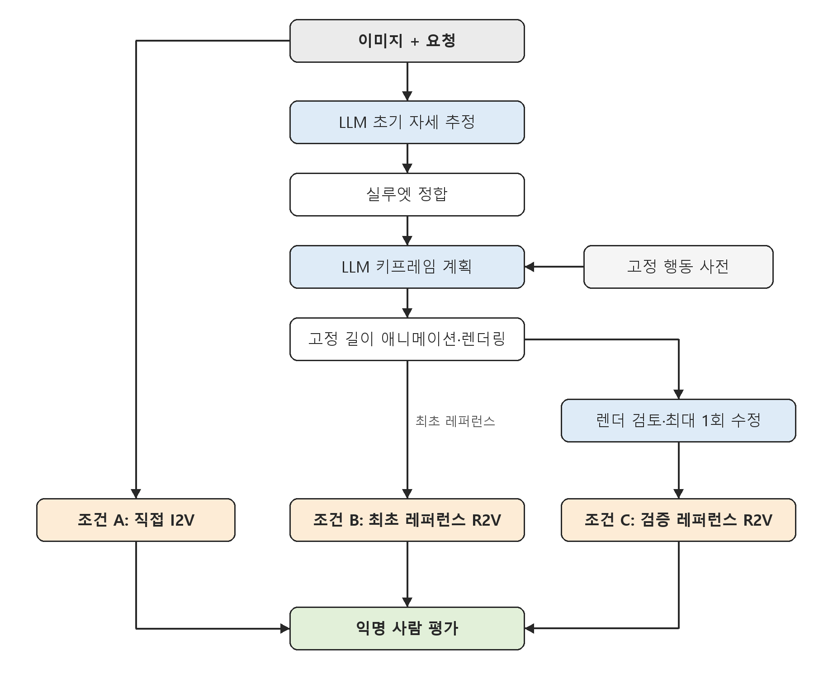
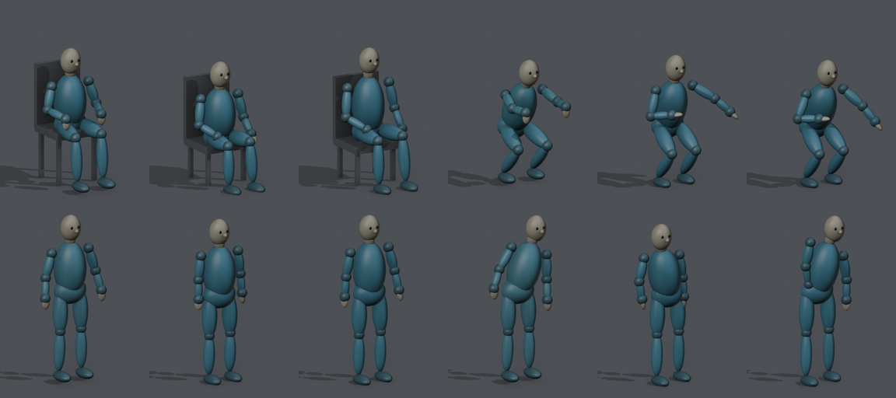
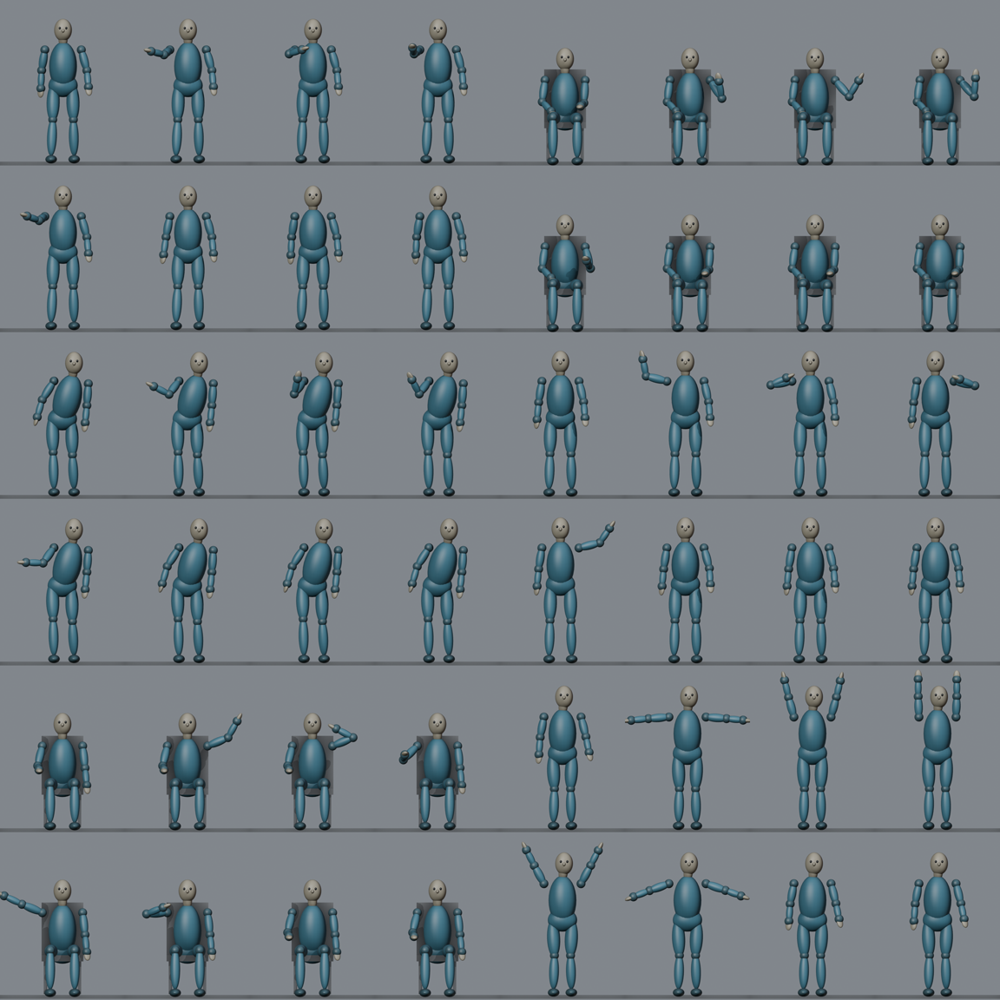

# 졸업논문 중간보고서

**제목(가제): 행동 사전 기반 LLM 모션 추론과 검증된 레퍼런스를 이용한 영상 생성의 행동 정확도 평가**

- 작성일: 2026-11-10
- 코드 및 데이터: https://github.com/enggaa/motion-reference-benchmark

## 개요

### 연구 배경

확산 모델 기반 영상 생성 모델은 이미지 한 장과 짧은 문장만으로 사실적인 인물 영상을 생성할 수 있으며(image-to-video, I2V), 이를 캐릭터 애니메이션이나 광고 제작에 활용하려는 수요가 커지고 있다. 본 연구는 실무에서 I2V 모델을 사용하며 반복적으로 관찰한 문제에서 출발하였다. 생성된 영상이 지시와 다른 동작을 수행하거나, 요청한 동작 없이 숨을 쉬며 몸이 들썩이는 정도의 미미한 움직임만 보이는 경우가 잦았다. 특히 어느 손을 쓰는지, 몇 번 반복하는지, 어떤 순서로 수행하는지, 입력 이미지의 자세에서 자연스럽게 시작하는지와 같은 세부 사항은 텍스트 조건만으로 보장되지 않는다. 이러한 실패는 문장 해석, 동작 구성, 영상 합성이 하나의 생성 과정 안에서 동시에 일어나기 때문에 원인을 특정하기 어렵고, 사용자는 프롬프트를 바꾸어 다시 생성하는 것 외에 대처할 방법이 없다.

동작을 정밀하게 제어하려는 기존 연구는 크게 네 갈래로 나뉘며, 각각 한계가 있다. 첫째, MotionCtrl과 Motion-I2V 같은 움직임 제어 생성 연구는 궤적이나 움직임 장으로 움직임을 지정하지만, 팔다리의 동작이나 좌우 손의 구분은 표현하기 어렵고 중간 결과를 요구 사항과 대조하기도 어렵다. 둘째, Animate Anyone과 Champ 같은 포즈 조건 애니메이션은 주어진 포즈 시퀀스를 정확히 따르지만, 그 포즈 시퀀스를 외부에서 별도로 요구한다. 셋째, MDM, MoMask, 그리고 LLM으로 핵심 자세를 계획하는 PRO-Motion 같은 텍스트-모션 생성 연구는 문장에서 3차원 동작을 만들지만, 학습 데이터의 동작과 선 자세에서 시작하는 동작에 맞추어져 있다. 넷째, VideoDirectorGPT와 LLM-grounded Video Diffusion은 LLM이 영상의 움직임을 계획하게 하였으나, 계획 단위가 객체 상자이므로 인체 내부의 동작은 다루지 못한다. 또한 VBench, T2V-CompBench, VBench-2.0 같은 영상 생성 벤치마크는 전반적 품질과 문장 일치를 주로 측정한다. 따라서 사용자가 문장으로 요청한 동작을 입력 이미지의 자세에서 시작하는 동작 레퍼런스로 얻는 방법은 아직 부족하며, 레퍼런스를 추가하는 것이 실제로 행동 정확도를 높이는지 측정할 평가 체계도 마련되어 있지 않다.

### 제안 방법

본 연구는 한 번의 생성에 몰려 있던 실패 요인을 LLM 동작 계획, 레퍼런스 영상, 영상 생성의 세 단계로 분산한다. 분해만으로 전체 실패율이 바로 줄지는 않더라도, 각 단계의 중간 결과를 따로 확인하고 실패한 단계만 수정할 수 있게 된다. 여기에 프롬프트 설계와 행동(키프레임) 사전으로 단계별 오류를 줄여 전체 실패율을 낮추는 것이 본 연구의 목표이다.

첫 단계에서 대형 언어 모델(LLM)은 소규모 행동 사전을 참조하여 입력 이미지의 초기 자세를 추정하고, 요청된 행동을 시간별 관절 키프레임으로 계획한다. 추정된 초기 자세는 렌더링-비교 방식의 실루엣 정합으로 보정한다. 두 번째 단계에서는 키프레임 보간, 순기구학·역기구학, 뼈 길이 보존과 같은 고전적 컴퓨터 애니메이션 기법으로 이 계획을 마네킹 레퍼런스 영상으로 만든다. 레퍼런스는 렌더링된 프레임을 근거로 검토하여 최대 1회 수정한다. 마지막 단계에서는 완성된 레퍼런스를 참조 영상 기반 생성(reference-to-video, R2V) 모델에 조건으로 제공하여 최종 영상을 생성한다. 즉 본 연구는 LLM 기반 동작 계획과 포즈·참조 영상 기반 생성을 관절 키프레임이라는 해석 가능한 중간 표현으로 연결한다.

### 사용 모델

동작 계획과 레퍼런스 검토에는 Anthropic의 Claude Sonnet 5.5를, 최종 영상 생성에는 ByteDance의 Seedance 2.0을, 레퍼런스 렌더링에는 Blender를 사용한다. 모든 모델은 추론에만 사용하며 학습이나 미세조정은 수행하지 않는다.

### 실험 설계

평가를 위해 24문항으로 구성된 벤치마크를 구축하였다. 각 문항은 입력 이미지, 요청 문장, 요구 단위 채점 기준으로 이루어진다. 같은 입력에서 세 조건을 비교한다. 조건 A는 직접 I2V, 조건 B는 검증하지 않은 레퍼런스를 사용한 R2V, 조건 C는 검증한 레퍼런스를 사용한 R2V이다. 주 지표는 모든 명시적 요구를 충족한 영상의 비율이며, 평가자 2인이 어느 조건에서 생성된 영상인지 모르는 상태에서 판정한다.

### 현재 결과

개발용 8문항에서 레퍼런스 생성 단계까지 네 차례 실행하였다. 실루엣 정합을 적용하자 초기 자세의 평균 관절 오차가 0.113 m에서 0.068 m로 감소하였고, LLM이 반대로 추정한 기울기 방향도 교정되었다. 반면 자동 검증기는 반복 횟수와 같은 세밀한 요구에서 판정이 불안정하였다. 판정 규칙을 바꾸자 11건 중 8건의 판정이 바뀌었고, 같은 규칙으로 다시 실행해도 11건 중 9건만 일치하였다. 반복 동작의 계획 규칙을 보강한 뒤에는 8건 모두에서 레퍼런스의 손 궤적이 요청된 왕복 수와 일치하였다.

### 남은 과제

최종 영상 생성과 사람 평가는 아직 수행하지 않았으므로 제안 방법의 효과는 아직 판단할 수 없다. 향후에는 먼저 사람 평가로 자동 검증기를 보정하고, 개발용 문항에서 세 조건의 최종 영상을 생성한다. 이후 파이프라인을 동결한 뒤 평가용 12문항에서 본 평가를 수행한다.

## 1. 서론

### 1.1 문제 상황

**연구의 계기:** 본 연구는 실무에서 I2V 모델을 사용하며 반복적으로 관찰한 두 가지 실패에서 출발하였다.
- **지시 불일치**: 생성된 영상이 요청한 동작과 다른 동작을 수행한다.
- **움직임 부족**: 요청한 동작은 나타나지 않고, 숨을 쉬며 몸이 들썩이는 정도의 미미한 움직임만 나타난다.

이러한 실패는 문장 해석, 동작 구성, 영상 합성이 하나의 생성 과정 안에서 동시에 일어나기 때문에 원인을 특정하기 어렵다. 실패한 영상을 보고 어느 부분이 잘못되었는지 알 수 없으므로, 사용자가 할 수 있는 일은 프롬프트를 바꾸어 다시 생성하는 것뿐이다. 본 연구는 이 문제를 해결하려면 실패 요인을 여러 단계로 분산해야 한다고 보았다. 이 관찰을 일반적인 연구 문제로 정리하면 다음과 같다.

**영상 생성 모델의 발전:** 영상 생성 모델은 확산 모델과 트랜스포머 구조를 기반으로 빠르게 발전하였다[1, 2, 3, 4]. 현재 상용 모델은 이미지 한 장과 짧은 문장만으로도 수 초 길이의 사실적인 인물 영상을 생성한다. 이에 따라 캐릭터 애니메이션, 광고, 사전 시각화와 같이 "이 인물이 이 동작을 하는 영상"이 필요한 작업에 생성 모델을 활용하려는 수요가 커지고 있다.

**세부 동작 지시의 문제:** 이러한 작업에서 요청은 대개 구체적이다. 예를 들어 다음과 같은 요청을 생각할 수 있다.
- "앉은 상태에서 왼손을 한 번 흔든 뒤 오른손을 한 번 흔든다"
- "몸통을 세운 뒤 양손을 허리에 얹는다"

생성 모델은 문장과 영상의 전반적인 의미 일치를 중심으로 학습된다. 그래서 다음과 같은 세부 사항을 지키지 못할 수 있다.
- 사용하는 손(좌우)
- 반복 횟수
- 동작 순서
- 입력 자세에서의 시작

선행 연구도 이 어려움을 보고하였다.
- 조합적 영상 생성 벤치마크[5]: 여러 대상에 서로 다른 행동을 정확히 배정하는 일(action binding)과 지정된 움직임 궤적을 따르는 일(motion binding)이 현재 모델에게 어려운 범주로 나타났다.
- VBench-2.0[6]: 시각적 그럴듯함을 넘어 인체 해부학적 정확성과 같은 내재적 충실도를 평가해야 한다고 제기하였다.

**기존 대안의 한계:** 동작을 정밀하게 제어하는 대안은 있으나 각각 한계가 있다.
- **포즈 조건 애니메이션**[7, 8, 9]: 구동용 포즈 시퀀스를 주면 그 동작을 정확히 따른다. 그러나 사용자는 요청한 동작의 포즈 시퀀스를 갖고 있지 않으며, 이를 얻으려면 모션 캡처나 애니메이터의 작업이 필요하다.
- **텍스트-모션 생성 모델**[10, 11, 12]: 문장에서 3차원 동작을 생성한다. 그러나 학습 데이터셋[13, 14]에 있는 동작에 성능이 의존하고, 주로 선 자세에서 시작하는 동작을 생성한다. 앉거나 기울어진 입력 이미지의 자세에서 시작하는 동작은 다루기 어렵다.

**본 연구가 다루는 공백:** 정리하면 다음 두 가지가 비어 있다.
- **레퍼런스 확보 수단**: 입력 이미지의 자세에서 시작하고, 요청 문장의 세부 사항을 정확히 반영하며, 학습 데이터에 없는 동작에도 적용할 수 있는 동작 레퍼런스를 얻는 방법이 없다.
- **평가 수단**: 기존 영상 생성 벤치마크[5, 6, 15]는 전반적인 품질과 의미 일치를 주로 측정한다. 초기 자세가 주어진 상황에서 요구 하나하나의 충족 여부를 측정하지는 않는다.

또한 레퍼런스를 추가하는 것이 항상 이로운지도 확인되지 않았다. 잘못된 레퍼런스는 오히려 잘못된 동작을 강제할 수 있다.

### 1.2 연구 목적과 접근

**LLM 계획의 확장:** LLM은 일반 상식과 추론 능력을 바탕으로 문장 속 동작을 단계로 분해할 수 있다. 선행 연구는 LLM이 장면 배치나 객체 이동 경로를 계획하고, 영상 생성 모델이 이를 따르게 하는 방식을 제안하였다[16, 17]. 다만 이 연구들의 계획 단위는 객체 상자이며, 인체 관절 수준의 동작은 다루지 않는다.

**본 연구의 접근:** 본 연구는 LLM의 계획을 인체 관절 수준으로 확장하고, 단일 생성 과정을 다음 세 단계로 분해한다.
1. **LLM 동작 계획**: LLM이 소규모 행동 사전을 참조하여 초기 자세와 관절 키프레임을 계획한다.
2. **레퍼런스 영상**: 고전적 애니메이션 기법이 계획을 레퍼런스 영상으로 만든다.
3. **영상 생성**: 이 레퍼런스를 R2V 모델에 제공하여 최종 영상을 생성한다.

**분해의 근거:** 단계를 나누는 것만으로 전체 실패율이 줄어든다고 보장할 수는 없다. 그러나 실패가 단계별로 분산되면 각 단계의 중간 결과(관절 계획, 레퍼런스 영상)를 사람이나 검증기가 직접 확인할 수 있다. 실패한 단계만 수정하면 되므로 전체를 다시 생성할 필요도 없다. 또한 각 단계에 맞는 보완 수단을 적용할 수 있다. 계획 단계에는 프롬프트 설계와 행동(키프레임) 사전을, 레퍼런스 단계에는 실루엣 정합과 렌더링 기반 검증을 적용한다. 본 연구는 이러한 단계별 보완이 전체 실패율을 낮출 것이라는 가설을 세운다.

**연구 목적:** 이 접근이 직접 I2V보다 요구 충족률을 높이는지 측정한다. 레퍼런스를 검증하는 단계가 잘못된 레퍼런스의 피해를 줄이는지도 함께 측정한다.

### 1.3 기대 기여

1. **행동 정확도 벤치마크**: 초기 자세와 사전 관계를 통제한 24문항 벤치마크와 요구 단위 채점 기준을 제공한다.
2. **레퍼런스 생성 파이프라인**: LLM 관절 계획, 실루엣 정합, 고전적 애니메이션, 렌더링 기반 검증으로 구성한다.
3. **통제된 비교**: 직접 I2V, 미검증 레퍼런스, 검증 레퍼런스를 같은 입력에서 비교한다. 부정적 결과도 포함하여 보고한다.

## 2. 배경 지식 및 관련 연구

본 장에서는 본 연구와 관련된 기존 연구를 일곱 갈래로 정리한다. 영상 생성 모델 자체(2.1), 영상 생성의 움직임 제어(2.2), 포즈 조건 인물 애니메이션(2.3), 텍스트 기반 인체 모션 생성(2.4), 단일 이미지 인체 자세 추정(2.5), LLM 기반 생성 계획(2.6), 영상 생성 평가와 LLM 판정(2.7)을 차례로 다룬 뒤, 이들과 비교한 본 연구의 위치를 정리한다(2.8).

### 2.1 확산 기반 영상 생성 모델

확산 모델[18]은 데이터에 잡음을 점진적으로 더하는 과정을 거꾸로 학습하여, 순수한 잡음에서 출발해 데이터를 생성한다. 잠재 확산 모델[19]은 이 과정을 오토인코더로 압축한 잠재 공간에서 수행하여 고해상도 생성의 계산량을 크게 줄였고, 확산 트랜스포머(DiT)[20]는 잡음 제거 신경망을 U-Net에서 트랜스포머로 바꾸어 모델 규모를 키울수록 성능이 안정적으로 오르도록 하였다.

영상 생성 모델은 이 구조를 시간 축으로 확장한 것이다. AnimateDiff[21]는 사전 학습된 이미지 확산 모델에 시간 모듈만 추가로 학습하여 영상을 생성하였고, Stable Video Diffusion[2]은 대규모 영상 데이터의 선별과 단계적 학습이 영상 확산 모델의 품질을 좌우함을 보였다. 이후 Sora[1], Wan[3], Seedance[4, 22]와 같은 대규모 모델은 확산 트랜스포머를 시공간 패치 단위로 적용하여 수 초에서 수십 초 길이의 사실적인 영상을 생성한다.

영상 생성 모델은 조건을 입력받는 방식에 따라 구분된다. 텍스트-영상(T2V) 생성은 문장만을, 이미지-영상(I2V) 생성은 첫 프레임이 될 이미지와 문장을 입력받는다. I2V 연구로는 영상 확산 모델의 사전 지식으로 정지 이미지를 움직이게 하는 DynamiCrafter[23]와, 의미 보존 단계와 화질 향상 단계를 나눈 I2VGen-XL[24] 등이 있다. 참조 영상 기반 생성(R2V)은 이미지와 함께 참조 영상을 입력하여 그 동작이나 카메라 움직임을 참고하게 한다. 본 연구의 비교 조건 A는 I2V를, 조건 B와 C는 R2V를 사용한다.

I2V 모델이 입력 이미지를 거의 그대로 유지한 채 움직임이 적은 영상을 생성하는 경향은 평가 연구에서도 별도의 측정 대상이 되어 왔다. VBench[15]는 광학 흐름으로 영상의 움직임 정도를 측정하는 동적 정도(dynamic degree) 항목을 두고 있으며, 이는 1.1절에서 서술한 "숨을 쉬는 정도의 움직임"이 개별 사례가 아닌 알려진 실패 유형임을 보여 준다.

### 2.2 영상 생성의 움직임 제어

텍스트만으로는 움직임을 정밀하게 지정하기 어렵다는 문제를 해결하기 위해, 움직임을 별도의 조건으로 입력하는 연구가 진행되었다. VideoComposer[25]는 움직임 벡터, 깊이, 스케치 등을 조합 가능한 조건으로 받아 영상을 생성하였고, MotionCtrl[26]은 카메라 움직임과 객체 궤적을 분리하여 각각 제어할 수 있게 하였다. MotionDirector[27]는 참조 영상 몇 개로부터 외형과 분리된 움직임 개념을 학습하여 다른 대상에 적용하였다.

이 가운데 Motion-I2V[28]는 본 연구와 문제 설정이 가깝다. 이 연구는 I2V 생성을 픽셀 궤적을 예측하는 단계와 그 궤적을 따라 영상을 합성하는 단계로 나누어, 큰 움직임에서도 일관된 영상을 얻었다. 생성 과정을 "움직임 결정"과 "영상 합성"으로 분해한다는 발상은 본 연구와 같지만, Motion-I2V는 움직임을 학습된 확산 모델이 픽셀 수준에서 예측하므로 그 중간 결과를 사람이 해석하거나 요구 사항과 대조하기 어렵다. 본 연구는 움직임을 관절 키프레임이라는 해석 가능한 형태로 계획하고, 이를 렌더링하여 검증할 수 있게 한다는 점에서 다르다.

### 2.3 포즈 조건 인물 애니메이션

ControlNet[29]은 사전 학습된 확산 모델의 가중치를 고정한 채 복제한 인코더로 포즈, 경계선, 깊이 같은 공간 조건을 주입하는 방법을 제시하였다. 이를 바탕으로 참조 이미지 속 인물을 포즈 시퀀스대로 움직이는 인물 애니메이션 연구가 활발히 이어졌다. Animate Anyone[7]은 참조 이미지의 세부 외형을 보존하는 별도 신경망과 경량 포즈 인코더를 결합하였고, MagicAnimate[8]는 시간 일관성 모듈을 도입하여 프레임 간 깜박임을 줄였다. Champ[9]는 3차원 인체 모델 SMPL[30]에서 얻은 깊이·법선·의미 지도를 조건에 추가하여 체형과 자세를 함께 맞추었다. UniAnimate[31]는 참조 이미지와 포즈 조건을 하나의 영상 확산 모델에서 처리하여 긴 영상 생성을 가능하게 하였고, MimicMotion[32]은 포즈 추정의 신뢰도를 반영한 조건으로 손과 같은 세부 부위의 왜곡을 줄였다.

이 계열의 방법은 주어진 포즈 시퀀스를 매우 정확하게 따르지만, 포즈 시퀀스 자체는 다른 영상에서 추출하거나 모션 캡처로 얻는 등 외부에서 주어져야 한다. 사용자가 원하는 동작을 문장으로만 가지고 있을 때는 이 방법들을 바로 쓸 수 없다. 본 연구는 이 포즈 시퀀스에 해당하는 동작 레퍼런스를 요청 문장과 입력 이미지로부터 만드는 문제를 다룬다.

### 2.4 텍스트 기반 인체 모션 생성

문장으로부터 3차원 인체 동작을 생성하는 연구는 모션 캡처 데이터에 문장 설명을 붙인 데이터셋을 기반으로 발전하였다. KIT Motion-Language[13]는 약 3,900개의 동작에 자연어 설명을 붙였고, HumanML3D[14]는 이를 약 14,600개 동작과 44,900여 개 설명으로 확장하였다.

생성 모델로는 확산 모델을 동작 생성에 초기에 적용한 MotionDiffuse[33]와 MDM[10], 동작을 이산 토큰으로 바꾸어 자기회귀적으로 생성하는 T2M-GPT[11], 동작을 언어 모델의 어휘처럼 다루어 문장과 동작을 함께 학습한 MotionGPT[12], 마스크 기반 생성으로 품질을 높인 MoMask[34] 등이 있다. 그러나 이 모델들은 학습 데이터의 동작 분포와 표준적인 시작 자세에 맞추어져 있어, 데이터에 드문 동작이나 앉거나 기울어진 임의의 초기 자세에서 시작하는 동작에는 직접 적용하기 어렵다.

이 한계를 LLM의 일반 지식으로 보완하려는 연구도 등장하였다. SINC[35]는 GPT-3에게 각 행동에 관여하는 신체 부위를 묻고, 그 답을 이용해 서로 다른 행동을 동시에 수행하는 동작을 합성하였다. PRO-Motion[36]은 LLM이 핵심 자세를 문장 형태의 대본으로 계획하면 확산 모델이 각 자세를 생성하고, 이어서 자세 사이의 전신 이동을 생성하는 3단계 구조를 제안하였다. 이 연구들은 LLM이 동작을 단계별 자세로 분해하는 능력을 갖추었음을 보여 주며, 본 연구의 LLM 관절 계획은 이 흐름을 따른다. 다만 이 연구들은 3차원 동작 자체를 최종 산출물로 삼고 선 자세에서 시작하는 반면, 본 연구는 입력 이미지의 자세에서 시작하는 동작을 계획하고 이를 영상 생성의 레퍼런스로 사용한다.

### 2.5 단일 이미지 인체 자세 추정

입력 이미지에서 시작하는 동작을 만들려면 먼저 이미지 속 인물의 3차원 자세를 알아야 한다. SMPLify[37]는 2차원 관절 검출 결과에 SMPL 모델을 최적화로 맞추어 3차원 자세와 체형을 추정하였고, HMR[38]은 이를 신경망 회귀로 대체하여 이미지에서 SMPL 매개변수를 직접 예측하였다. 최근의 4DHumans[39]는 트랜스포머 기반 추정기로 다양한 자세에서 정확도를 높였다.

본 연구는 이러한 학습 기반 추정기를 사용하지 않고, LLM이 사전의 자세 어휘로 초기 자세를 추정한 뒤 렌더링 실루엣을 입력 실루엣에 맞추는 방식으로 보정한다(6.4절). 이는 SMPLify의 "모델을 렌더링하여 관측과 비교하고 최적화한다"는 분석-합성 원리를 단순한 마네킹 모델과 실루엣 겹침 지표에 적용한 것이다.

### 2.6 LLM 기반 생성 계획

LLM을 생성 과정의 계획 단계로 사용하는 연구도 제안되었다. VideoDirectorGPT[16]는 LLM이 장면별 설명, 등장 객체, 객체 배치를 담은 영상 계획을 작성하고, 영상 생성 모델이 이 계획을 따라 여러 장면으로 이루어진 영상을 생성하게 하였다. LLM-grounded Video Diffusion[17]은 LLM이 프레임별 객체 상자의 이동 궤적을 생성하고, 이를 영상 확산 모델의 어텐션 조정에 사용하여 문장이 요구하는 움직임을 더 잘 따르게 하였다.

이 연구들은 LLM이 문장으로부터 시공간적 움직임을 계획할 수 있고, 그 계획을 중간 표현으로 두면 생성 결과의 정확도가 높아짐을 보였다. 다만 계획 단위가 객체 상자이므로 팔다리의 움직임이나 좌우 손의 구분처럼 인체 내부의 동작은 표현하지 못한다. 본 연구는 계획 단위를 인체 관절로 낮추고, 계획을 실제 골격 동작과 레퍼런스 영상으로 바꾸는 단계를 추가한다.

### 2.7 영상 생성 평가와 LLM 판정

영상 생성 모델의 평가는 단일 점수에서 세부 차원별 평가로 발전하였다. VBench[15]는 영상 품질을 피사체 일관성, 움직임의 부드러움, 동적 정도 등 16개 차원으로 나누어 자동 평가하였고, EvalCrafter[40]는 시각 품질, 문장 일치, 움직임 품질, 시간 일관성을 여러 지표로 측정하였다. T2V-CompBench[5]는 속성, 행동, 공간 관계, 움직임의 조합적 일치를 평가하여 행동 배정과 움직임 궤적이 현재 모델에게 어려운 범주임을 보였고, VBench-2.0[6]은 물리 법칙, 상식, 인체 해부학적 정확성과 같은 내재적 충실도를 평가 대상으로 삼았다. 그러나 이 벤치마크들은 대부분 텍스트 조건 생성을 대상으로 하며, 입력 이미지의 초기 자세가 주어진 상황에서 요구 하나하나의 충족 여부를 측정하지는 않는다.

평가와 수정 과정에 LLM을 사용하는 연구도 많다. LLM을 평가자로 사용하는 방식은 사람 판정과 상당히 일치하지만, 제시 순서나 답변 길이에 따른 편향이 보고되었다[41]. LLM이 자신의 출력을 스스로 고치는 방식에 대해서는, 반복적인 자기 피드백으로 품질이 오른다는 보고[42]와 외부 신호 없이 스스로 수정하면 오히려 성능이 떨어질 수 있다는 보고[43]가 함께 존재한다. CRITIC[44]은 검색이나 코드 실행과 같은 외부 도구의 결과를 근거로 삼을 때 수정이 효과적임을 보였다. 본 연구의 검증 단계가 LLM의 판단만이 아니라 렌더링된 프레임과 손 궤적 같은 측정값을 근거로 제시하는 것은 이 결과를 반영한 설계이다. 또한 본 연구의 주 지표는 사람 평가자의 요구 단위 판정이며, LLM 검토자의 판정은 사람 판정과의 일치도를 별도로 측정하여 신뢰성을 확인한다.

### 2.8 기존 연구와 본 연구의 비교

앞의 연구들과 본 연구를 동작 지정 방식과 초기 자세 처리 관점에서 비교하면 다음과 같다.

| 연구 계열 | 대표 연구 | 동작을 지정하는 방식 | 임의 초기 자세 | 중간 결과 검증 |
|---|---|---|---|---|
| I2V 생성 | DynamiCrafter, Seedance | 문장 | 입력 이미지로 반영 | 불가 |
| 움직임 제어 생성 | MotionCtrl, Motion-I2V | 궤적·움직임 장 | 입력 이미지로 반영 | 제한적 |
| 포즈 조건 애니메이션 | Animate Anyone, Champ | 외부 포즈 시퀀스 | 포즈 시퀀스에 의존 | 포즈 시퀀스로 가능 |
| 텍스트-모션 생성 | MDM, MoMask, PRO-Motion | 문장 → 3차원 동작 | 주로 선 자세 | 3차원 동작으로 가능 |
| LLM 생성 계획 | VideoDirectorGPT, LVD | 문장 → 객체 상자 | 해당 없음 | 상자 수준 |
| **본 연구** | | 문장 → 관절 키프레임 → 레퍼런스 영상 | 정합으로 반영 | 렌더링 프레임으로 가능 |

정리하면 본 연구는 LLM 기반 동작 계획(2.4, 2.6)과 포즈·참조 영상 기반 생성(2.2, 2.3)을 연결하는 위치에 있다. 문장만으로 동작을 지정하면서도, 입력 이미지의 자세에서 시작하고, 중간 결과를 사람이 해석할 수 있는 형태로 남긴다는 점이 기존 연구와 구별된다.

### 2.9 본 연구에서 사용한 모델과 도구

본 연구는 새로운 모델을 학습하거나 미세조정하지 않으며, 공개된 모델과 도구를 추론 단계에서만 사용한다.

| 구분 | 모델 및 도구 | 용도 |
|---|---|---|
| 대형 언어 모델 | Anthropic Claude Sonnet 5.5[45] | 초기 자세 추정, 관절 키프레임 계획, 레퍼런스 검토 |
| 영상 생성 모델 | ByteDance Seedance 2.0[22, 46] | 조건 A의 I2V, 조건 B·C의 R2V |
| 3차원 렌더링 | Blender 4.2 LTS, Workbench 엔진[47] | 입력 이미지와 레퍼런스 영상 렌더링 |
| 모션 데이터 | KIT Motion-Language Dataset[13] | 선행 작업의 동작 재생 기준선 |

## 3. 연구 질문

1. LLM 레퍼런스 조건은 직접 I2V 대비 명시적 행동 요구의 충족률을 높이는가?
2. 레퍼런스 검증·수정 단계는 최초 레퍼런스의 오류와 최종 실패를 줄이는가?
3. 그 효과는 사전 내·조합·사전 외 행동 및 비표준 초기 자세에 따라 어떻게 달라지는가?
4. 개선이 확인될 경우, 그 개선은 추가 비용·지연·중단율과 어떠한 관계를 가지는가?

## 4. 제안 방법

*그림 1. 제안 방법의 구조*

**구성 요소의 역할:**
- **LLM**: 초기 자세, 행동 단계, 키프레임을 제안한다.
- **수치 계산 모듈**: 자세 정합과 애니메이션 생성을 담당한다.

**고전적 기법의 선택:** 애니메이션 생성에는 학습 기반 모션 모델[7, 10] 대신 고전적 컴퓨터 애니메이션 기법(6.3절)을 사용한다. 이를 통해 다음 두 가지를 얻는다.
- 동일 입력에 대해 동일 결과를 얻을 수 있다.
- LLM 계획의 오류가 측정 가능한 형태로 남는다.

**실패 위치 기록:** 각 단계의 실패는 초기 자세, 계획, 리타기팅, 레퍼런스 검토로 구분하여 기록한다. 이를 통해 최종 영상만으로 실패 원인을 추정하는 것을 방지한다.

## 5. 실험 설계

### 5.1 문항 구성

| 분할 | 문항 수 | 용도 |
|---|---:|---|
| 개발용 | 8 | 구현 및 수정 |
| 보정용 | 4 | 평가자 훈련 및 검증기 보정 |
| 평가용 | 12 | 동결된 파이프라인의 최종 평가 |

- **문항 배치**: 평가용 문항은 사전 관계 3종(사전 내·조합·사전 외)과 초기 자세 4종(서기·앉기·기울기·웅크리기)의 각 조합에 1문항씩 배정하였다.
- **입력 이미지**: 외부 캐릭터 자산 없이 3D 기본 도형으로 생성한 절차적 마네킹이다.
- **정보 분리**: 요구 단위의 채점 기준과 관절 정답은 생성 과정에 제공하지 않는다.

### 5.2 비교 조건

| 조건 | 내용 |
|---|---|
| A | 이미지 + 요청 → 직접 I2V |
| B | 동일 이미지·요청 + 최초 LLM 레퍼런스 → R2V |
| C | B와 동일한 최초 레퍼런스 → 검토, 최대 1회 수정, 재검토 → R2V (재검토 실패 시 차단) |

**실험 운영 원칙:**
- **레퍼런스 공유**: 동일 반복 내에서 B와 C는 최초 레퍼런스를 공유한다. 따라서 두 조건의 차이는 검증 단계의 효과로 해석할 수 있다.
- **선별 금지**: 재생성 및 최선 결과 선별은 허용하지 않는다.
- **결측 처리**: 미실행 결과는 실패로 간주하지 않고 결측으로 처리한다.
- **사전 동결**: 평가용 문항 실행 전에 코드, 프롬프트, 모델, 비용 상한을 동결하고[48], 결과 확인 후에는 동일 버전을 수정하지 않는다.

**실행 규모:**
- 기능 시험: 개발용 8문항 × 3조건 × 1회
- 본 평가: 평가용 12문항 × 3조건 × 3회

### 5.3 평가 지표

**주 지표**는 모든 명시적 요구를 충족한 최종 영상의 비율이다. 사례별로 산출한 뒤 사례 간 평균을 구한다.
- 실패, 중단, 합의된 불확실 판정은 성공으로 계수하지 않는다.
- 평가자 2인이 조건을 모르는 상태에서 독립적으로 판정하고, 불일치는 제3자가 조정한다.

**부 지표**는 다음 8가지이다.
- 외형 보존, 시작 연속성, 시간적 아티팩트, 자연스러움(5점 척도)
- 레퍼런스 자체의 요구 충족, 비용, 지연, 중단율

**통계 처리:**
- 신뢰구간은 사례·행동군 단위 군집 부트스트랩[49, 50]으로 산출한다.
- 검증기와 사람 판정의 일치도는 Cohen's κ[51, 52]로 산출한다.
- 평가용 문항 수가 적으므로 결과는 기술 통계로 제시하며, 우월성 검정에는 사용하지 않는다.

## 6. 진행 현황

본 장의 수치는 개발용 8문항을 문항당 1회 실행한 결과이다. 개발 과정의 기록이며 성능 평가 결과가 아니다.

### 6.1 선행 작업

기존 리그와 KIT 동작 자료[13, 14]를 기반으로 착수하였다.
- **문제 확인**: 수치 지표는 개선되었으나, 화면상으로는 팔이 뒤로 처지는 오류가 잔존하였다.
- **원인 추적**: 원본 마커, MMM 골격[53], 로컬 관절 입력, 최종 리그를 단계별로 대조하였다. 그 결과 팔의 부모 관절 설정이 잘못된 변환 경로를 재현하였다.
- **기준선 구축**: 원본 마커로 관절을 재구성하여 흔들기와 스쿼트 동작의 재생 기준선을 마련하였다.

### 6.2 LLM 계획기

LLM(Claude Sonnet 5.5[45])이 입력 이미지와 요청으로부터 초기 자세와 시간별 키프레임을 구조화된 형식으로 출력하도록 구현하였다.

1차 실행 결과는 다음과 같다.
- 8건 모두 형식 검사를 통과하였고, 사용 손과 동작 순서가 요청과 일치하였다.
- 평가 정답과 비교한 결과, 기울어진 자세의 한 문항(D08)에서 기울기 방향이 반대로 추정되었다(정답: 좌측 18°, 추정: 우측 12°).
- 같은 문항에서 손을 허리에 닿게 하기 위해 위팔 길이가 약 25% 늘어났다.

이는 형식 검사 통과가 계획의 정확성을 보장하지 않음을 보여 준다.

### 6.3 레퍼런스 렌더러

LLM이 출력한 키프레임을 프레임별 골격 동작으로 변환하고 렌더링한다. 키프레임 애니메이션[54]의 구성에 따라, LLM은 주요 시점의 자세만 지정하고 중간 프레임은 다음 절차로 생성한다.

- **골격 구성**: 15관절 골격을 사용한다. 각 뼈의 길이는 첫 키프레임을 기준으로 고정한다.
- **몸통과 팔**: 관절 위치 대신 뼈 방향 벡터를 시간에 대해 보간하고 정규화한다. 이후 골반에서부터 뼈 방향과 길이를 순차적으로 누적하는 순기구학(FK)으로 관절 위치를 산출한다.
  - 이 방식은 회전 보간[55]의 단순화 형태로, 팔이 원호를 따라 움직인다.
  - 초기에 적용한 관절 위치 선형 보간은 팔을 드는 도중 팔꿈치가 측방으로 꺾이는 문제를 보여, 이 방식으로 변경하였다.
- **보간 곡선**: 단조 3차 Hermite 보간을 사용하며, 접선은 Fritsch–Butland 방식[56, 57]으로 정한다. 극값에서 기울기가 0이 되므로 키프레임 값을 넘어서는 오버슈트가 생기지 않는다.
- **다리**: 발목 위치를 보간한 뒤, 고관절–슬관절–족관절을 코사인 법칙으로 푸는 2관절 해석적 역기구학(IK)[58]을 적용한다. 이로써 지지발이 미끄러지지 않는다.
- **길이 보존**: 계획이 뼈 길이를 바꾸더라도 리타기팅[59]의 길이 보존 원칙에 따라 길이를 고정하고, 도달하지 못한 거리를 오차로 기록한다. 따라서 LLM 계획의 오류가 영상에서 숨겨지지 않고 측정 가능한 값으로 남는다.
- **렌더링**: 입력 이미지와 동일한 절차적 마네킹·카메라·조명을 Blender Workbench 엔진[47]으로 렌더링한다(576×768, 24 fps). 검토용으로 정면 정사영 시점 영상도 함께 생성한다.

1차 실행에서 D08의 렌더 첫 프레임은 입력과 반대 방향으로 기운 상태로 출력되었다. 이로써 계획 단계의 오류가 최종 출력까지 전파됨을 확인하였다.

### 6.4 초기 자세 실루엣 정합

입력 이미지와 렌더 결과를 비교하여 자세를 보정하는 분석-합성(analysis-by-synthesis) 방식[37]을 적용하였다.

**정합 절차:**
1. LLM이 추정한 자세에 변화를 준 후보들을 입력과 동일한 조건으로 렌더링한다.
2. 입력 이미지와의 실루엣 IoU 및 피부 영역 IoU[60]의 평균을 점수로 사용한다.
3. 좌표별 패턴 탐색[61]으로 점수를 최대화한다. 탐색은 몸 전체, 팔, 전체의 순서로 진행한다.
4. 단일 시점에서는 깊이를 관측할 수 없으므로, 전후 방향 변화에는 벌점을 부과한다.

**기각한 방법:** LLM에게 렌더 결과와 입력의 차이를 제시하고 스스로 수정하도록 하였으나, 2회 모두 오차가 확대되었다. 이는 외부 신호가 없는 자기 수정의 한계에 관한 선행 보고[43]와 일치한다.

| 지표 | 1차 실행 (정합 없음) | 2차 실행 | 3차 실행 | 4차 실행 |
|---|---|---|---|---|
| 평균 관절 오차 | 0.113 m | 0.068 m | 0.077 m | 0.068 m |
| 최대 관절 오차의 평균 | 0.250 m | 0.142 m | 0.183 m | 0.158 m |
| D08 좌우 기울기 (정답 +18°) | −12° | +14° | +7° | +6° |

- **오차 감소**: 정합 적용 후 평균 관절 오차가 32–40% 감소하였고, D08의 기울기 방향이 교정되었다.
- **각도 추정의 한계**: 기울기 각도는 과소 추정되며, 실행 간 편차가 크다.
- **벌점의 역할**: 벌점이 없으면 실루엣 겹침은 증가하지만 3차원 오차가 오히려 증가하였다.

*그림 2. 실루엣 정합 전후 비교. 각 세 장 묶음은 입력, 정합 전, 정합 후 순서이며, 위 줄은 D02·D04, 아래 줄은 D07·D08이다.*

### 6.5 레퍼런스 검증 게이트

검토자(LLM)는 계획이 아닌 렌더링된 프레임을 근거로 요구별 판정을 내린다. 시점은 입력 카메라 시점과 정면 정사영 시점을 함께 사용한다. 프레임 이미지만으로는 반복 횟수를 판별하기 어려우므로 동작 계측값을 함께 제공한다. 계측값은 렌더 골격에서 프레임마다 측정한 다음 항목이다.
- 손의 좌우 위치 시계열
- 방향 전환점
- 어깨·머리 위 구간
- 정지 구간

**판정 근거의 단계적 보강:** 검증기는 다음 순서로 보강하였다.
1. 프레임 격자만 제공: 흔들기 왕복 수를 판별할 수 없었다.
2. 동작 계측값 추가: 팔을 올리고 내리는 동작까지 흔들기로 계수하였다.
3. 손을 든 구간만 계수하는 산식 도입: 손의 출발 위치를 반영하지 못하여 오판이 발생하였다.
4. 손의 좌우 위치 시계열과 채점 기준상의 왕복 정의 제공.

**판정 안정성:** 3차 실행의 렌더 11건을 재검토한 결과는 다음과 같다.
- 판정 규칙을 바꾸자 11건 중 8건의 판정이 바뀌었다.
- 같은 규칙으로 다시 실행했을 때 일치율은 9/11에 그쳤다.
- 일어서기, 머리 위 유지와 같은 개략적 요구는 모든 경우에 안정적으로 판정되었다.

반복 횟수와 같은 세밀한 요구는 단일 자동 판정에 의존하기 어렵다. 이는 LLM 평가자의 일관성 한계에 관한 선행 보고[41]와 같은 방향의 관찰이다.

**레퍼런스 모호성 제거:**
- **원인**: 판정 불일치의 원인 중 하나는 레퍼런스 자체의 모호성이었다. 마지막 흔들기 이후의 중앙 복귀 동작이 반 왕복으로 해석될 수 있었다.
- **조치**: "반복 동작은 두 극점 사이를 왕복하며 마지막 왕복 이후 복귀 동작을 넣지 않는다"는 계획 규칙을 추가하였다.
- **결과**: 4차 실행에서는 8건 모두 손의 좌우 궤적이 요청된 왕복 수와 일치하였다. 예를 들어 오른손 2왕복 요청의 궤적은 25 → −9 → 24 → −9 → 25 cm였다.
- **남은 과제**: 이 결과가 레퍼런스 품질의 향상인지 검증기의 관대함인지는 사람 평가로 확인해야 한다.

*그림 3. 4차 실행 흔들기 문항의 정면 시점 프레임. 두 칸씩 D01·D02, D03·D05, D06·D07 순서이다.*

### 6.6 평가 도구

- **익명 평가 패키지**: 영상 메타데이터를 제거하고 임의 식별자를 부여하여, 평가자가 조건을 알 수 없게 하였다.
- **집계 도구**: 주·부 지표, 실패 위치별 빈도, 군집 부트스트랩 신뢰구간, 검증기와 사람 판정의 일치도를 산출한다.

### 6.7 최종 영상 생성 모듈

최종 영상 생성에는 Seedance 2.0[22, 46]을 사용한다.
- **사용 기능**: 조건 A는 image-to-video, 조건 B·C는 reference-to-video 기능을 사용한다.
- **조건 간 차이**: reference-to-video에서는 입력 이미지가 시작 프레임으로 강제되지 않는다. 이 차이를 고려하여 시작 연속성을 부 지표로 별도 평가한다.

## 7. 결과 확보 현황

| 항목 | 현황 |
|---|---|
| 벤치마크 문항·입력·채점 기준 | 완료 (24문항) |
| 레퍼런스 생성 파이프라인 | 구현 완료, 개발용 문항에서 4회 실행 |
| 평가 및 집계 도구 | 구현 완료 |
| 레퍼런스 사람 평가 | 준비 완료, 미실시 |
| 최종 영상 생성 (A/B/C) | 미실시 |
| 제안 방법의 효과 | 판단 불가 |

## 8. 연구의 한계

- **입력의 범위**: 입력이 합성 마네킹 단일 계열로 한정된다. 실루엣 정합은 카메라 정보를 안다고 가정하므로, 실사 이미지에는 그대로 적용할 수 없다.
- **깊이 모호성**: 단일 시점 실루엣으로는 전후 깊이를 구분할 수 없어, 기울기 각도의 과소 추정이 잔존한다.
- **표본 규모**: 평가 셀당 1문항에 불과하여 통계적 검정력을 주장할 수 없다.
- **검증 신뢰성**: 세밀한 요구에서 자동 판정이 불안정하며, 조건 C의 효과는 이 판정 품질에 직접적으로 의존한다.

## 9. 향후 계획

1. **사람 평가**: 레퍼런스에 대한 사람 평가를 수행하고, 자동 검증기와의 일치도를 산출한다.
2. **검증기 보정**: 보정용 문항에서 사람 판정과 검증기 판정을 대조하여 검증기를 보정한다.
3. **기능 시험**: 개발용 문항에서 세 조건의 최종 영상을 생성하여 기능 시험을 수행한다.
4. **정합 개선**: 실루엣 정합에서 좌우 기울기와 전후 기울기를 분리하여 각도 추정을 개선한다.
5. **본 평가**: 파이프라인을 동결한 뒤 평가용 문항에서 본 평가를 수행하고, 부정적 결과를 포함하여 보고한다.

## 참고 문헌

1. Brooks, T. et al. Video generation models as world simulators. OpenAI Technical Report, 2024. https://openai.com/index/video-generation-models-as-world-simulators/
2. Blattmann, A. et al. Stable Video Diffusion: Scaling latent video diffusion models to large datasets. arXiv:2311.15127, 2023.
3. Wan Team. Wan: Open and advanced large-scale video generative models. arXiv:2503.20314, 2025.
4. Gao, Y. et al. Seedance 1.0: Exploring the boundaries of video generation models. arXiv:2506.09113, 2025.
5. Sun, K. et al. T2V-CompBench: A comprehensive benchmark for compositional text-to-video generation. *CVPR* 2025.
6. Zheng, D. et al. VBench-2.0: Advancing video generation benchmark suite for intrinsic faithfulness. arXiv:2503.21755, 2025.
7. Hu, L. et al. Animate Anyone: Consistent and controllable image-to-video synthesis for character animation. *CVPR* 2024, 8153–8163.
8. Xu, Z. et al. MagicAnimate: Temporally consistent human image animation using diffusion model. *CVPR* 2024, 1481–1490.
9. Zhu, S. et al. Champ: Controllable and consistent human image animation with 3D parametric guidance. *ECCV* 2024.
10. Tevet, G. et al. Human motion diffusion model. *ICLR* 2023.
11. Zhang, J. et al. T2M-GPT: Generating human motion from textual descriptions with discrete representations. *CVPR* 2023.
12. Jiang, B. et al. MotionGPT: Human motion as a foreign language. *NeurIPS* 2023.
13. Plappert, M., Mandery, C., Asfour, T. The KIT Motion-Language Dataset. *Big Data* 4(4):236–252, 2016.
14. Guo, C. et al. Generating diverse and natural 3D human motions from text. *CVPR* 2022.
15. Huang, Z. et al. VBench: Comprehensive benchmark suite for video generative models. *CVPR* 2024.
16. Lin, H., Zala, A., Cho, J., Bansal, M. VideoDirectorGPT: Consistent multi-scene video generation via LLM-guided planning. arXiv:2309.15091, 2023.
17. Lian, L., Shi, B., Yala, A., Darrell, T., Li, B. LLM-grounded video diffusion models. *ICLR* 2024.
18. Ho, J., Jain, A., Abbeel, P. Denoising diffusion probabilistic models. *NeurIPS* 2020.
19. Rombach, R. et al. High-resolution image synthesis with latent diffusion models. *CVPR* 2022.
20. Peebles, W., Xie, S. Scalable diffusion models with transformers. *ICCV* 2023.
21. Guo, Y. et al. AnimateDiff: Animate your personalized text-to-image diffusion models without specific tuning. *ICLR* 2024.
22. ByteDance Seed. Seedance 2.0: Advancing video generation for world complexity. arXiv:2604.14148, 2026.
23. Xing, J. et al. DynamiCrafter: Animating open-domain images with video diffusion priors. *ECCV* 2024.
24. Zhang, S. et al. I2VGen-XL: High-quality image-to-video synthesis via cascaded diffusion models. arXiv:2311.04145, 2023.
25. Wang, X. et al. VideoComposer: Compositional video synthesis with motion controllability. *NeurIPS* 2023.
26. Wang, Z. et al. MotionCtrl: A unified and flexible motion controller for video generation. *SIGGRAPH* 2024 Conference Papers.
27. Zhao, R. et al. MotionDirector: Motion customization of text-to-video diffusion models. *ECCV* 2024.
28. Shi, X. et al. Motion-I2V: Consistent and controllable image-to-video generation with explicit motion modeling. arXiv:2401.15977, 2024.
29. Zhang, L., Rao, A., Agrawala, M. Adding conditional control to text-to-image diffusion models. *ICCV* 2023.
30. Loper, M. et al. SMPL: A skinned multi-person linear model. *ACM Trans. Graph.* 34(6):248, 2015.
31. Wang, X. et al. UniAnimate: Taming unified video diffusion models for consistent human image animation. arXiv:2406.01188, 2024.
32. Zhang, Y. et al. MimicMotion: High-quality human motion video generation with confidence-aware pose guidance. arXiv:2406.19680, 2024.
33. Zhang, M. et al. MotionDiffuse: Text-driven human motion generation with diffusion model. *IEEE TPAMI* 46(6):4115–4128, 2024.
34. Guo, C. et al. MoMask: Generative masked modeling of 3D human motions. *CVPR* 2024.
35. Athanasiou, N. et al. SINC: Spatial composition of 3D human motions for simultaneous action generation. *ICCV* 2023.
36. Liu, J. et al. Plan, posture and go: Towards open-vocabulary text-to-motion generation. *ECCV* 2024.
37. Bogo, F. et al. Keep it SMPL: Automatic estimation of 3D human pose and shape from a single image. *ECCV* 2016.
38. Kanazawa, A., Black, M. J., Jacobs, D. W., Malik, J. End-to-end recovery of human shape and pose. *CVPR* 2018.
39. Goel, S. et al. Humans in 4D: Reconstructing and tracking humans with transformers. *ICCV* 2023.
40. Liu, Y. et al. EvalCrafter: Benchmarking and evaluating large video generation models. *CVPR* 2024.
41. Zheng, L. et al. Judging LLM-as-a-judge with MT-Bench and Chatbot Arena. *NeurIPS* 2023 Datasets and Benchmarks.
42. Madaan, A. et al. Self-Refine: Iterative refinement with self-feedback. *NeurIPS* 2023.
43. Huang, J. et al. Large language models cannot self-correct reasoning yet. *ICLR* 2024.
44. Gou, Z. et al. CRITIC: Large language models can self-correct with tool-interactive critiquing. *ICLR* 2024.
45. Anthropic. Claude Sonnet 5.5 model overview. https://platform.claude.com/docs/en/models/sonnet-5-5/overview
46. fal.ai. Seedance 2.0 API documentation. https://fal.ai/models/bytedance/seedance-2.0/reference-to-video/api
47. Blender Foundation. Blender Manual: Workbench render engine. https://docs.blender.org/manual/en/4.2/render/workbench/index.html
48. Nosek, B. A. et al. The preregistration revolution. *PNAS* 115(11):2600–2606, 2018.
49. Efron, B., Tibshirani, R. J. *An Introduction to the Bootstrap.* Chapman & Hall, 1993.
50. Field, C. A., Welsh, A. H. Bootstrapping clustered data. *J. R. Stat. Soc. B* 69(3):369–390, 2007.
51. Cohen, J. A coefficient of agreement for nominal scales. *Educ. Psychol. Meas.* 20(1):37–46, 1960.
52. Landis, J. R., Koch, G. G. The measurement of observer agreement for categorical data. *Biometrics* 33(1):159–174, 1977.
53. Terlemez, Ö. et al. Master Motor Map (MMM): Framework and toolkit for capturing, representing, and reproducing human motion on humanoid robots. *IEEE-RAS Humanoids* 2014.
54. Lasseter, J. Principles of traditional animation applied to 3D computer animation. *Computer Graphics (SIGGRAPH '87)* 21(4):35–44, 1987.
55. Shoemake, K. Animating rotation with quaternion curves. *Computer Graphics (SIGGRAPH '85)* 19(3):245–254, 1985.
56. Fritsch, F. N., Butland, J. A method for constructing local monotone piecewise cubic interpolants. *SIAM J. Sci. Stat. Comput.* 5(2):300–304, 1984.
57. Fritsch, F. N., Carlson, R. E. Monotone piecewise cubic interpolation. *SIAM J. Numer. Anal.* 17(2):238–246, 1980.
58. Tolani, D., Goswami, A., Badler, N. I. Real-time inverse kinematics techniques for anthropomorphic limbs. *Graphical Models* 62(5):353–388, 2000.
59. Gleicher, M. Retargetting motion to new characters. *Proc. SIGGRAPH '98*, 33–42, 1998.
60. Jaccard, P. The distribution of the flora in the alpine zone. *New Phytologist* 11(2):37–50, 1912.
61. Hooke, R., Jeeves, T. A. "Direct search" solution of numerical and statistical problems. *J. ACM* 8(2):212–229, 1961.
