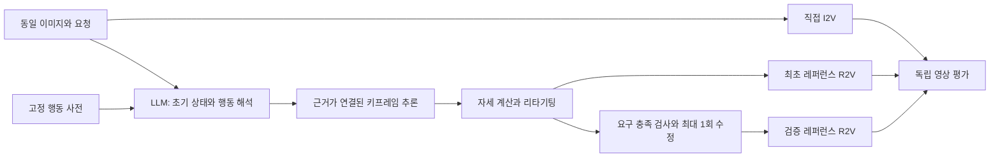

# 졸업논문 중간보고 초안

**제목(잠정): 행동 사전 기반 LLM 모션 추론과 검증된 레퍼런스를 이용한 영상 생성의 행동 정확도 평가**
작성일: 2026-10-29
상태: 시스템 기반 구축 및 벤치마크 초판 작성. 최종 I2V/R2V 비교실험 미실행.

## 1. 연구 문제

이미지와 자연어 요청으로 영상을 생성할 때, 요청한 행동·좌우·순서·초기 자세가 제대로 보존되는지 평가한다. 제안 접근은 행동 사전의 키프레임을 LLM이 검색·변형·조합하여 레퍼런스 영상을 만들고, 이를 최종 영상 생성 모델에 제공하는 것이다. 사전에 없는 행동과 T-pose/standing이 아닌 초기 상태에 대한 추론이 핵심이다.

레퍼런스는 추가 정보인 동시에 추가 실패 경로다. 잘못된 레퍼런스가 최종 생성에 잘못된 제약을 줄 수 있으므로, 중간 단계를 추가했다는 이유만으로 향상을 가정하지 않는다.

## 2. 연구 질문

1. LLM 레퍼런스 조건이 직접 I2V보다 명시 행동 요구의 충족률을 높이는가?
2. 레퍼런스 검증·수정 단계가 최초 레퍼런스의 오류 및 최종 실패를 줄이는가?
3. 효과가 사전 내/조합/사전 밖 행동과 비표준 초기 자세에 따라 어떻게 달라지는가?
4. 개선이 있을 경우 추가 비용·지연·중단율과 어떤 관계가 있는가?

## 3. 제안 구조

LLM은 행동 단계·근거·제약·추론 부분을 제안하고, 자세 계산기는 실제 초기 관절 상태에서 해를 계산한다. 계획이 자기 입력과 일치하는 검사와 원래 요청을 충족하는 검사를 구분한다. 추론 결과를 검증 없이 사전이나 학습 데이터에 편입하지 않는다.

## 4. 현재까지 수행한 작업과 관찰

### 4.1 로컬 모션 재생 기반

기존 프로젝트의 리그와 동작 자료를 이어받아 레퍼런스 생성 기반을 확인했다. 초기에 회전 변화량·좌우 매핑 지표를 개선했으나, 실제 화면에서는 팔이 뒤로 처지는 오류가 남았다. 수치 실행 성공을 행동 정확도와 동일시한 검증상의 문제가 있었다.

원본 C3D 마커, 공식 MMM 골격 복원, 로컬 21관절 입력, 최종 리그를 단계별로 대조했다. 세 KIT 촬영에서는 팔을 아래쪽 목(BLN)의 자식으로 두고 일괄 Rz·Ry·Rx 회전을 적용한 단순 골격 계산이 로컬 입력의 팔 방향을 평균 약 0.00002–0.00004도로 재현했다. 공식 골격의 어깨는 몸통/쇄골 경로에 연결된다. 이는 해당 세 사례의 변환 오류 경로를 재현한 근거이며 원본 exporter 코드를 찾았다는 의미는 아니다. 별도 네 번째 사례는 같은 가정으로 재현되지 않아 격리했다.

### 4.2 수정 기준선

원본 마커로 근사 관절을 구성한 오른손 흔들기·왼손 흔들기·스쿼트와 한 순차 연결을 제작했다. 네 사례의 제한된 실제 리그 기계검사와 해당 로컬 경로의 회귀/입력규격 시험 14개가 통과했다. 정면/측면 주요 프레임을 작성자가 점검했고 카메라 잘림을 수정했다.

이 결과는 **세 동작의 재생 기준선**이다. 학습된 LLM의 미관측 행동 생성 성능, 독립 사람 평가, I2V/R2V 우월성을 입증하지 않는다. 해당 모션/캐릭터 원본은 본 GitHub 패키지에 포함하지 않는다.

### 4.3 벤치마크 초판

총 24문항을 작성했다: 개발 8, 채점 연습 4, 평가 12. 실제 PNG 입력 24개와 요구사항별 평가 계약을 포함한다. 평가 12개는 사전 관계 3개와 초기 자세 4개의 모든 조합을 포함한다. 이미지는 외부 캐릭터 재배포 없이 재현 가능한 절차적 마네킹으로 제작했다.

실행 슬롯 계획, 해시 결합, 최초 레퍼런스 공유, 실패 위치 기록, 독립 평가 합의 처리, 완료 후 대응 사례 분석 도구를 구현했다. 미실행 슬롯은 0점 결과로 꾸미지 않고 `null`로 유지한다. 벤치마크 코드의 단위시험과 영상 생성 성능은 별개의 결과다.

## 5. 비교실험 설계

| 조건 | 내용 |
|---|---|
| A | 이미지 + 요청 → 직접 I2V |
| B | 같은 이미지/요청 + 최초 LLM 레퍼런스 → R2V |
| C | B와 같은 최초 레퍼런스 → 검증 및 최대 1회 수정 → R2V |

사례·반복 안에서 B/C의 최초 레퍼런스를 동일하게 공유한다. 같은 최종 모델·길이·해상도·비율 등 공통 조건을 고정하되, 제공자별 이미지 역할이나 시작 프레임 강제 여부 차이는 별도로 기록한다.

최초 기능 확인은 개발 8문항 × 3조건 × 1회 = 24개 슬롯으로 계획한다. 고정 평가 계획은 12문항 × 3조건 × 3회 = 108개 슬롯이다. 현재 실제 실행 수는 0이다. 금액 예산은 모델/제공자 선정 후 가격과 길이를 기준으로 확정한다.

## 6. 평가 지표

주 지표는 모든 명시 요구를 충족한 최종 영상의 사례별 반복 성공률 평균이다. 실패·중단·합의된 불확실은 성공으로 세지 않으며 분모에서 제거하지 않는다. 두 독립 사람 평가자가 요구별로 판정하고, 불일치는 제3자가 조정한다. 모델의 자기평가만으로 자연스러움을 입증하지 않는다.

외형 보존, 초기 자세 연속성, 시간적 아티팩트, 자연스러움, 레퍼런스 자체의 오류, 비용·지연은 별도 지표다. v0.1 코드에는 주 점수와 대응 평균 차이만 구현됐고, 부 결과 분석과 군집 의존성을 반영한 불확실성 추정은 후속 구현이다.

## 7. 현재 없는 결과

| 항목 | 상태 |
|---|---|
| 실제 I2V/R2V 비교 출력 | 없음 |
| LLM 추론/영상 API 어댑터 | 미구현 |
| LLM 학습 또는 파인튜닝 성과 | 없음 |
| 독립 사람 평가 | 미실행 |
| 제안 방법의 우월성 | 판단 불가 |
| 문항/입력/기록/채점 도구 | 초판 구현 |

## 8. 한계와 다음 단계

입력이 단순한 한 계열의 합성 마네킹이며 가려진 자세, 다양한 체형·화풍·실사 이미지까지 포괄하지 않는다. 각 평가 셀에 한 사례뿐이므로 통계적 검정력을 주장하지 않는다. 알려진 행동과 자세 유형은 분할 간 공유되며, 사전 밖 평가 행동군만 명시적으로 분리했다. 공개된 평가 문항을 보고 튜닝하면 새로운 평가 버전이 필요하다.

다음은 LLM 계획/자세 추정/레퍼런스 생성 어댑터를 연결하고, 개발 문항에서 실패 위치를 기록하며 수정한 뒤 파이프라인을 동결하는 것이다. 채점 연습 후 평가 문항에서 세 조건을 실행한다. 레퍼런스가 틀리거나 최종 결과가 직접 I2V보다 나쁘면 실패를 포함하여 보고한다.

## 9. 참고 자료

원천 자료와 코드/이미지의 재현 범위는 [PROVENANCE.md](PROVENANCE.md), 상세 설계는 [PROTOCOL.md](PROTOCOL.md), 채점 기준은 [RUBRIC.md](RUBRIC.md)에 정리했다. 이 문서는 중간보고 초안이며 학과 제출 양식, 지도교수 검토 및 실제 실험 결과가 반영된 최종 논문이 아니다.
