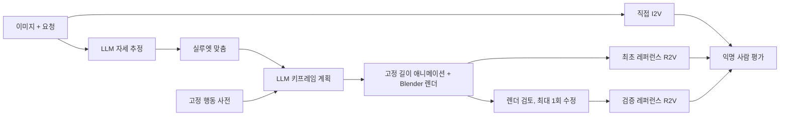

# 졸업논문 중간보고서

**제목(잠정): 행동 사전 기반 LLM 모션 추론과 검증된 레퍼런스를 이용한 영상 생성의 행동 정확도 평가**

- 작성일: 2026-10-29 (dev-005 실행까지 반영)
- 상태:
  - 완료: 벤치마크 초판, 레퍼런스 생성 파이프라인(개발판), 평가 도구.
  - 미실행: 최종 영상(I2V/R2V) 생성, 사람 평가.
- 범위: 모든 실험 수치는 development 분할 8문항에서 각 1회 실행한 결과입니다. 성능 주장이 아니라 개발 기록입니다.

## 요약

이미지와 자연어 요청으로 영상을 만들 때, 요청한 행동·좌우·순서·초기 자세가 지켜지는지를 묻는 연구입니다.

**제안 방법:** LLM이 행동 사전을 참조해 키프레임 계획을 세우고, 이를 마네킹 레퍼런스 영상으로 렌더링해 최종 영상 모델(R2V)에 넘깁니다. 직접 I2V(A), 검증 없는 레퍼런스(B), 검증·1회 수정한 레퍼런스(C)를 같은 입력에서 비교합니다.

**지금까지 한 일:**
- 24문항 벤치마크와 실행 기록·채점 도구를 만들었습니다.
- LLM 계획기, 레퍼런스 렌더러, 초기 자세 실루엣 맞춤, 조건 C 게이트를 구현했습니다.
- 파이프라인을 development에서 다섯 번 실행했습니다(dev-001~005).

**주요 관찰:**
1. **실루엣 맞춤으로 초기 자세 오차가 줄었습니다.** 평균 관절 오차가 0.113 m에서 0.068–0.077 m로 줄었습니다. LLM이 반대로 추정한 기울기 방향(D08)도 바로잡았습니다.
2. **LLM 자기수정은 오히려 나빠졌습니다.** 렌더 비교를 보여 주고 고치게 하자 결과가 더 나빠져, 수치 탐색으로 바꿨습니다.
3. **자동 게이트 판정이 흔들립니다.** 반복 횟수처럼 세밀한 요구에서는 규칙 버전에 따라 11건 중 8건, 같은 규칙을 다시 돌려도 11건 중 2건의 판정이 바뀌었습니다.
4. **레퍼런스 자체를 고치자 판정 갈림이 사라졌습니다.** 계획 규칙을 바꿔 레퍼런스를 깨끗하게 만들자 8건 모두 요청한 왕복 수와 숫자로 맞았습니다.

**아직 없는 것:** 최종 영상과 사람 평가가 없어서 연구 질문에는 아직 답할 수 없습니다.

## 1. 연구 문제

이미지와 요청으로 영상을 생성할 때, 요청한 행동·좌우·순서·초기 자세가 제대로 보존되는지 평가합니다.

**제안 접근:**
- LLM이 행동 사전의 키프레임을 검색·변형·조합해 레퍼런스 영상을 만들고, 이를 최종 영상 생성 모델에 제공합니다.
- 핵심은 두 가지 추론입니다. 하나는 사전에 없는 행동이고, 다른 하나는 T-pose나 선 자세가 아닌 초기 상태입니다.

레퍼런스는 추가 정보이면서 추가 실패 경로이기도 합니다. 잘못된 레퍼런스는 최종 생성에 잘못된 제약을 줍니다. 그래서 중간 단계를 추가했다는 이유만으로 향상을 가정하지 않습니다.

## 2. 연구 질문

1. LLM 레퍼런스 조건이 직접 I2V보다 명시 행동 요구의 충족률을 높이는가?
2. 레퍼런스 검증·수정 단계가 최초 레퍼런스의 오류와 최종 실패를 줄이는가?
3. 그 효과가 사전 내·조합·사전 밖 행동, 그리고 비표준 초기 자세에 따라 어떻게 달라지는가?
4. 개선이 있다면 추가 비용·지연·중단율과 어떤 관계인가?

## 3. 제안 구조

각 단계의 역할은 다음과 같습니다.
- **LLM**: 초기 자세와 행동 단계, 키프레임을 제안합니다.
- **수치 단계**: 자세 맞춤과 뼈 길이 고정 애니메이션은 LLM 없이 계산합니다.

각 단계는 실패 위치를 따로 기록합니다(initial_pose, planning, retargeting, reference_review). 그래서 최종 영상만 보고 원인을 짐작하지 않습니다. 단계별 명령과 정보 경계는 [PIPELINE.md](PIPELINE.md)에 있습니다.

## 4. 벤치마크와 실험 규칙

### 4.1 문항

| 분할 | 문항 | 용도 |
|---|---:|---|
| development | 8 | 구현과 수정. 실패를 보고 고칠 수 있음 |
| calibration | 4 | 평가자 연습과 검증기 보정 |
| test | 12 | 동결된 파이프라인의 평가. 결과를 보고 같은 버전을 고치지 않음 |

- **test 구성**: 사전 관계 3개(사전 내·조합·사전 밖) × 초기 자세 4개(서기·앉기·기울기·웅크리기)의 각 칸에 한 문항씩 있습니다.
- **입력 이미지**: 외부 캐릭터 없이 Blender 기본 도형으로 만든 절차적 마네킹입니다.
- **평가 계약**: 요구별 평가 계약과 평가용 관절 정답은 생성 쪽에 넘기지 않습니다.

### 4.2 조건과 규칙

| 조건 | 내용 |
|---|---|
| A | 이미지 + 요청 → 직접 I2V |
| B | 같은 이미지와 요청 + 최초 LLM 레퍼런스 → R2V |
| C | B와 **같은** 최초 레퍼런스 → 검토, 최대 1회 수정, 재검토 → R2V. 재검토도 실패하면 `blocked` |

- **B와 C의 최초 레퍼런스 공유**: 같은 반복 안에서는 B와 C가 최초 레퍼런스를 공유합니다. 그래서 차이는 검증 효과로만 해석됩니다.
- **실행 기록**:
  - 실행 기록(ledger)은 덧붙이기만 합니다.
  - 미실행 슬롯은 0점이 아니라 `null`로 남깁니다.
  - 재생성이나 최고 결과 선별은 하지 않습니다.
- **동결**: test 실행 전에 코드·프롬프트·모델·비용 상한의 지문을 동결합니다(`freeze-pipeline`). 동결 없이는 test 분할의 계획·게이트·생성 명령이 거부됩니다.
- **실행 규모**:
  - 기능 시험: development 8 × 3조건 × 1회 = 24슬롯.
  - 본 평가: test 12 × 3조건 × 3회 = 108슬롯.

## 5. 연구 경과

### 5.1 선행 작업: 로컬 모션 재생 기반과 수정 기준선

**오류 추적:**
- 기존 프로젝트의 리그와 KIT 동작 자료[13, 14]를 이어받았습니다.
- 처음에는 회전 변화량 지표를 개선했지만, 화면에서는 팔이 뒤로 처지는 오류가 남았습니다. 수치 실행 성공을 행동 정확도와 같게 본 검증 문제였습니다.
- 원본 C3D 마커, MMM 골격 복원[15], 로컬 21관절 입력, 최종 리그를 단계별로 대조했습니다.
- 세 촬영에서는 "팔을 아래쪽 목의 자식으로 두고 일괄 회전" 가정이 로컬 입력의 팔 방향을 평균 0.00004° 이하 오차로 재현했습니다. 이는 오류 경로를 재현한 근거일 뿐이고, 원본 변환 코드를 찾았다는 뜻은 아닙니다.

**수정 기준선:**
- 원본 마커로 근사 관절을 다시 구성해 오른손 흔들기·왼손 흔들기·스쿼트와 순차 연결 1건을 만들었습니다.
- 해당 경로의 시험 14개를 통과했습니다.
- 이 결과는 **세 동작의 재생 기준선**입니다. 원본 모션과 캐릭터 자료는 저장소에 넣지 않았습니다([PROVENANCE.md](PROVENANCE.md)).

### 5.2 LLM 계획기 (dev-001)

**호출 경로:**
- **경로 A**: Claude 구독의 헤드리스 CLI(`claude -p`, 도구 끔, JSON 스키마 출력)를 씁니다.
- **경로 B**: 공식 SDK를 이용하는 API 키 경로입니다. 구현은 마쳤지만 실제 호출은 하지 않았습니다.
- **모델**: 비용을 줄이려고 기본 모델은 sonnet으로 했습니다.

**dev-001 결과 (8건, 각 1회):**
- 8건 모두 구조 검사를 통과했습니다. 계획의 손·순서도 요청과 맞았습니다.
- 평가 정답과 개발 측에서 비교하니 **D08(기울기)은 기울기 방향을 반대로 추정**했습니다(정답 왼쪽 18°, 추정 오른쪽 12°).
- 위팔을 약 25% 늘려 손을 허리에 닿게 했습니다.
- 구조 검사 통과가 정확성을 뜻하지 않는다는 사례입니다([결과](../results/dev-001-planner/README.md)).

### 5.3 레퍼런스 렌더러

계획의 키프레임을 매 프레임 골격으로 바꾸고, 입력 이미지와 같은 마네킹·카메라·조명으로 렌더링합니다(576×768, 24 fps). 사용한 애니메이션 기법은 6절에 정리했습니다.

**보간 방식 교체:** 처음 쓴 관절 위치 직선 보간은 팔을 드는 중간에 팔꿈치가 옆으로 꺾이는 자세를 만들었습니다. 그래서 뼈 방향 보간으로 바꿨습니다.

**뼈 길이 고정:**
- 뼈 길이는 첫 키프레임 기준으로 고정합니다.
- 계획이 팔을 늘린 D08은 손이 허리에서 약 7 cm 떨어진 채 그려집니다. 이 차이는 키프레임 오차로 기록합니다.

**D08 초기 자세 오류의 전파:** 렌더 첫 프레임이 입력과 반대로 기운 모습으로 나와, 계획 단계의 오류가 실제 출력까지 이어진다는 것을 확인했습니다([결과](../results/dev-001-reference/README.md)).

### 5.4 초기 자세 실루엣 맞춤

**방법 (분석-합성 방식):**
1. LLM이 추정한 자세를 조금씩 바꾼 후보들을 입력과 같은 조건으로 렌더링합니다.
2. 입력 이미지와 비교해 실루엣 IoU와 피부(얼굴·손) IoU의 평균을 점수로 씁니다[22].
3. 좌표별 패턴 탐색[21]으로 점수를 올립니다. 몸 전체 → 팔 → 전체 순서로 단계를 나누고, 한 칸과 두 칸 이동을 함께 시도합니다.
4. 한 시점에서는 깊이가 안 보이므로, 앞뒤 방향 변화에는 2배 벌점을 줍니다.

**결과 (dev-001 계획에 사후 적용):**
- 평균 관절 오차가 0.113 m에서 0.074 m로 줄었습니다.
- D08의 기울기 방향이 바로잡혔습니다.
- 벌점이 없으면 겹침은 늘지만 팔을 앞뒤로 휘둘러 3D 오차가 커졌습니다(D03·D04 최대 오차 0.6 m 이상).

**버린 방법:** LLM에게 입력·렌더·차이 그림을 보여 주고 스스로 고치게 했습니다. 2회 모두 겹침이 줄고 기울기가 더 틀어졌습니다. 외부 신호 없는 자기수정의 한계에 대한 보고[23]와 같은 방향의 관찰이지만, 2회만 시도했으므로 일반화하지 않습니다.

**dev-002 (버그 기록):**
- 리팩터링 중 문자열 치환 오류로 자세 호출 프롬프트에서 좌표계 설명이 빠졌습니다. 그래서 y축을 위로 쓴 자세가 나왔습니다.
- run을 중단해 그대로 기록으로 남겼습니다.
- 재발 방지책은 세 가지입니다.
  - 정답 없이 쓸 수 있는 좌표 관례 검사
  - 맞춤 점수 하한(0.5): 미달하면 `initial_pose` 실패로 기록
  - 회귀 시험

**dev-003 (실제 파이프라인 적용):** 자세 호출 → 맞춤 → 계획(맞춘 자세 고정) 순서로 처음부터 실행했습니다.

| 지표 | dev-001 | dev-003 | dev-004 | dev-005 |
|---|---|---|---|---|
| 평균 관절 오차 | 0.113 m | **0.068 m** | 0.077 m | 0.068 m |
| 최대 관절 오차의 평균 | 0.250 m | **0.142 m** | 0.183 m | 0.158 m |
| D08 좌우 기울기 (정답 +18°) | −12° | +14° | +7° | +6° |

- **D08 기울기**: 방향은 매번 맞지만, 각도는 run마다 차이가 크고 작게 잡힙니다. 원인은 자세 호출의 출발점 변동과 국소 해입니다.
- **첫 프레임 일치(0.46 → 0.82)**: 맞춤이 직접 최대화하는 값이라 독립된 근거가 아닙니다. 독립된 근거는 평가 정답과의 관절 오차입니다.

### 5.5 조건 C 게이트와 검증기의 변화

**검토 방식:** 검토자(LLM)는 계획 JSON이 아니라 **렌더된 프레임**을 보고 요구별로 판정합니다. 입력 카메라와 정면 정사영 두 시점을 씁니다. 평가 계약은 보지 않습니다.

이 단계에서 가장 많은 설계 수정이 있었습니다.

| 버전 | 바꾼 점 | 드러난 문제 |
|---|---|---|
| v1 | 8장 격자만 제공 | 흔들기 왕복 수를 셀 수 없어 uncertain → blocked |
| v2 | 렌더 골격에서 측정한 동작 요약(손목 좌우 전환점, 어깨 위 구간, 정지 구간) 추가 | 팔을 들고 내릴 때의 좌우 이동까지 흔들기로 셈 |
| v3 | 전환점에 "든 상태" 표시, 왕복 = (전환점 수 − 1)/2 | 산식이 손의 출발 위치를 무시해서 잘못된 판정을 냄 |
| v4 | 든 손의 좌우 위치 시계열(cm)과 RUBRIC의 왕복 정의 제공 | 아래 재검토 참고 |

**dev-004 (v3, 일관 실행):**
- 결과는 통과 6건, blocked 2건(D01, D05)이었습니다.
- 그런데 시계열로 다시 보니, D01은 요청한 대로 2왕복이었습니다. v3의 blocked는 산식이 만든 거짓 판정일 가능성이 큽니다.
- 그래서 처음 썼던 "LLM 계획이 반복 횟수를 자주 틀린다"는 결론은 **철회했습니다**([결과](../results/dev-004/README.md)).

**v4 오프라인 재검토 (dev-004 렌더 11개):**
- 규칙을 v3에서 v4로 바꾸자 판정 11개 중 8개가 바뀌었습니다.
- 같은 v4로 두 번 돌려도 일치는 9/11이었습니다.
- 일어서기, 머리 위 유지, 허리에 손 같은 거친 요구는 모든 버전에서 안정적이었습니다.
- **반복 횟수 같은 세밀한 요구는 자동 게이트 하나로 판정할 수 없습니다.** LLM 평가자의 일관성 한계에 대한 보고[24]와 같은 방향입니다.

**dev-005 (계획 규칙 6 + v4):**
- 판정 갈림의 원인 중 하나는 레퍼런스 자체의 애매함이었습니다. 마지막 흔들기 뒤에 "가운데로 복귀"하는 동작이 반 흔들기처럼 보였기 때문입니다.
- 그래서 계획 규칙에 "반복은 두 극점 사이를 오가고, 마지막 뒤에 복귀 동작을 넣지 않는다"를 추가했습니다.
- 그 결과 8건 모두 최초 레퍼런스로 통과했고, 손의 좌우 궤적이 요청한 왕복 수와 숫자로 맞았습니다. 예를 들어 D01은 25 → −9 → 24 → −9 → 25 cm로 2왕복입니다.
- 다만 이 결과는 레퍼런스가 좋아졌다는 뜻일 수도, 검증기가 관대하다는 뜻일 수도 있습니다. 둘을 가르려면 사람 평가가 필요합니다([결과](../results/dev-005/README.md)).

### 5.6 평가·집계 도구

- **익명 평가 패키지**:
  - 영상의 메타데이터를 지우고 임의 ID를 붙입니다. 조건과의 대응표는 패키지 밖에 둡니다.
  - 평가자는 브라우저 평가 페이지(`rate.html`)에서 판정하고 결과 파일을 저장합니다.
- **평가 합의**: 평가자 2명이 독립적으로 판정합니다. 불일치는 제3자가 조정하기 전까지 `disputed`로 남깁니다.
- **집계**: 주 결과, 부 결과, 실패 위치별 개수, 사례·행동군 단위 군집 부트스트랩 95% 구간[16, 17]을 냅니다.
- **검증기-사람 일치도**: 원 일치율, Cohen's κ[18, 19], 혼동표, "사람은 fail인데 검증기는 pass한" 놓친 실패 수를 냅니다.

### 5.7 최종 영상 어댑터 (Seedance 2.0)

- **모델과 엔드포인트**: 최종 모델은 fal.ai의 Seedance 2.0[1, 2]으로 정했습니다. A는 image-to-video, B·C는 reference-to-video를 씁니다.
- **조건 간 차이**: R2V에서는 입력 이미지가 시작 프레임으로 강제되지 않습니다. 이 차이는 기록하고, 시작 연속성은 부 결과로 따로 평가합니다.
- **현재 상태**: dry run과 비용 상한 검사만 구현했고, 실제 호출 경로는 검증하지 않았습니다.
- **비용 추정** (480p, 토큰식 기준 상한): development 24슬롯 약 $18, test 108슬롯 약 $82입니다([SEEDANCE_SETUP.md](SEEDANCE_SETUP.md)).

### 5.8 비용

- 계획·검토 LLM 호출은 모두 구독 경로였습니다.
- 한 run 기준으로 호출 24–30회, 출력 7만–11만 토큰, 모델 대기 7–11분이었습니다.
- 별도 과금은 없었습니다.

## 6. 사용한 컴퓨터 애니메이션 기법

| 기법 | 쓰인 곳 | 내용 |
|---|---|---|
| 골격 리그와 정기구학(FK) | 렌더러 | 15관절 골격. 골반에서 출발해 뼈 방향 × 고정 길이를 차례로 더해 관절 위치를 계산 |
| 키프레임 애니메이션 | 계획 → 렌더러 | LLM은 시간별 키프레임만 내고, 사이 프레임은 보간으로 채움[5] |
| 단조 3차 Hermite 보간 | 렌더러 | Fritsch–Butland 기울기[3, 4]. 극값에서 기울기가 0이라 키프레임 값을 넘어서는 오버슈트가 없음 |
| 뼈 방향 보간 | 몸통·팔 | 관절 위치 대신 뼈 방향 벡터를 보간하고 정규화(nlerp 방식). 회전 보간[6]의 단순형으로, 팔이 호를 그리며 움직임 |
| 2관절 해석적 IK | 다리 | 엉덩이–무릎–발목을 코사인 법칙으로 풀고, 무릎 방향은 FK 무릎을 기준(pole)으로 정함[7]. 디딘 발이 미끄러지지 않음 |
| 고정 길이 리타기팅 | 렌더러 | 계획이 뼈를 늘려도 길이를 고정하고, 닿지 못한 거리와 키프레임 오차를 기록[8] |
| 분석-합성 자세 맞춤 | 초기 자세 | 후보 자세를 렌더링해 입력과의 실루엣 겹침을 최대화. 사람 모델 맞춤 연구[9]의 단순형 |
| 절차적 마네킹과 비사실적 렌더링 | 입력·레퍼런스 | Blender 기본 도형 마네킹, Workbench 엔진[10], 입력 카메라와 정면 정사영 두 시점 |
| 동작 측정 | 게이트 | 렌더된 골격에서 손의 좌우 위치 시계열, 방향 전환점(zigzag), 어깨·머리 위 구간, 정지 구간을 측정 |

기법을 고른 이유는 두 가지입니다.
- **오류가 드러나도록**: LLM 계획의 오류(뼈 늘리기, 닿을 수 없는 목표)를 숨기지 않고 기록으로 드러냅니다.
- **재현 가능하도록**: 표준 라이브러리만으로 계산합니다. 학습된 모션 모델[11, 12]은 쓰지 않았습니다.

## 7. 평가 지표

**주 지표:**
- 모든 명시 요구를 충족한 최종 영상의 비율을 사례마다 구하고, 사례 간 평균을 냅니다.
- 실패·중단·합의된 불확실은 성공으로 세지 않고 분모에서도 빼지 않습니다.
- 두 독립 평가자가 판정하고, 불일치는 제3자가 조정합니다.

**부 지표:** 외형 보존, 시작 연속성, 시간적 아티팩트, 자연스러움(1–5), 레퍼런스 자체의 요구 충족, 비용, 지연, 중단율.
- 이 값들을 하나의 가중 점수로 합치지 않습니다.
- 평가 12문항으로는 구간이 넓으므로 기술 통계로만 제시하고, 우월성 검정으로 쓰지 않습니다.

## 8. 현재 결과 현황

| 항목 | 상태 |
|---|---|
| 벤치마크 문항·입력·채점 계약 | 초판 완료 (24문항) |
| LLM 계획·자세 맞춤·렌더·C 게이트 | 개발판, development에서 5회 실행 |
| 평가 패키지·집계·일치도 도구 | 구현, 단위시험 88개 통과 |
| 레퍼런스 사람 평가 (dev-005) | 패키지 준비 완료, 평가 미실행 |
| 최종 영상 (A/B/C) | 0건. Seedance 계정 미준비 |
| 경로 B (API 키) 실제 호출 | 미검증 |
| 제안 방법의 우월성 | 판단 불가 |

## 9. 한계

- **합성 입력**: 입력이 단순한 합성 마네킹 한 계열입니다. 실루엣 맞춤은 카메라를 안다고 가정하므로 실사 이미지에는 그대로 적용되지 않습니다.
- **깊이 모호성**: 한 시점 실루엣으로는 앞뒤 깊이를 구분할 수 없습니다. 벌점으로 줄였지만 D08의 기울기 각도 과소 추정이 남아 있습니다.
- **표본 크기**: 평가 셀마다 한 문항뿐이라 통계적 검정력을 주장하지 않습니다.
- **자동 게이트**: 세밀한 요구에서 판정이 규칙과 표본에 따라 흔들립니다. C의 효과는 게이트 품질에 직접 묶여 있습니다.
- **개발 데이터 사용**: development 결과를 보고 여러 번 수정했습니다. 이 수치들은 개발 기록이며 test 성능의 추정치가 아닙니다.

## 10. 다음 단계

1. **dev-005 레퍼런스 사람 평가**: 평가자 2명이 판정한 결과를 들여와 검증기 v4와의 일치도를 계산합니다.
2. **calibration 4문항 대조**: 사람 판정과 검증기를 대조해 게이트를 보정합니다.
3. **Seedance 기능 시험**: 계정을 연결하고 development 24슬롯의 기능 시험을 합니다. 실패 위치를 기록하며 수정합니다.
4. **D08 기울기 과소 추정 개선**: development에서만 진행합니다. 예를 들어 맞춤에서 좌우와 앞뒤 기울기를 분리합니다.
5. **동결과 본 평가**: `freeze-pipeline`으로 동결한 뒤 test 108슬롯을 실행합니다. 레퍼런스가 틀리거나 결과가 직접 I2V보다 나빠도 그대로 보고합니다.

## 참고 문헌

**영상 생성과 모델 접근**

1. Gao, Y. et al. (ByteDance Seed). *Seedance 1.0: Exploring the Boundaries of Video Generation Models.* arXiv:2506.09113, 2025. https://arxiv.org/abs/2506.09113
2. fal.ai. *Seedance 2.0 reference-to-video / image-to-video API.* https://fal.ai/models/bytedance/seedance-2.0/reference-to-video/api (2026-10 확인; 가격과 입력 규격은 실행 전에 다시 확인)

**보간과 애니메이션**

3. Fritsch, F. N., Butland, J. A method for constructing local monotone piecewise cubic interpolants. *SIAM J. Sci. Stat. Comput.* 5(2):300–304, 1984.
4. Fritsch, F. N., Carlson, R. E. Monotone piecewise cubic interpolation. *SIAM J. Numer. Anal.* 17(2):238–246, 1980.
5. Lasseter, J. Principles of traditional animation applied to 3D computer animation. *SIGGRAPH '87, Computer Graphics* 21(4):35–44, 1987.
6. Shoemake, K. Animating rotation with quaternion curves. *SIGGRAPH '85, Computer Graphics* 19(3):245–254, 1985.
7. Tolani, D., Goswami, A., Badler, N. I. Real-time inverse kinematics techniques for anthropomorphic limbs. *Graphical Models* 62(5):353–388, 2000.
8. Gleicher, M. Retargetting motion to new characters. *SIGGRAPH '98*, 33–42, 1998.
9. Bogo, F. et al. Keep it SMPL: Automatic estimation of 3D human pose and shape from a single image. *ECCV* 2016.
10. Blender Foundation. *Blender Manual: Workbench render engine* (Blender 4.2 LTS). https://docs.blender.org/manual/en/4.2/render/workbench/index.html

**관련 생성 연구**

11. Tevet, G. et al. Human Motion Diffusion Model. *ICLR* 2023.
12. Hu, L. et al. Animate Anyone: Consistent and controllable image-to-video synthesis for character animation. *CVPR* 2024, 8153–8163.

**모션 데이터와 골격**

13. Plappert, M., Mandery, C., Asfour, T. The KIT Motion-Language Dataset. *Big Data* 4(4):236–252, 2016.
14. Guo, C. et al. Generating diverse and natural 3D human motions from text (HumanML3D). *CVPR* 2022.
15. Terlemez, Ö. et al. Master Motor Map (MMM): Framework and toolkit for capturing, representing, and reproducing human motion on humanoid robots. *IEEE-RAS Humanoids* 2014.

**통계와 평가 방법**

16. Efron, B., Tibshirani, R. J. *An Introduction to the Bootstrap.* Chapman & Hall, 1993.
17. Field, C. A., Welsh, A. H. Bootstrapping clustered data. *J. R. Stat. Soc. B* 69(3):369–390, 2007.
18. Cohen, J. A coefficient of agreement for nominal scales. *Educ. Psychol. Meas.* 20(1):37–46, 1960.
19. Landis, J. R., Koch, G. G. The measurement of observer agreement for categorical data. *Biometrics* 33(1):159–174, 1977.
20. Nosek, B. A. et al. The preregistration revolution. *PNAS* 115(11):2600–2606, 2018.
21. Hooke, R., Jeeves, T. A. "Direct search" solution of numerical and statistical problems. *J. ACM* 8(2):212–229, 1961.
22. Jaccard, P. The distribution of the flora in the alpine zone. *New Phytologist* 11(2):37–50, 1912.

**LLM의 자기수정과 판정**

23. Huang, J. et al. Large language models cannot self-correct reasoning yet. *ICLR* 2024.
24. Zheng, L. et al. Judging LLM-as-a-judge with MT-Bench and Chatbot Arena. *NeurIPS* 2023 Datasets and Benchmarks.
25. Lin, H., Zala, A., Cho, J., Bansal, M. VideoDirectorGPT: Consistent multi-scene video generation via LLM-guided planning. arXiv:2309.15091, 2023.

**도구 문서**

26. Anthropic. *Claude Code headless mode* (`claude -p`). https://code.claude.com/docs/en/headless
27. Anthropic. *Structured outputs.* https://platform.claude.com/docs/en/build-with-claude/structured-outputs

원천 자료의 재현 범위는 [PROVENANCE.md](PROVENANCE.md)에, 상세 설계는 [PROTOCOL.md](PROTOCOL.md)에, 채점 기준은 [RUBRIC.md](RUBRIC.md)에 있습니다. 이 문서는 중간보고 초안입니다. 학과 제출 양식, 지도교수 검토, 최종 실험 결과는 아직 반영하지 않았습니다.

### 참고 그림

- 초기 자세 맞춤 전후: [results/dev-001-posefit/before_after.png](../results/dev-001-posefit/before_after.png)
- 입력과 렌더 첫 프레임 비교 (dev-003): [results/dev-003/first_frame_vs_input.png](../results/dev-003/first_frame_vs_input.png)
- dev-005 흔들기 레퍼런스 정면 격자: [results/dev-005/front_grids_waves.png](../results/dev-005/front_grids_waves.png)
