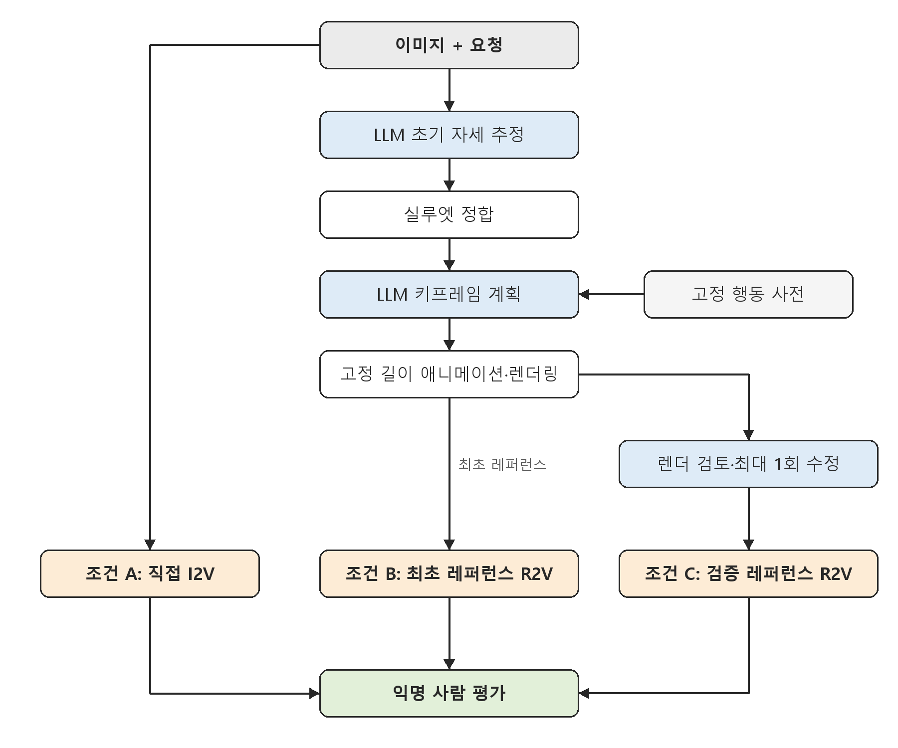

# 졸업논문 중간보고서

**제목(가제): 행동 사전 기반 LLM 모션 추론과 검증된 레퍼런스를 이용한 영상 생성의 행동 정확도 평가**

- 작성일: 2026-10-29
- 코드 및 데이터: https://github.com/enggaa/motion-reference-benchmark

## 요약

본 연구는 이미지와 자연어 요청으로 영상을 생성할 때 요청된 행동, 좌우 구분, 동작 순서, 초기 자세가 보존되는지를 평가한다. 제안 방법에서는 LLM이 행동 사전을 참조하여 키프레임 계획을 수립하고, 이를 마네킹 레퍼런스 영상으로 렌더링하여 최종 영상 모델에 조건으로 제공한다. 이 방법을 직접 I2V 조건 및 검증을 거친 레퍼런스 조건과 비교한다.

현재까지 24문항 규모의 벤치마크를 구축하고, 레퍼런스 생성 파이프라인과 평가 도구를 구현하였다. 개발용 문항에서 다음 두 가지를 확인하였다.
- 실루엣 정합으로 초기 자세의 평균 관절 오차가 0.113 m에서 0.068 m로 감소하였다.
- LLM 기반 레퍼런스 검증은 반복 횟수와 같은 세밀한 요구에서 판정이 불안정하였다.

최종 영상 생성과 사람 평가는 향후 수행할 예정이다.

## 1. 연구 배경 및 목적

최근 영상 생성 모델은 이미지와 텍스트로부터 고품질 영상을 생성한다[1]. 그러나 이 영상들이 요청된 행동의 종류, 좌우, 순서, 횟수를 정확히 따르는지는 별도로 검증되어야 한다. 관련 연구로는 다음이 제안된 바 있다.
- 포즈 시퀀스를 조건으로 캐릭터 영상을 생성하는 연구[2]
- LLM이 영상 생성 계획을 수립하는 연구[3]
- 텍스트로부터 모션을 생성하는 학습 기반 연구[4]

본 연구는 소규모 행동 사전과 LLM 추론을 결합하여 모션 레퍼런스를 구성한다. 핵심 과제는 다음 두 가지 추론이다.
- 사전에 존재하지 않는 행동의 추론
- 선 자세가 아닌 초기 상태의 추론

레퍼런스는 추가 정보인 동시에 추가 실패 경로이다. 잘못된 레퍼런스는 최종 생성에 잘못된 제약으로 작용할 수 있으므로, 중간 단계의 추가가 곧 성능 향상이라고 가정하지 않는다.

## 2. 연구 질문

1. LLM 레퍼런스 조건은 직접 I2V 대비 명시적 행동 요구의 충족률을 높이는가?
2. 레퍼런스 검증·수정 단계는 최초 레퍼런스의 오류와 최종 실패를 줄이는가?
3. 그 효과는 사전 내·조합·사전 외 행동 및 비표준 초기 자세에 따라 어떻게 달라지는가?
4. 개선이 확인될 경우, 그 개선은 추가 비용·지연·중단율과 어떠한 관계를 가지는가?

## 3. 제안 방법

*그림 1. 제안 방법의 구조*

LLM은 초기 자세, 행동 단계, 키프레임을 제안한다. 자세 정합과 애니메이션 생성은 수치 계산 모듈이 담당한다. 애니메이션 생성에는 학습 기반 모션 모델[2, 4] 대신 고전적 컴퓨터 애니메이션 기법(5.3절)을 사용한다. 이를 통해 다음 두 가지를 얻는다.
- 동일 입력에 대해 동일 결과를 얻을 수 있다.
- LLM 계획의 오류가 측정 가능한 형태로 남는다.

각 단계의 실패는 초기 자세, 계획, 리타기팅, 레퍼런스 검토로 구분하여 기록한다. 이를 통해 최종 영상만으로 실패 원인을 추정하는 것을 방지한다.

## 4. 실험 설계

### 4.1 문항 구성

| 분할 | 문항 수 | 용도 |
|---|---:|---|
| 개발용 | 8 | 구현 및 수정 |
| 보정용 | 4 | 평가자 훈련 및 검증기 보정 |
| 평가용 | 12 | 동결된 파이프라인의 최종 평가 |

- **문항 배치**: 평가용 문항은 사전 관계 3종(사전 내·조합·사전 외)과 초기 자세 4종(서기·앉기·기울기·웅크리기)의 각 조합에 1문항씩 배정하였다.
- **입력 이미지**: 외부 캐릭터 자산 없이 3D 기본 도형으로 생성한 절차적 마네킹이다.
- **정보 분리**: 요구 단위의 채점 기준과 관절 정답은 생성 과정에 제공하지 않는다.

### 4.2 비교 조건

| 조건 | 내용 |
|---|---|
| A | 이미지 + 요청 → 직접 I2V |
| B | 동일 이미지·요청 + 최초 LLM 레퍼런스 → R2V |
| C | B와 동일한 최초 레퍼런스 → 검토, 최대 1회 수정, 재검토 → R2V (재검토 실패 시 차단) |

**실험 운영 원칙:**
- **레퍼런스 공유**: 동일 반복 내에서 B와 C는 최초 레퍼런스를 공유한다. 따라서 두 조건의 차이는 검증 단계의 효과로 해석할 수 있다.
- **선별 금지**: 재생성 및 최선 결과 선별은 허용하지 않는다.
- **결측 처리**: 미실행 결과는 실패로 간주하지 않고 결측으로 처리한다.
- **사전 동결**: 평가용 문항 실행 전에 코드, 프롬프트, 모델, 비용 상한을 동결하고[5], 결과 확인 후에는 동일 버전을 수정하지 않는다.

**실행 규모:**
- 기능 시험: 개발용 8문항 × 3조건 × 1회
- 본 평가: 평가용 12문항 × 3조건 × 3회

### 4.3 평가 지표

**주 지표**는 모든 명시적 요구를 충족한 최종 영상의 비율이다. 사례별로 산출한 뒤 사례 간 평균을 구한다.
- 실패, 중단, 합의된 불확실 판정은 성공으로 계수하지 않는다.
- 평가자 2인이 조건을 모르는 상태에서 독립적으로 판정하고, 불일치는 제3자가 조정한다.

**부 지표**는 다음 8가지이다.
- 외형 보존, 시작 연속성, 시간적 아티팩트, 자연스러움(5점 척도)
- 레퍼런스 자체의 요구 충족, 비용, 지연, 중단율

**통계 처리:**
- 신뢰구간은 사례·행동군 단위 군집 부트스트랩[6, 7]으로 산출한다.
- 검증기와 사람 판정의 일치도는 Cohen's κ[8, 9]로 산출한다.
- 평가용 문항 수가 적으므로 결과는 기술 통계로 제시하며, 우월성 검정에는 사용하지 않는다.

## 5. 진행 현황

본 장의 수치는 개발용 8문항을 문항당 1회 실행한 결과이다. 개발 과정의 기록이며 성능 평가 결과가 아니다.

### 5.1 선행 작업

기존 리그와 KIT 동작 자료[10, 11]를 기반으로 착수하였다.
- **문제 확인**: 수치 지표는 개선되었으나, 화면상으로는 팔이 뒤로 처지는 오류가 잔존하였다.
- **원인 추적**: 원본 마커, MMM 골격[12], 로컬 관절 입력, 최종 리그를 단계별로 대조하였다. 그 결과 팔의 부모 관절 설정이 잘못된 변환 경로를 재현하였다.
- **기준선 구축**: 원본 마커로 관절을 재구성하여 흔들기와 스쿼트 동작의 재생 기준선을 마련하였다.

### 5.2 LLM 계획기

LLM(Anthropic Claude Sonnet 5.5)이 입력 이미지와 요청으로부터 초기 자세와 시간별 키프레임을 구조화된 형식으로 출력하도록 구현하였다.

1차 실행 결과는 다음과 같다.
- 8건 모두 형식 검사를 통과하였고, 사용 손과 동작 순서가 요청과 일치하였다.
- 평가 정답과 비교한 결과, 기울어진 자세의 한 문항(D08)에서 기울기 방향이 반대로 추정되었다(정답: 좌측 18°, 추정: 우측 12°).
- 같은 문항에서 손을 허리에 닿게 하기 위해 위팔 길이가 약 25% 늘어났다.

이는 형식 검사 통과가 계획의 정확성을 보장하지 않음을 보여 준다.

### 5.3 레퍼런스 렌더러

LLM이 출력한 키프레임을 프레임별 골격 동작으로 변환하고 렌더링한다. 키프레임 애니메이션[13]의 구성에 따라, LLM은 주요 시점의 자세만 지정하고 중간 프레임은 다음 절차로 생성한다.

- **골격 구성**: 15관절 골격을 사용한다. 각 뼈의 길이는 첫 키프레임을 기준으로 고정한다.
- **몸통과 팔**: 관절 위치 대신 뼈 방향 벡터를 시간에 대해 보간하고 정규화한다. 이후 골반에서부터 뼈 방향과 길이를 순차적으로 누적하는 순기구학(FK)으로 관절 위치를 산출한다.
  - 이 방식은 회전 보간[14]의 단순화 형태로, 팔이 원호를 따라 움직인다.
  - 초기에 적용한 관절 위치 선형 보간은 팔을 드는 도중 팔꿈치가 측방으로 꺾이는 문제를 보여, 이 방식으로 변경하였다.
- **보간 곡선**: 단조 3차 Hermite 보간을 사용하며, 접선은 Fritsch–Butland 방식[15, 16]으로 정한다. 극값에서 기울기가 0이 되므로 키프레임 값을 넘어서는 오버슈트가 생기지 않는다.
- **다리**: 발목 위치를 보간한 뒤, 고관절–슬관절–족관절을 코사인 법칙으로 푸는 2관절 해석적 역기구학(IK)[17]을 적용한다. 이로써 지지발이 미끄러지지 않는다.
- **길이 보존**: 계획이 뼈 길이를 바꾸더라도 리타기팅[18]의 길이 보존 원칙에 따라 길이를 고정하고, 도달하지 못한 거리를 오차로 기록한다. 따라서 LLM 계획의 오류가 영상에서 숨겨지지 않고 측정 가능한 값으로 남는다.
- **렌더링**: 입력 이미지와 동일한 절차적 마네킹·카메라·조명을 Blender Workbench 엔진[19]으로 렌더링한다(576×768, 24 fps). 검토용으로 정면 정사영 시점 영상도 함께 생성한다.

1차 실행에서 D08의 렌더 첫 프레임은 입력과 반대 방향으로 기운 상태로 출력되었다. 이로써 계획 단계의 오류가 최종 출력까지 전파됨을 확인하였다.

### 5.4 초기 자세 실루엣 정합

입력 이미지와 렌더 결과를 비교하여 자세를 보정하는 분석-합성(analysis-by-synthesis) 방식[20]을 적용하였다.

**정합 절차:**
1. LLM이 추정한 자세에 변화를 준 후보들을 입력과 동일한 조건으로 렌더링한다.
2. 입력 이미지와의 실루엣 IoU 및 피부 영역 IoU[21]의 평균을 점수로 사용한다.
3. 좌표별 패턴 탐색[22]으로 점수를 최대화한다. 탐색은 몸 전체, 팔, 전체의 순서로 진행한다.
4. 단일 시점에서는 깊이를 관측할 수 없으므로, 전후 방향 변화에는 벌점을 부과한다.

**기각한 방법:** LLM에게 렌더 결과와 입력의 차이를 제시하고 스스로 수정하도록 하였으나, 2회 모두 오차가 확대되었다. 이는 외부 신호가 없는 자기 수정의 한계에 관한 선행 보고[23]와 일치한다.

| 지표 | 1차 실행 (정합 없음) | 2차 실행 | 3차 실행 | 4차 실행 |
|---|---|---|---|---|
| 평균 관절 오차 | 0.113 m | 0.068 m | 0.077 m | 0.068 m |
| 최대 관절 오차의 평균 | 0.250 m | 0.142 m | 0.183 m | 0.158 m |
| D08 좌우 기울기 (정답 +18°) | −12° | +14° | +7° | +6° |

- **오차 감소**: 정합 적용 후 평균 관절 오차가 32–40% 감소하였고, D08의 기울기 방향이 교정되었다.
- **각도 추정의 한계**: 기울기 각도는 과소 추정되며, 실행 간 편차가 크다.
- **벌점의 역할**: 벌점이 없으면 실루엣 겹침은 증가하지만 3차원 오차가 오히려 증가하였다.

*그림 2. 실루엣 정합 전후 비교. 각 세 장 묶음은 입력, 정합 전, 정합 후 순서이며, 위 줄은 D02·D04, 아래 줄은 D07·D08이다.*

### 5.5 레퍼런스 검증 게이트

검토자(LLM)는 계획이 아닌 렌더링된 프레임을 근거로 요구별 판정을 내린다. 시점은 입력 카메라 시점과 정면 정사영 시점을 함께 사용한다. 프레임 이미지만으로는 반복 횟수를 판별하기 어려우므로 동작 계측값을 함께 제공한다. 계측값은 렌더 골격에서 프레임마다 측정한 다음 항목이다.
- 손의 좌우 위치 시계열
- 방향 전환점
- 어깨·머리 위 구간
- 정지 구간

**판정 근거의 단계적 보강:** 검증기는 다음 순서로 보강하였다.
1. 프레임 격자만 제공: 흔들기 왕복 수를 판별할 수 없었다.
2. 동작 계측값 추가: 팔을 올리고 내리는 동작까지 흔들기로 계수하였다.
3. 손을 든 구간만 계수하는 산식 도입: 손의 출발 위치를 반영하지 못하여 오판이 발생하였다.
4. 손의 좌우 위치 시계열과 채점 기준상의 왕복 정의 제공.

**판정 안정성:** 3차 실행의 렌더 11건을 재검토한 결과는 다음과 같다.
- 판정 규칙을 바꾸자 11건 중 8건의 판정이 바뀌었다.
- 같은 규칙으로 다시 실행했을 때 일치율은 9/11에 그쳤다.
- 일어서기, 머리 위 유지와 같은 개략적 요구는 모든 경우에 안정적으로 판정되었다.

반복 횟수와 같은 세밀한 요구는 단일 자동 판정에 의존하기 어렵다. 이는 LLM 평가자의 일관성 한계에 관한 선행 보고[24]와 같은 방향의 관찰이다.

**레퍼런스 모호성 제거:**
- **원인**: 판정 불일치의 원인 중 하나는 레퍼런스 자체의 모호성이었다. 마지막 흔들기 이후의 중앙 복귀 동작이 반 왕복으로 해석될 수 있었다.
- **조치**: "반복 동작은 두 극점 사이를 왕복하며 마지막 왕복 이후 복귀 동작을 넣지 않는다"는 계획 규칙을 추가하였다.
- **결과**: 4차 실행에서는 8건 모두 손의 좌우 궤적이 요청된 왕복 수와 일치하였다. 예를 들어 오른손 2왕복 요청의 궤적은 25 → −9 → 24 → −9 → 25 cm였다.
- **남은 과제**: 이 결과가 레퍼런스 품질의 향상인지 검증기의 관대함인지는 사람 평가로 확인해야 한다.

*그림 3. 4차 실행 흔들기 문항의 정면 시점 프레임. 두 칸씩 D01·D02, D03·D05, D06·D07 순서이다.*

### 5.6 평가 도구

- **익명 평가 패키지**: 영상 메타데이터를 제거하고 임의 식별자를 부여하여, 평가자가 조건을 알 수 없게 하였다.
- **집계 도구**: 주·부 지표, 실패 위치별 빈도, 군집 부트스트랩 신뢰구간, 검증기와 사람 판정의 일치도를 산출한다.

### 5.7 최종 영상 생성 모듈

최종 영상 모델로 Seedance 2.0[1, 25]을 채택하였다.
- **사용 기능**: 조건 A는 image-to-video, 조건 B·C는 reference-to-video 기능을 사용한다.
- **조건 간 차이**: reference-to-video에서는 입력 이미지가 시작 프레임으로 강제되지 않는다. 이 차이를 고려하여 시작 연속성을 부 지표로 별도 평가한다.

## 6. 결과 확보 현황

| 항목 | 현황 |
|---|---|
| 벤치마크 문항·입력·채점 기준 | 완료 (24문항) |
| 레퍼런스 생성 파이프라인 | 구현 완료, 개발용 문항에서 4회 실행 |
| 평가 및 집계 도구 | 구현 완료 |
| 레퍼런스 사람 평가 | 준비 완료, 미실시 |
| 최종 영상 생성 (A/B/C) | 미실시 |
| 제안 방법의 효과 | 판단 불가 |

## 7. 연구의 한계

- **입력의 범위**: 입력이 합성 마네킹 단일 계열로 한정된다. 실루엣 정합은 카메라 정보를 안다고 가정하므로, 실사 이미지에는 그대로 적용할 수 없다.
- **깊이 모호성**: 단일 시점 실루엣으로는 전후 깊이를 구분할 수 없어, 기울기 각도의 과소 추정이 잔존한다.
- **표본 규모**: 평가 셀당 1문항에 불과하여 통계적 검정력을 주장할 수 없다.
- **검증 신뢰성**: 세밀한 요구에서 자동 판정이 불안정하며, 조건 C의 효과는 이 판정 품질에 직접적으로 의존한다.

## 8. 향후 계획

1. **사람 평가**: 레퍼런스에 대한 사람 평가를 수행하고, 자동 검증기와의 일치도를 산출한다.
2. **검증기 보정**: 보정용 문항에서 사람 판정과 검증기 판정을 대조하여 검증기를 보정한다.
3. **기능 시험**: 개발용 문항에서 세 조건의 최종 영상을 생성하여 기능 시험을 수행한다.
4. **정합 개선**: 실루엣 정합에서 좌우 기울기와 전후 기울기를 분리하여 각도 추정을 개선한다.
5. **본 평가**: 파이프라인을 동결한 뒤 평가용 문항에서 본 평가를 수행하고, 부정적 결과를 포함하여 보고한다.

## 참고 문헌

1. Gao, Y. et al. Seedance 1.0: Exploring the boundaries of video generation models. arXiv:2506.09113, 2025.
2. Hu, L. et al. Animate Anyone: Consistent and controllable image-to-video synthesis for character animation. *CVPR* 2024, 8153–8163.
3. Lin, H., Zala, A., Cho, J., Bansal, M. VideoDirectorGPT: Consistent multi-scene video generation via LLM-guided planning. arXiv:2309.15091, 2023.
4. Tevet, G. et al. Human motion diffusion model. *ICLR* 2023.
5. Nosek, B. A. et al. The preregistration revolution. *PNAS* 115(11):2600–2606, 2018.
6. Efron, B., Tibshirani, R. J. *An Introduction to the Bootstrap.* Chapman & Hall, 1993.
7. Field, C. A., Welsh, A. H. Bootstrapping clustered data. *J. R. Stat. Soc. B* 69(3):369–390, 2007.
8. Cohen, J. A coefficient of agreement for nominal scales. *Educ. Psychol. Meas.* 20(1):37–46, 1960.
9. Landis, J. R., Koch, G. G. The measurement of observer agreement for categorical data. *Biometrics* 33(1):159–174, 1977.
10. Plappert, M., Mandery, C., Asfour, T. The KIT Motion-Language Dataset. *Big Data* 4(4):236–252, 2016.
11. Guo, C. et al. Generating diverse and natural 3D human motions from text. *CVPR* 2022.
12. Terlemez, Ö. et al. Master Motor Map (MMM): Framework and toolkit for capturing, representing, and reproducing human motion on humanoid robots. *IEEE-RAS Humanoids* 2014.
13. Lasseter, J. Principles of traditional animation applied to 3D computer animation. *Computer Graphics (SIGGRAPH '87)* 21(4):35–44, 1987.
14. Shoemake, K. Animating rotation with quaternion curves. *Computer Graphics (SIGGRAPH '85)* 19(3):245–254, 1985.
15. Fritsch, F. N., Butland, J. A method for constructing local monotone piecewise cubic interpolants. *SIAM J. Sci. Stat. Comput.* 5(2):300–304, 1984.
16. Fritsch, F. N., Carlson, R. E. Monotone piecewise cubic interpolation. *SIAM J. Numer. Anal.* 17(2):238–246, 1980.
17. Tolani, D., Goswami, A., Badler, N. I. Real-time inverse kinematics techniques for anthropomorphic limbs. *Graphical Models* 62(5):353–388, 2000.
18. Gleicher, M. Retargetting motion to new characters. *Proc. SIGGRAPH '98*, 33–42, 1998.
19. Blender Foundation. Blender Manual: Workbench render engine. https://docs.blender.org/manual/en/4.2/render/workbench/index.html
20. Bogo, F. et al. Keep it SMPL: Automatic estimation of 3D human pose and shape from a single image. *ECCV* 2016.
21. Jaccard, P. The distribution of the flora in the alpine zone. *New Phytologist* 11(2):37–50, 1912.
22. Hooke, R., Jeeves, T. A. "Direct search" solution of numerical and statistical problems. *J. ACM* 8(2):212–229, 1961.
23. Huang, J. et al. Large language models cannot self-correct reasoning yet. *ICLR* 2024.
24. Zheng, L. et al. Judging LLM-as-a-judge with MT-Bench and Chatbot Arena. *NeurIPS* 2023 Datasets and Benchmarks.
25. fal.ai. Seedance 2.0 API documentation. https://fal.ai/models/bytedance/seedance-2.0/reference-to-video/api
