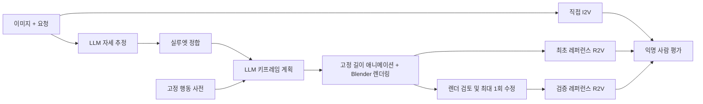

# 졸업논문 중간보고서

**제목(가제): 행동 사전 기반 LLM 모션 추론과 검증된 레퍼런스를 이용한 영상 생성의 행동 정확도 평가**

- 작성일: 2026-10-29 (dev-005 실행 결과까지 반영)
- 진행 단계:
  - 완료: 벤치마크 초판 구축, 레퍼런스 생성 파이프라인 개발판 구현, 평가 도구 구현
  - 미착수: 최종 영상(I2V/R2V) 생성, 사람 평가
- 적용 범위: 본 보고서의 실험 수치는 모두 development 분할 8문항을 문항당 1회 실행한 결과이다. 개발 과정의 기록이며 성능 주장의 근거로 사용하지 않는다.

## 요약

본 연구는 이미지와 자연어 요청으로 영상을 생성할 때 요청된 행동, 좌우 구분, 동작 순서, 초기 자세가 보존되는지를 평가한다.

**제안 방법:**
- LLM이 행동 사전을 참조하여 키프레임 계획을 수립한다.
- 계획을 마네킹 레퍼런스 영상으로 렌더링하여 최종 영상 모델(R2V)에 입력한다.
- 동일 입력에 대해 다음 세 조건을 비교한다.
  - A: 직접 I2V
  - B: 검증을 거치지 않은 레퍼런스
  - C: 검증 및 1회 수정을 거친 레퍼런스

**진행 현황:**
- 24문항 규모의 벤치마크와 실행 기록·채점 도구를 구축하였다.
- LLM 계획기, 레퍼런스 렌더러, 초기 자세 실루엣 정합, 조건 C 검증 게이트를 구현하였다.
- development 분할에서 파이프라인을 다섯 차례 실행하였다(dev-001~005).

**주요 관찰:**
1. **실루엣 정합으로 초기 자세 오차가 감소하였다.** 평균 관절 오차가 0.113 m에서 0.068–0.077 m로 줄었고, LLM이 반대로 추정한 기울기 방향(D08)도 교정되었다.
2. **LLM 자기 수정은 결과를 악화시켰다.** 이에 따라 수정 단계를 수치 탐색으로 대체하였다.
3. **자동 게이트의 판정은 불안정하였다.** 반복 횟수와 같은 세밀한 요구에서 판정 규칙 변경 시 11건 중 8건, 동일 규칙 재실행 시 11건 중 2건의 판정이 달라졌다.
4. **레퍼런스의 모호성을 제거하자 판정 불일치가 해소되었다.** 계획 규칙을 개정한 결과, 8건 모두 요청된 왕복 수와 수치상 일치하였다.

**미확보 결과:** 최종 영상과 사람 평가가 확보되지 않아 연구 질문에 대한 답은 아직 도출되지 않았다.

## 1. 연구 배경 및 문제 정의

본 연구는 이미지와 요청 문장으로 영상을 생성할 때 요청된 행동, 좌우 구분, 동작 순서, 초기 자세가 보존되는지를 평가한다.

**제안 접근:**
- LLM이 행동 사전의 키프레임을 검색·변형·조합하여 레퍼런스 영상을 생성하고, 이를 최종 영상 생성 모델에 조건으로 제공한다.
- 핵심 과제는 두 가지 추론이다.
  - 사전에 존재하지 않는 행동의 추론
  - T-pose나 선 자세가 아닌 초기 상태의 추론

레퍼런스는 추가 정보인 동시에 추가 실패 경로이다. 잘못된 레퍼런스는 최종 생성에 잘못된 제약으로 작용할 수 있다. 따라서 중간 단계를 추가했다는 사실만으로 성능 향상을 가정하지 않는다.

## 2. 연구 질문

1. LLM 레퍼런스 조건은 직접 I2V 대비 명시적 행동 요구의 충족률을 높이는가?
2. 레퍼런스 검증·수정 단계는 최초 레퍼런스의 오류와 최종 실패를 줄이는가?
3. 그 효과는 사전 내·조합·사전 외 행동, 그리고 비표준 초기 자세에 따라 어떻게 달라지는가?
4. 개선이 확인될 경우, 그 개선은 추가 비용·지연·중단율과 어떠한 관계를 가지는가?

## 3. 제안 구조

**단계별 역할:**
- LLM: 초기 자세, 행동 단계, 키프레임을 제안한다.
- 수치 계산 단계: 자세 정합과 뼈 길이 고정 애니메이션을 LLM 없이 계산한다.

**실패 위치 기록:**
- 각 단계의 실패는 단계별로 구분하여 기록한다(initial_pose, planning, retargeting, reference_review).
- 이를 통해 최종 영상만으로 실패 원인을 추정하는 것을 방지한다.
- 단계별 명령과 정보 경계는 [PIPELINE.md](PIPELINE.md)에 정리하였다.

## 4. 벤치마크 및 실험 규칙

### 4.1 문항 구성

| 분할 | 문항 수 | 용도 |
|---|---:|---|
| development | 8 | 구현 및 수정. 실패 사례를 근거로 한 수정을 허용함 |
| calibration | 4 | 평가자 훈련 및 검증기 보정 |
| test | 12 | 동결된 파이프라인의 평가. 결과 확인 후 동일 버전의 수정을 금지함 |

- test 분할은 사전 관계 3종(사전 내·조합·사전 외)과 초기 자세 4종(서기·앉기·기울기·웅크리기)의 각 조합에 1문항씩 배정하였다.
- 입력 이미지는 외부 캐릭터 자산 없이 Blender 기본 도형으로 생성한 절차적 마네킹이다.
- 요구 단위의 평가 계약과 평가용 관절 정답은 생성 측에 제공하지 않는다.

### 4.2 실험 조건 및 운영 규칙

| 조건 | 내용 |
|---|---|
| A | 이미지 + 요청 → 직접 I2V |
| B | 동일 이미지·요청 + 최초 LLM 레퍼런스 → R2V |
| C | B와 **동일한** 최초 레퍼런스 → 검토, 최대 1회 수정, 재검토 → R2V. 재검토 실패 시 `blocked`로 처리 |

- **최초 레퍼런스 공유**: 동일 반복 내에서 B와 C는 최초 레퍼런스를 공유한다. 따라서 두 조건의 차이는 검증 단계의 효과로 해석할 수 있다.
- **실행 기록 관리**:
  - 실행 기록(ledger)은 추가만 허용한다.
  - 미실행 슬롯은 0점이 아닌 `null`로 유지한다.
  - 재생성 및 최선 결과 선별은 허용하지 않는다.
- **동결 절차**: test 실행 전 코드·프롬프트·모델·비용 상한의 지문을 동결한다(`freeze-pipeline`). 동결되지 않은 상태에서는 test 분할의 계획·게이트·생성 명령이 거부된다.
- **실행 규모**:
  - 기능 시험: development 8문항 × 3조건 × 1회 = 24슬롯
  - 본 평가: test 12문항 × 3조건 × 3회 = 108슬롯

## 5. 연구 진행 경과

### 5.1 선행 작업: 로컬 모션 재생 기반 및 수정 기준선 구축

**오류 경로 추적:**
- 기존 프로젝트의 리그와 KIT 동작 자료[13, 14]를 기반으로 착수하였다.
- 초기에는 회전 변화량 지표를 개선하였으나, 실제 화면에서는 팔이 뒤로 처지는 오류가 잔존하였다. 이는 수치상 실행 성공을 행동 정확도와 동일시한 검증상의 결함이었다.
- 원본 C3D 마커, MMM 골격 복원[15], 로컬 21관절 입력, 최종 리그를 단계별로 대조하였다.
- 세 건의 촬영에서는 "팔을 하부 경추의 자식으로 두고 일괄 회전한다"는 가정이 로컬 입력의 팔 방향을 평균 0.00004° 이하의 오차로 재현하였다. 이는 오류 경로를 재현한 근거일 뿐이며, 원본 변환 코드를 확인했다는 의미는 아니다.

**수정 기준선:**
- 원본 마커로 근사 관절을 재구성하여 오른손 흔들기, 왼손 흔들기, 스쿼트, 순차 연결 1건을 제작하였다.
- 해당 경로의 시험 14건을 통과하였다.
- 이 결과는 **세 동작에 대한 재생 기준선**에 해당한다.
- 원본 모션 및 캐릭터 자료는 저장소에 포함하지 않았다([PROVENANCE.md](PROVENANCE.md)).

### 5.2 LLM 계획기 구현 및 초기 실험 (dev-001)

**호출 경로:**
- **경로 A**: Claude 구독의 헤드리스 CLI(`claude -p`; 도구 비활성화, JSON 스키마 출력)
- **경로 B**: 공식 SDK 기반 API 키 경로. 구현은 완료하였으나 실제 호출은 검증하지 않았다.
- **모델**: 비용 절감을 위해 sonnet을 기본 모델로 채택하였다.

**dev-001 결과 (8건, 각 1회):**
- 8건 모두 구조 검사를 통과하였으며, 계획상 사용 손과 동작 순서도 요청과 일치하였다.
- 평가 정답과의 개발 측 비교에서 **D08(기울기)의 기울기 방향이 반대로 추정되었다**(정답: 좌측 18°, 추정: 우측 12°).
- 손을 허리에 닿게 하기 위해 위팔 길이가 약 25% 늘어났다.
- 구조 검사 통과가 계획의 정확성을 보장하지 않음을 보여 주는 사례이다([결과](../results/dev-001-planner/README.md)).

### 5.3 레퍼런스 렌더러 구현

계획의 키프레임을 프레임별 골격으로 변환하고, 입력 이미지와 동일한 마네킹·카메라·조명으로 렌더링한다(576×768, 24 fps). 적용한 애니메이션 기법은 6장에 정리하였다.

**보간 방식 변경:** 초기에 적용한 관절 위치 선형 보간은 팔을 드는 도중 팔꿈치가 측방으로 꺾이는 자세를 생성하였다. 이에 따라 뼈 방향 보간으로 변경하였다.

**뼈 길이 고정:**
- 뼈 길이는 첫 키프레임을 기준으로 고정한다.
- 계획상 팔 길이가 늘어난 D08에서는 손이 허리로부터 약 7 cm 떨어진 상태로 렌더링되며, 이 차이는 키프레임 오차로 기록된다.

**초기 자세 오류의 전파:** D08의 렌더 첫 프레임이 입력과 반대 방향으로 기운 상태로 출력되었다. 이로써 계획 단계의 오류가 실제 출력까지 전파됨을 확인하였다([결과](../results/dev-001-reference/README.md)).

### 5.4 초기 자세 실루엣 정합

**방법 (분석-합성 방식):**
1. LLM이 추정한 자세에 변화를 준 후보 자세들을 입력과 동일한 조건으로 렌더링한다.
2. 입력 이미지와의 실루엣 IoU 및 피부(얼굴·손) IoU의 평균을 점수로 사용한다[22].
3. 좌표별 패턴 탐색[21]으로 점수를 최대화한다. 탐색은 몸 전체 → 팔 → 전체의 단계로 나누며, 단위 이동과 2단위 이동을 함께 시도한다.
4. 단일 시점에서는 깊이를 관측할 수 없으므로, 전후 방향 변화에는 2배의 벌점을 부과한다.

**결과 (dev-001 계획에 사후 적용):**
- 평균 관절 오차가 0.113 m에서 0.074 m로 감소하였다.
- D08의 기울기 방향이 교정되었다.
- 벌점을 적용하지 않은 경우 겹침은 증가하였으나, 팔이 전후로 과도하게 회전하여 3차원 오차가 증가하였다(D03·D04 최대 오차 0.6 m 이상).

**기각한 방법:**
- LLM에게 입력, 렌더 결과, 차이 영상을 제시하고 자세를 스스로 수정하도록 하였다.
- 2회 시도 모두 겹침이 감소하고 기울기 오차가 확대되었다.
- 외부 신호가 없는 자기 수정의 한계에 관한 선행 보고[23]와 일치하는 관찰이다. 다만 시행 횟수가 2회에 불과하므로 일반화하지 않는다.

**dev-002 (결함 기록):**
- 리팩터링 과정의 문자열 치환 오류로 자세 추정 프롬프트에서 좌표계 설명이 누락되었고, 그 결과 y축을 상방으로 사용한 자세가 출력되었다.
- 해당 실행은 중단하고 기록으로 보존하였다.
- 재발 방지 조치는 다음과 같다.
  - 정답 없이 적용 가능한 좌표 관례 검사 도입
  - 정합 점수 하한(0.5) 설정. 미달 시 `initial_pose` 실패로 기록
  - 회귀 시험 추가

**dev-003 (파이프라인 통합 실행):** 자세 추정 → 정합 → 계획(정합 자세 고정)의 순서로 처음부터 실행하였다.

| 지표 | dev-001 | dev-003 | dev-004 | dev-005 |
|---|---|---|---|---|
| 평균 관절 오차 | 0.113 m | **0.068 m** | 0.077 m | 0.068 m |
| 최대 관절 오차의 평균 | 0.250 m | **0.142 m** | 0.183 m | 0.158 m |
| D08 좌우 기울기 (정답 +18°) | −12° | +14° | +7° | +6° |

- **D08 기울기**: 방향은 매 실행 정확하나, 각도는 실행 간 편차가 크고 과소 추정되는 경향을 보인다. 자세 추정 출발점의 변동과 국소 최적해가 원인으로 판단된다.
- **첫 프레임 일치도(0.46 → 0.82)**: 정합 과정이 직접 최대화하는 값이므로 독립적 근거로 볼 수 없다. 독립적 근거는 평가 정답과의 관절 오차이다.

### 5.5 조건 C 검증 게이트와 검증기 개정 경과

**검토 방식:**
- 검토자(LLM)는 계획 JSON이 아닌 **렌더링된 프레임**을 근거로 요구별 판정을 내린다.
- 입력 카메라 시점과 정면 정사영 시점을 함께 사용한다.
- 검토자는 평가 계약에 접근하지 않는다.

본 단계에서 가장 많은 설계 수정이 이루어졌으며, 그 경과는 다음과 같다.

| 버전 | 변경 사항 | 확인된 문제 |
|---|---|---|
| v1 | 8장 격자 이미지만 제공 | 흔들기 왕복 수 판별 불가 → uncertain → blocked |
| v2 | 렌더 골격에서 측정한 동작 요약(손목 좌우 전환점, 어깨 위 구간, 정지 구간) 추가 | 팔을 올리고 내리는 과정의 좌우 이동을 흔들기로 계수함 |
| v3 | 전환점별 거상(擧上) 여부 표시, 왕복 = (전환점 수 − 1)/2 | 산식이 손의 출발 위치를 반영하지 못하여 오판 발생 |
| v4 | 거상한 손의 좌우 위치 시계열(cm)과 채점 기준(RUBRIC)의 왕복 정의 제공 | 아래 재검토 결과 참조 |

**dev-004 (v3, 일관 실행):**
- 통과 6건, blocked 2건(D01, D05)으로 판정되었다.
- 그러나 시계열을 재확인한 결과 D01은 요청대로 2왕복을 수행하였다. 따라서 v3의 blocked 판정은 산식에 기인한 오판일 가능성이 높다.
- 이에 따라 "LLM 계획이 반복 횟수를 빈번히 틀린다"는 초기 결론을 **철회하였다**([결과](../results/dev-004/README.md)).

**v4 오프라인 재검토 (dev-004 렌더 11건):**
- 판정 규칙을 v3에서 v4로 변경하자 11건 중 8건의 판정이 바뀌었다.
- 동일한 v4로 재실행했을 때의 일치율은 9/11에 그쳤다.
- 일어서기, 머리 위 유지, 허리에 손 얹기와 같은 개략적 요구는 모든 버전에서 안정적으로 판정되었다.
- **반복 횟수와 같은 세밀한 요구는 단일 자동 게이트로 판정하기 어렵다.** LLM 평가자의 일관성 한계에 관한 선행 보고[24]와 같은 방향의 관찰이다.

**dev-005 (계획 규칙 6 및 v4 적용):**
- 판정 불일치의 원인 중 하나는 레퍼런스 자체의 모호성이었다. 마지막 흔들기 이후의 "중앙 복귀" 동작이 반 왕복으로 해석될 여지가 있었다.
- 이에 "반복 동작은 두 극점 사이를 왕복하며, 마지막 왕복 이후 복귀 동작을 삽입하지 않는다"는 계획 규칙을 추가하였다.
- 그 결과 8건 모두 최초 레퍼런스로 게이트를 통과하였고, 손의 좌우 궤적이 요청된 왕복 수와 수치상 일치하였다. 예를 들어 D01의 궤적은 25 → −9 → 24 → −9 → 25 cm로 2왕복에 해당한다.
- 다만 이 결과는 레퍼런스 품질의 향상일 수도, 검증기의 관대함일 수도 있다. 두 가능성을 구분하려면 사람 평가가 필요하다([결과](../results/dev-005/README.md)).

### 5.6 평가 및 집계 도구

- **익명 평가 패키지**:
  - 영상 메타데이터를 제거하고 임의 식별자를 부여한다.
  - 조건과의 대응표는 패키지 외부에 별도 보관한다.
  - 평가자는 브라우저 기반 평가 페이지(`rate.html`)에서 판정하고 결과 파일을 저장한다.
- **평가 합의**: 평가자 2인이 독립적으로 판정한다. 불일치 항목은 제3자의 조정 전까지 `disputed`로 유지한다.
- **집계**: 주 결과, 부 결과, 실패 위치별 빈도, 사례·행동군 단위 군집 부트스트랩 95% 신뢰구간[16, 17]을 산출한다.
- **검증기-평가자 일치도**: 원 일치율, Cohen's κ[18, 19], 혼동 행렬, 그리고 평가자가 fail로 판정했으나 검증기가 pass로 판정한 누락 실패 건수를 산출한다.

### 5.7 최종 영상 생성 어댑터 (Seedance 2.0)

- **모델 및 엔드포인트**: 최종 영상 모델로 fal.ai를 통한 Seedance 2.0[1, 2]을 채택하였다. 조건 A는 image-to-video, 조건 B·C는 reference-to-video 엔드포인트를 사용한다.
- **조건 간 차이**: R2V에서는 입력 이미지가 시작 프레임으로 강제되지 않는다. 이 차이는 기록하며, 시작 연속성은 부 결과로 별도 평가한다.
- **구현 현황**: 모의 실행(dry run)과 비용 상한 검사만 구현하였고, 실제 호출 경로는 검증하지 않았다.
- **비용 추정** (480p, 토큰 산식 기준 상한): development 24슬롯 약 $18, test 108슬롯 약 $82로 추정된다([SEEDANCE_SETUP.md](SEEDANCE_SETUP.md)).

### 5.8 소요 비용

- 계획 및 검토용 LLM 호출은 모두 구독 경로로 수행하였다.
- 실행 1회당 호출 24–30회, 출력 7만–11만 토큰, 모델 대기 시간 7–11분이 소요되었다.
- 별도의 과금은 발생하지 않았다.

## 6. 적용한 컴퓨터 애니메이션 기법

| 기법 | 적용 위치 | 내용 |
|---|---|---|
| 골격 리그 및 순기구학(FK) | 렌더러 | 15관절 골격. 골반을 기점으로 뼈 방향과 고정 길이의 곱을 순차적으로 더하여 관절 위치를 산출함 |
| 키프레임 애니메이션 | 계획 → 렌더러 | LLM은 시간별 키프레임만 생성하고, 중간 프레임은 보간으로 생성함[5] |
| 단조 3차 Hermite 보간 | 렌더러 | Fritsch–Butland 기울기[3, 4] 적용. 극값에서 기울기가 0이 되어 키프레임 값을 초과하는 오버슈트가 발생하지 않음 |
| 뼈 방향 보간 | 몸통·팔 | 관절 위치 대신 뼈 방향 벡터를 보간한 뒤 정규화함(nlerp 방식). 회전 보간[6]의 단순화 형태로, 팔이 원호를 따라 움직임 |
| 2관절 해석적 역기구학(IK) | 다리 | 고관절–슬관절–족관절을 코사인 법칙으로 해석하며, 무릎 방향은 FK로 구한 무릎 위치를 기준(pole)으로 결정함[7]. 지지발의 미끄러짐을 방지함 |
| 고정 길이 리타기팅 | 렌더러 | 계획이 뼈 길이를 변경하더라도 길이를 고정하고, 도달하지 못한 거리와 키프레임 오차를 기록함[8] |
| 분석-합성 자세 정합 | 초기 자세 | 후보 자세를 렌더링하여 입력과의 실루엣 겹침을 최대화함. 인체 모델 정합 연구[9]의 단순화 형태 |
| 절차적 마네킹 및 비사실적 렌더링 | 입력·레퍼런스 | Blender 기본 도형 마네킹, Workbench 렌더 엔진[10], 입력 카메라 시점 및 정면 정사영 시점 |
| 동작 계측 | 검증 게이트 | 렌더 골격에서 손의 좌우 위치 시계열, 방향 전환점(zigzag), 어깨·머리 위 구간, 정지 구간을 측정함 |

**기법 선정 기준:**
- **오류의 가시화**: LLM 계획의 오류(뼈 길이 변경, 도달 불가능한 목표)를 은폐하지 않고 기록으로 남긴다.
- **재현성 확보**: 표준 라이브러리만으로 계산한다. 학습 기반 모션 모델[11, 12]은 사용하지 않았다.

## 7. 평가 지표

**주 지표:**
- 모든 명시적 요구를 충족한 최종 영상의 비율을 사례별로 산출한 뒤 사례 간 평균을 구한다.
- 실패, 중단, 합의된 불확실 판정은 성공으로 계수하지 않으며 분모에서도 제외하지 않는다.
- 평가자 2인이 독립적으로 판정하고, 불일치는 제3자가 조정한다.

**부 지표:** 외형 보존, 시작 연속성, 시간적 아티팩트, 자연스러움(5점 척도), 레퍼런스 자체의 요구 충족, 비용, 지연, 중단율.
- 부 지표는 단일 가중 점수로 통합하지 않는다.
- 평가 12문항으로는 신뢰구간이 넓으므로 기술 통계로만 제시하며, 우월성 검정에는 사용하지 않는다.

## 8. 결과 확보 현황

| 항목 | 현황 |
|---|---|
| 벤치마크 문항·입력·채점 계약 | 초판 완료 (24문항) |
| LLM 계획·자세 정합·렌더링·C 게이트 | 개발판 구현, development에서 5회 실행 |
| 평가 패키지·집계·일치도 도구 | 구현 완료, 단위 시험 88건 통과 |
| 레퍼런스 사람 평가 (dev-005) | 평가 패키지 준비 완료, 평가 미실시 |
| 최종 영상 (A/B/C) | 0건. Seedance 계정 미준비 |
| 경로 B (API 키) 실제 호출 | 미검증 |
| 제안 방법의 우월성 | 판단 불가 |

## 9. 연구의 한계

- **합성 입력**: 입력이 단순한 합성 마네킹 단일 계열로 한정된다. 실루엣 정합은 카메라 정보를 안다고 가정하므로 실사 이미지에 그대로 적용할 수 없다.
- **깊이 모호성**: 단일 시점 실루엣으로는 전후 깊이를 구분할 수 없다. 벌점으로 완화하였으나 D08의 기울기 각도 과소 추정이 잔존한다.
- **표본 규모**: 평가 셀당 1문항에 불과하여 통계적 검정력을 주장할 수 없다.
- **자동 게이트의 신뢰성**: 세밀한 요구에서 판정이 규칙과 표본에 따라 변동한다. 조건 C의 효과는 게이트의 품질에 직접적으로 의존한다.
- **개발 데이터의 반복 사용**: development 결과를 근거로 여러 차례 수정하였다. 따라서 본 수치는 개발 기록이며 test 성능의 추정치로 간주할 수 없다.

## 10. 향후 계획

1. **dev-005 레퍼런스 사람 평가**: 평가자 2인의 판정 결과를 반영하여 검증기 v4와의 일치도를 산출한다.
2. **calibration 4문항 대조**: 사람 판정과 검증기 판정을 대조하여 게이트를 보정한다.
3. **Seedance 기능 시험**: 계정을 연동하여 development 24슬롯의 기능 시험을 수행하고, 실패 위치를 기록하며 수정한다.
4. **D08 기울기 과소 추정 개선**: development 범위에서만 진행한다. 정합 단계에서 좌우 기울기와 전후 기울기를 분리하는 방안을 검토한다.
5. **동결 및 본 평가**: `freeze-pipeline`으로 파이프라인을 동결한 뒤 test 108슬롯을 실행한다. 레퍼런스 오류나 직접 I2V 대비 열위 결과가 발생하더라도 그대로 보고한다.

## 참고 문헌

**영상 생성 및 모델 접근**

1. Gao, Y. et al. (ByteDance Seed). *Seedance 1.0: Exploring the Boundaries of Video Generation Models.* arXiv:2506.09113, 2025. https://arxiv.org/abs/2506.09113
2. fal.ai. *Seedance 2.0 reference-to-video / image-to-video API.* https://fal.ai/models/bytedance/seedance-2.0/reference-to-video/api (2026년 10월 확인. 가격 및 입력 규격은 실행 전 재확인 필요)

**보간 및 애니메이션**

3. Fritsch, F. N., Butland, J. A method for constructing local monotone piecewise cubic interpolants. *SIAM J. Sci. Stat. Comput.* 5(2):300–304, 1984.
4. Fritsch, F. N., Carlson, R. E. Monotone piecewise cubic interpolation. *SIAM J. Numer. Anal.* 17(2):238–246, 1980.
5. Lasseter, J. Principles of traditional animation applied to 3D computer animation. *SIGGRAPH '87, Computer Graphics* 21(4):35–44, 1987.
6. Shoemake, K. Animating rotation with quaternion curves. *SIGGRAPH '85, Computer Graphics* 19(3):245–254, 1985.
7. Tolani, D., Goswami, A., Badler, N. I. Real-time inverse kinematics techniques for anthropomorphic limbs. *Graphical Models* 62(5):353–388, 2000.
8. Gleicher, M. Retargetting motion to new characters. *SIGGRAPH '98*, 33–42, 1998.
9. Bogo, F. et al. Keep it SMPL: Automatic estimation of 3D human pose and shape from a single image. *ECCV* 2016.
10. Blender Foundation. *Blender Manual: Workbench render engine* (Blender 4.2 LTS). https://docs.blender.org/manual/en/4.2/render/workbench/index.html

**관련 생성 연구**

11. Tevet, G. et al. Human Motion Diffusion Model. *ICLR* 2023.
12. Hu, L. et al. Animate Anyone: Consistent and controllable image-to-video synthesis for character animation. *CVPR* 2024, 8153–8163.

**모션 데이터 및 골격**

13. Plappert, M., Mandery, C., Asfour, T. The KIT Motion-Language Dataset. *Big Data* 4(4):236–252, 2016.
14. Guo, C. et al. Generating diverse and natural 3D human motions from text (HumanML3D). *CVPR* 2022.
15. Terlemez, Ö. et al. Master Motor Map (MMM): Framework and toolkit for capturing, representing, and reproducing human motion on humanoid robots. *IEEE-RAS Humanoids* 2014.

**통계 및 평가 방법론**

16. Efron, B., Tibshirani, R. J. *An Introduction to the Bootstrap.* Chapman & Hall, 1993.
17. Field, C. A., Welsh, A. H. Bootstrapping clustered data. *J. R. Stat. Soc. B* 69(3):369–390, 2007.
18. Cohen, J. A coefficient of agreement for nominal scales. *Educ. Psychol. Meas.* 20(1):37–46, 1960.
19. Landis, J. R., Koch, G. G. The measurement of observer agreement for categorical data. *Biometrics* 33(1):159–174, 1977.
20. Nosek, B. A. et al. The preregistration revolution. *PNAS* 115(11):2600–2606, 2018.
21. Hooke, R., Jeeves, T. A. "Direct search" solution of numerical and statistical problems. *J. ACM* 8(2):212–229, 1961.
22. Jaccard, P. The distribution of the flora in the alpine zone. *New Phytologist* 11(2):37–50, 1912.

**LLM의 자기 수정 및 판정**

23. Huang, J. et al. Large language models cannot self-correct reasoning yet. *ICLR* 2024.
24. Zheng, L. et al. Judging LLM-as-a-judge with MT-Bench and Chatbot Arena. *NeurIPS* 2023 Datasets and Benchmarks.
25. Lin, H., Zala, A., Cho, J., Bansal, M. VideoDirectorGPT: Consistent multi-scene video generation via LLM-guided planning. arXiv:2309.15091, 2023.

**도구 문서**

26. Anthropic. *Claude Code headless mode* (`claude -p`). https://code.claude.com/docs/en/headless
27. Anthropic. *Structured outputs.* https://platform.claude.com/docs/en/build-with-claude/structured-outputs

원천 자료의 재현 범위는 [PROVENANCE.md](PROVENANCE.md), 상세 설계는 [PROTOCOL.md](PROTOCOL.md), 채점 기준은 [RUBRIC.md](RUBRIC.md)에 정리하였다. 본 문서는 중간보고 초안으로서, 학과 제출 양식, 지도교수 검토 의견, 최종 실험 결과는 반영되지 않았다.

### 참고 그림

- 초기 자세 정합 전후 비교: [results/dev-001-posefit/before_after.png](../results/dev-001-posefit/before_after.png)
- 입력 이미지와 렌더 첫 프레임 비교 (dev-003): [results/dev-003/first_frame_vs_input.png](../results/dev-003/first_frame_vs_input.png)
- dev-005 흔들기 레퍼런스 정면 격자: [results/dev-005/front_grids_waves.png](../results/dev-005/front_grids_waves.png)
