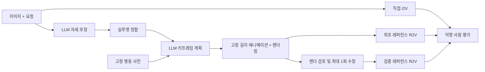

# 졸업논문 중간보고서

**제목(가제): 행동 사전 기반 LLM 모션 추론과 검증된 레퍼런스를 이용한 영상 생성의 행동 정확도 평가**

작성일: 2026-10-29

## 요약

본 연구는 이미지와 자연어 요청으로 영상을 생성할 때 요청된 행동, 좌우 구분, 동작 순서, 초기 자세가 보존되는지를 평가한다.

**제안 방법:** LLM이 행동 사전을 참조하여 키프레임 계획을 수립하고, 이를 마네킹 레퍼런스 영상으로 렌더링하여 최종 영상 모델에 조건으로 제공한다. 이 방법을 직접 I2V 및 검증을 거친 레퍼런스 조건과 비교한다.

**현재까지의 성과:**
- 24문항 규모의 벤치마크를 구축하였다.
- 레퍼런스 생성 파이프라인과 평가 도구를 구현하였다.

**개발용 문항에서 확인한 사항:**
- 실루엣 정합을 통해 초기 자세의 평균 관절 오차가 0.113 m에서 0.068 m로 감소하였다.
- LLM 기반 레퍼런스 검증은 반복 횟수와 같은 세밀한 요구에서 판정이 불안정하였다.

최종 영상 생성과 사람 평가는 향후 수행할 예정이다.

## 1. 연구 배경 및 목적

**배경:**
- 최근 영상 생성 모델은 이미지와 텍스트로부터 고품질 영상을 생성한다[3]. 그러나 요청된 행동의 종류, 좌우, 순서, 횟수를 정확히 따르는지는 별도로 검증되어야 한다.
- 포즈 시퀀스를 조건으로 캐릭터 영상을 생성하는 연구[2]와, LLM이 영상 생성 계획을 수립하는 연구[1]가 제안된 바 있다.
- 학습 기반 텍스트-모션 생성 연구[5]도 있다. 본 연구는 이와 달리 소규모 행동 사전과 LLM 추론을 결합하여 모션 레퍼런스를 구성한다.

**핵심 과제:** 다음 두 가지 추론이다.
- 사전에 존재하지 않는 행동의 추론
- 선 자세가 아닌 초기 상태의 추론

레퍼런스는 추가 정보인 동시에 추가 실패 경로이다. 잘못된 레퍼런스는 최종 생성에 잘못된 제약으로 작용할 수 있으므로, 중간 단계의 추가가 곧 성능 향상이라고 가정하지 않는다.

## 2. 연구 질문

1. LLM 레퍼런스 조건은 직접 I2V 대비 명시적 행동 요구의 충족률을 높이는가?
2. 레퍼런스 검증·수정 단계는 최초 레퍼런스의 오류와 최종 실패를 줄이는가?
3. 그 효과는 사전 내·조합·사전 외 행동 및 비표준 초기 자세에 따라 어떻게 달라지는가?
4. 개선이 확인될 경우, 그 개선은 추가 비용·지연·중단율과 어떠한 관계를 가지는가?

## 3. 제안 방법

**구성 요소의 역할:**
- **LLM**: 초기 자세, 행동 단계, 키프레임을 제안한다.
- **수치 계산 모듈**: 자세 정합과 애니메이션 생성을 담당한다.

각 단계의 실패는 초기 자세, 계획, 리타기팅, 레퍼런스 검토로 구분하여 기록한다. 이를 통해 최종 영상만으로 실패 원인을 추정하는 것을 방지한다.

## 4. 실험 설계

### 4.1 문항 구성

| 분할 | 문항 수 | 용도 |
|---|---:|---|
| 개발용 | 8 | 구현 및 수정 |
| 보정용 | 4 | 평가자 훈련 및 검증기 보정 |
| 평가용 | 12 | 동결된 파이프라인의 최종 평가 |

- **평가용 문항 배치**: 사전 관계 3종(사전 내·조합·사전 외)과 초기 자세 4종(서기·앉기·기울기·웅크리기)의 각 조합에 1문항씩 배정하였다.
- **입력 이미지**: 외부 캐릭터 자산 없이 3D 기본 도형으로 생성한 절차적 마네킹이다.
- **평가 정답**: 요구 단위의 채점 기준과 관절 정답은 생성 과정에 제공하지 않는다.

### 4.2 비교 조건

| 조건 | 내용 |
|---|---|
| A | 이미지 + 요청 → 직접 I2V |
| B | 동일 이미지·요청 + 최초 LLM 레퍼런스 → R2V |
| C | B와 동일한 최초 레퍼런스 → 검토, 최대 1회 수정, 재검토 → R2V (재검토 실패 시 차단) |

**운영 규칙:**
- 동일 반복 내에서 B와 C는 최초 레퍼런스를 공유한다. 따라서 두 조건의 차이는 검증 단계의 효과로 해석할 수 있다.
- 재생성 및 최선 결과 선별은 허용하지 않는다.
- 미실행 결과는 실패로 간주하지 않고 결측으로 처리한다.
- 평가용 문항 실행 전에 코드, 프롬프트, 모델, 비용 상한을 동결한다[6]. 결과 확인 후에는 동일 버전을 수정하지 않는다.

**실행 규모:**
- 기능 시험: 개발용 8문항 × 3조건 × 1회
- 본 평가: 평가용 12문항 × 3조건 × 3회

### 4.3 평가 지표

**주 지표:**
- 모든 명시적 요구를 충족한 최종 영상의 비율을 사례별로 산출한 뒤 사례 간 평균을 구한다.
- 실패, 중단, 합의된 불확실 판정은 성공으로 계수하지 않는다.
- 평가자 2인이 조건을 모르는 상태에서 독립적으로 판정하고, 불일치는 제3자가 조정한다.

**부 지표:**
- 지표: 외형 보존, 시작 연속성, 시간적 아티팩트, 자연스러움(5점 척도), 레퍼런스 자체의 요구 충족, 비용, 지연, 중단율.
- 신뢰구간: 사례·행동군 단위 군집 부트스트랩[7, 8]으로 산출한다.
- 검증기 일치도: 사람 판정과의 일치도를 Cohen's κ[9, 10]로 산출한다.
- 해석 범위: 평가용 문항 수가 적으므로 결과는 기술 통계로 제시하며, 우월성 검정에는 사용하지 않는다.

## 5. 진행 현황

본 장의 수치는 개발용 8문항을 문항당 1회 실행한 결과이다. 개발 과정의 기록이며 성능 평가 결과가 아니다.

### 5.1 선행 작업

**기존 기반의 결함 확인:**
- 기존 리그와 KIT 동작 자료[11, 12]를 기반으로 착수하였다.
- 수치 지표는 개선되었으나 화면상으로는 팔이 뒤로 처지는 오류가 잔존하였다.

**원인 추적:**
- 원본 마커, MMM 골격[13], 로컬 관절 입력, 최종 리그를 단계별로 대조하였다.
- 그 결과 팔의 부모 관절 설정이 잘못된 변환 경로를 재현하였다.

**재생 기준선 구축:** 원본 마커로 관절을 재구성하여 흔들기와 스쿼트 동작의 재생 기준선을 마련하였다.

### 5.2 LLM 계획기

LLM(Anthropic Claude Sonnet 5.5)이 입력 이미지와 요청으로부터 초기 자세와 시간별 키프레임을 구조화된 형식으로 출력하도록 구현하였다.

1차 실행 결과는 다음과 같다.
- 8건 모두 형식 검사를 통과하였고, 사용 손과 동작 순서가 요청과 일치하였다.
- 평가 정답과 비교한 결과, 기울어진 자세의 한 문항(D08)에서 기울기 방향이 반대로 추정되었다(정답: 좌측 18°, 추정: 우측 12°).
- 해당 문항에서는 손을 허리에 닿게 하기 위해 위팔 길이가 약 25% 늘어났다.

이는 형식 검사 통과가 계획의 정확성을 보장하지 않음을 보여 준다.

### 5.3 레퍼런스 렌더러

계획의 키프레임을 프레임별 골격으로 변환하고, 입력 이미지와 동일한 마네킹·카메라·조명으로 렌더링한다(576×768, 24 fps). 적용한 기법은 6장에 정리하였다.

- **보간 방식**: 관절 위치 선형 보간은 팔을 드는 도중 팔꿈치가 측방으로 꺾이는 문제를 보여, 뼈 방향 보간으로 변경하였다.
- **오류 전파 확인**: D08의 렌더 첫 프레임이 입력과 반대 방향으로 기운 상태로 출력되어, 계획 단계의 오류가 최종 출력까지 전파됨을 확인하였다.

### 5.4 초기 자세 실루엣 정합

**방법 (분석-합성 방식):**
1. 후보 렌더링: LLM이 추정한 자세에 변화를 준 후보들을 입력과 동일한 조건으로 렌더링한다.
2. 점수 산출: 입력 이미지와의 실루엣 IoU 및 피부 영역 IoU[14]의 평균을 점수로 사용한다.
3. 최적화: 좌표별 패턴 탐색[15]으로 점수를 최대화한다.
4. 깊이 보정: 단일 시점에서는 깊이를 관측할 수 없으므로 전후 방향 변화에 벌점을 부과한다.

**기각한 방법:** LLM에게 렌더 결과와 입력의 차이를 제시하고 스스로 수정하도록 하였으나, 2회 모두 오차가 확대되었다. 이는 외부 신호가 없는 자기 수정의 한계에 관한 선행 보고[16]와 일치한다.

**결과:**

| 지표 | 1차 실행 (정합 없음) | 2차 실행 | 3차 실행 | 4차 실행 |
|---|---|---|---|---|
| 평균 관절 오차 | 0.113 m | 0.068 m | 0.077 m | 0.068 m |
| 최대 관절 오차의 평균 | 0.250 m | 0.142 m | 0.183 m | 0.158 m |
| D08 좌우 기울기 (정답 +18°) | −12° | +14° | +7° | +6° |

- **오차 감소**: 정합 적용 후 평균 관절 오차가 32–40% 감소하였다.
- **기울기 방향 교정**: D08의 기울기 방향이 교정되었다.
- **잔존 문제**: 기울기 각도는 과소 추정되며 실행 간 편차가 크다.
- **벌점의 필요성**: 벌점이 없으면 실루엣 겹침은 증가하지만 3차원 오차가 오히려 증가하였다.

### 5.5 레퍼런스 검증 게이트

**검토 방식:**
- 검토자(LLM)는 계획이 아닌 렌더링된 프레임을 근거로 요구별 판정을 내린다.
- 입력 카메라 시점과 정면 정사영 시점을 함께 사용한다.

**검증기 개정 경과:** 판정 근거를 다음과 같이 단계적으로 보강하였다.
1. 프레임 격자만 제공: 흔들기 왕복 수를 판별할 수 없었다.
2. 렌더 골격의 동작 계측값 추가: 팔을 올리고 내리는 동작까지 흔들기로 계수하였다.
3. 손을 든 구간만 계수하는 산식 도입: 손의 출발 위치를 반영하지 못하여 오판이 발생하였다.
4. 손의 좌우 위치 시계열과 채점 기준상의 왕복 정의 제공.

**판정 안정성:** 3차 실행의 렌더 11건을 재검토하였다.
- 판정 규칙 변경 시 11건 중 8건의 판정이 바뀌었다.
- 동일 규칙 재실행 시 일치율은 9/11에 그쳤다.
- 일어서기, 머리 위 유지와 같은 개략적 요구는 모든 경우에 안정적이었다.
- 반복 횟수와 같은 세밀한 요구는 단일 자동 판정에 의존하기 어렵다. 이는 LLM 평가자의 일관성 한계에 관한 선행 보고[17]와 같은 방향의 관찰이다.

**레퍼런스 모호성 제거:** 판정 불일치의 원인 중 하나는 레퍼런스 자체의 모호성이었다.
- 원인: 마지막 흔들기 이후의 중앙 복귀 동작이 반 왕복으로 해석될 수 있었다.
- 조치: "반복 동작은 두 극점 사이를 왕복하며 마지막 왕복 이후 복귀 동작을 넣지 않는다"는 계획 규칙을 추가하였다.
- 결과: 4차 실행에서 8건 모두 손의 좌우 궤적이 요청된 왕복 수와 일치하였다. 예를 들어 오른손 2왕복 요청의 궤적은 25 → −9 → 24 → −9 → 25 cm였다.
- 남은 과제: 이 결과가 레퍼런스 품질의 향상인지 검증기의 관대함인지는 사람 평가로 확인해야 한다.

### 5.6 평가 도구

- **익명 평가 패키지**: 영상 메타데이터를 제거하고 임의 식별자를 부여하여, 평가자가 조건을 알 수 없게 하였다.
- **집계 도구**: 주·부 지표, 실패 위치별 빈도, 군집 부트스트랩 신뢰구간, 검증기-평가자 일치도를 산출한다.

### 5.7 최종 영상 생성 모듈

- **모델**: 최종 영상 모델로 Seedance 2.0[3, 4]을 채택하였다.
- **조건별 기능**: 조건 A는 image-to-video, 조건 B·C는 reference-to-video 기능을 사용한다.
- **조건 간 차이**: reference-to-video에서는 입력 이미지가 시작 프레임으로 강제되지 않는다. 따라서 시작 연속성을 부 지표로 별도 평가한다.

## 6. 적용한 컴퓨터 애니메이션 기법

| 기법 | 적용 위치 | 내용 |
|---|---|---|
| 골격 리그 및 순기구학(FK) | 렌더러 | 15관절 골격. 골반을 기점으로 뼈 방향과 고정 길이를 순차적으로 누적하여 관절 위치를 산출함 |
| 키프레임 애니메이션[18] | 계획 → 렌더러 | LLM은 시간별 키프레임만 생성하고, 중간 프레임은 보간으로 생성함 |
| 단조 3차 Hermite 보간 | 렌더러 | Fritsch–Butland 기울기[19, 20] 적용. 키프레임 값을 초과하는 오버슈트가 발생하지 않음 |
| 뼈 방향 보간 | 몸통·팔 | 관절 위치 대신 뼈 방향 벡터를 보간한 뒤 정규화함. 회전 보간[21]의 단순화 형태로, 팔이 원호를 따라 움직임 |
| 2관절 해석적 역기구학(IK) | 다리 | 고관절–슬관절–족관절을 코사인 법칙으로 해석함[22]. 지지발의 미끄러짐을 방지함 |
| 고정 길이 리타기팅[23] | 렌더러 | 계획이 뼈 길이를 변경하더라도 길이를 고정하고, 도달하지 못한 거리를 오차로 기록함 |
| 분석-합성 자세 정합 | 초기 자세 | 후보 자세를 렌더링하여 입력과의 실루엣 겹침을 최대화함. 인체 모델 정합 연구[24]의 단순화 형태 |
| 절차적 마네킹 및 비사실적 렌더링 | 입력·레퍼런스 | Blender 기본 도형 마네킹과 Workbench 렌더 엔진[25] |
| 동작 계측 | 검증 게이트 | 렌더 골격에서 손의 좌우 위치 시계열, 방향 전환점, 거상 구간, 정지 구간을 측정함 |

**기법 선정 기준:** 학습 기반 모션 모델[2, 5]을 사용하지 않고, 다음 두 가지를 우선하였다.
- **오류의 가시화**: LLM 계획의 오류를 은폐하지 않고 측정 가능한 오차로 드러낸다.
- **재현성**: 동일한 입력에 대해 동일한 결과를 얻을 수 있다.

## 7. 결과 확보 현황

| 항목 | 현황 |
|---|---|
| 벤치마크 문항·입력·채점 기준 | 완료 (24문항) |
| 레퍼런스 생성 파이프라인 | 구현 완료, 개발용 문항에서 4회 실행 |
| 평가 및 집계 도구 | 구현 완료 |
| 레퍼런스 사람 평가 | 준비 완료, 미실시 |
| 최종 영상 생성 (A/B/C) | 미실시 |
| 제안 방법의 효과 | 판단 불가 |

## 8. 연구의 한계

- **입력의 범위**: 입력이 합성 마네킹 단일 계열로 한정된다. 실루엣 정합은 카메라 정보를 안다고 가정하므로 실사 이미지에 그대로 적용할 수 없다.
- **깊이 모호성**: 단일 시점 실루엣으로는 전후 깊이를 구분할 수 없어, 기울기 각도의 과소 추정이 잔존한다.
- **표본 규모**: 평가 셀당 1문항에 불과하여 통계적 검정력을 주장할 수 없다.
- **검증의 신뢰성**: 세밀한 요구에서 자동 판정이 불안정하며, 조건 C의 효과는 이 판정 품질에 직접적으로 의존한다.

## 9. 향후 계획

1. **레퍼런스 사람 평가**: 레퍼런스에 대한 사람 평가를 수행하고, 자동 검증기와의 일치도를 산출한다.
2. **검증기 보정**: 보정용 문항에서 사람 판정과 검증기 판정을 대조하여 검증기를 보정한다.
3. **기능 시험**: 개발용 문항에서 세 조건의 최종 영상을 생성하여 기능 시험을 수행한다.
4. **정합 개선**: 실루엣 정합에서 좌우 기울기와 전후 기울기를 분리하여 각도 추정을 개선한다.
5. **본 평가**: 파이프라인을 동결한 뒤 평가용 문항에서 본 평가를 수행하고, 부정적 결과를 포함하여 보고한다.

## 참고 문헌

1. Lin, H., Zala, A., Cho, J., Bansal, M. VideoDirectorGPT: Consistent multi-scene video generation via LLM-guided planning. arXiv:2309.15091, 2023.
2. Hu, L. et al. Animate Anyone: Consistent and controllable image-to-video synthesis for character animation. *CVPR* 2024, 8153–8163.
3. Gao, Y. et al. Seedance 1.0: Exploring the boundaries of video generation models. arXiv:2506.09113, 2025.
4. fal.ai. Seedance 2.0 API documentation. https://fal.ai/models/bytedance/seedance-2.0/reference-to-video/api
5. Tevet, G. et al. Human motion diffusion model. *ICLR* 2023.
6. Nosek, B. A. et al. The preregistration revolution. *PNAS* 115(11):2600–2606, 2018.
7. Efron, B., Tibshirani, R. J. *An Introduction to the Bootstrap.* Chapman & Hall, 1993.
8. Field, C. A., Welsh, A. H. Bootstrapping clustered data. *J. R. Stat. Soc. B* 69(3):369–390, 2007.
9. Cohen, J. A coefficient of agreement for nominal scales. *Educ. Psychol. Meas.* 20(1):37–46, 1960.
10. Landis, J. R., Koch, G. G. The measurement of observer agreement for categorical data. *Biometrics* 33(1):159–174, 1977.
11. Plappert, M., Mandery, C., Asfour, T. The KIT Motion-Language Dataset. *Big Data* 4(4):236–252, 2016.
12. Guo, C. et al. Generating diverse and natural 3D human motions from text. *CVPR* 2022.
13. Terlemez, Ö. et al. Master Motor Map (MMM): Framework and toolkit for capturing, representing, and reproducing human motion on humanoid robots. *IEEE-RAS Humanoids* 2014.
14. Jaccard, P. The distribution of the flora in the alpine zone. *New Phytologist* 11(2):37–50, 1912.
15. Hooke, R., Jeeves, T. A. "Direct search" solution of numerical and statistical problems. *J. ACM* 8(2):212–229, 1961.
16. Huang, J. et al. Large language models cannot self-correct reasoning yet. *ICLR* 2024.
17. Zheng, L. et al. Judging LLM-as-a-judge with MT-Bench and Chatbot Arena. *NeurIPS* 2023 Datasets and Benchmarks.
18. Lasseter, J. Principles of traditional animation applied to 3D computer animation. *Computer Graphics (SIGGRAPH '87)* 21(4):35–44, 1987.
19. Fritsch, F. N., Butland, J. A method for constructing local monotone piecewise cubic interpolants. *SIAM J. Sci. Stat. Comput.* 5(2):300–304, 1984.
20. Fritsch, F. N., Carlson, R. E. Monotone piecewise cubic interpolation. *SIAM J. Numer. Anal.* 17(2):238–246, 1980.
21. Shoemake, K. Animating rotation with quaternion curves. *Computer Graphics (SIGGRAPH '85)* 19(3):245–254, 1985.
22. Tolani, D., Goswami, A., Badler, N. I. Real-time inverse kinematics techniques for anthropomorphic limbs. *Graphical Models* 62(5):353–388, 2000.
23. Gleicher, M. Retargetting motion to new characters. *Proc. SIGGRAPH '98*, 33–42, 1998.
24. Bogo, F. et al. Keep it SMPL: Automatic estimation of 3D human pose and shape from a single image. *ECCV* 2016.
25. Blender Foundation. Blender Manual: Workbench render engine. https://docs.blender.org/manual/en/4.2/render/workbench/index.html
