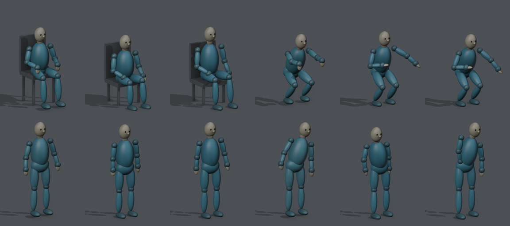
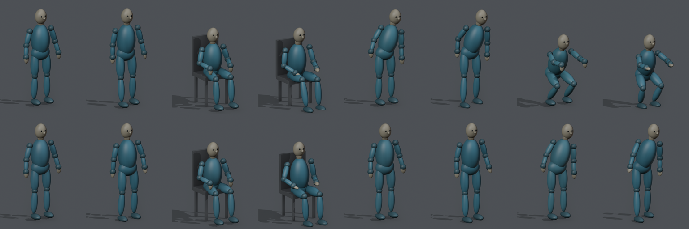
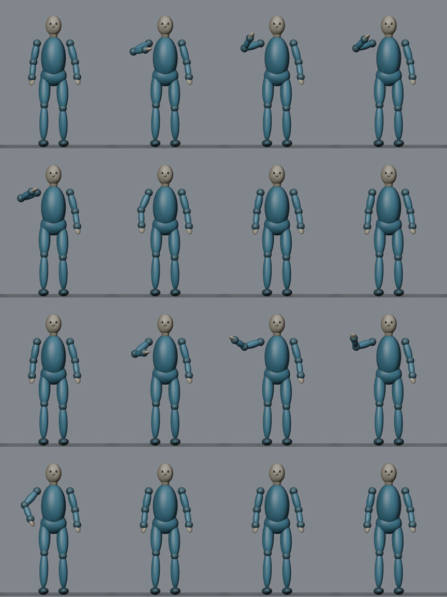
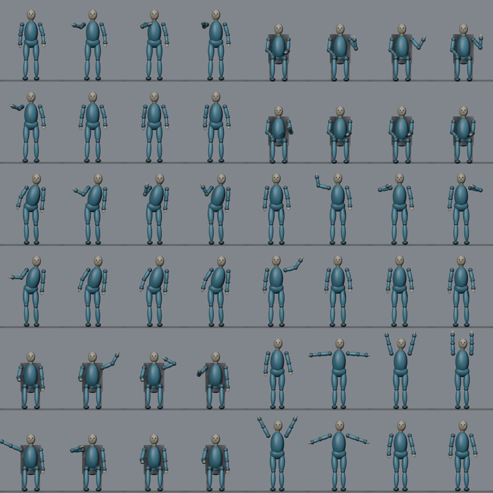
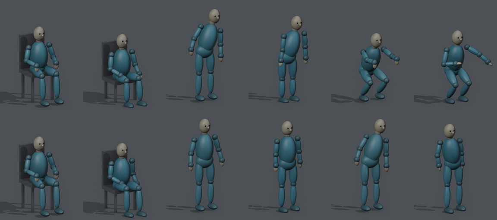

# 개발 실행 결과

이 문서는 개발용 8문항(D01–D08)을 문항당 1회 실행한 결과를 정리한 것이다. 개발 과정의 기록이며 성능 평가 결과가 아니다.

**실행 조건과 현황:**
- 계획 및 검토 모델: Anthropic Claude Sonnet 5.5
- 렌더링: Blender 4.2 Workbench, 576×768, 24 fps
- 최종 영상 생성과 사람 평가: 미실시
- 레퍼런스 영상(MP4)과 사례별 원시 기록: 저장소에 포함하지 않았다.

## 문항

| 문항 | 초기 자세 | 사전 관계 | 요청 |
|---|---|---|---|
| D01 | 서기 | 사전 내 | 오른손 2왕복 흔들기 |
| D02 | 앉기 | 사전 내 | 왼손 1왕복 흔들기 |
| D03 | 기울기 | 사전 내 | 기울인 채 오른손 1왕복 흔들기 |
| D04 | 웅크리기 | 사전 내 | 일어서기 |
| D05 | 서기 | 조합 | 오른손 1왕복 → 왼손 1왕복 |
| D06 | 앉기 | 조합 | 왼손 1왕복 → 오른손 1왕복 |
| D07 | 서기 | 사전 외 | 양팔을 머리 위로 올려 1초 유지 |
| D08 | 기울기 | 사전 외 | 몸통을 세운 뒤 양손을 허리에 얹기 |

## 실행 경과

| 실행 | 구성 | 주요 결과 |
|---|---|---|
| 1차 | LLM 계획 → 렌더링 (자세 정합 없음) | 8건 모두 형식 검사 통과. D08의 기울기 방향이 반대로 추정됨 |
| 1차 사후 분석 | 1차 계획의 초기 자세에 실루엣 정합 적용 | 평균 관절 오차 0.113 → 0.074 m, D08 방향 교정 |
| 2차 | LLM 자세 추정 → 실루엣 정합 → 계획 → 렌더링 → 검증 | 평균 관절 오차 0.068 m. 검증기 개정이 실행 중에 이루어져 게이트 결과는 집계에서 제외 |
| 3차 | 2차와 동일 구성, 동일 코드로 일괄 실행 | 게이트 통과 6건, 차단 2건. 재검토 시 판정이 규칙과 표본에 따라 변동 |
| 4차 | 반복 동작 계획 규칙 추가, 검증기에 손 위치 시계열 제공 | 8건 모두 최초 레퍼런스로 통과. 흔들기 궤적이 요청된 왕복 수와 일치 |

## 초기 자세 정확도

평가 정답과의 관절 오차는 개발 측 분석에서만 산출하며, 이 값은 생성 과정에 제공하지 않는다.

| 지표 | 1차 | 2차 | 3차 | 4차 |
|---|---|---|---|---|
| 평균 관절 오차 | 0.113 m | 0.068 m | 0.077 m | 0.068 m |
| 최대 관절 오차의 평균 | 0.250 m | 0.142 m | 0.183 m | 0.158 m |
| D08 좌우 기울기 (정답 +18°) | −12° | +14° | +7° | +6° |

*그림 1. 실루엣 정합 전후 비교. 각 세 장 묶음은 입력, 정합 전, 정합 후 순서이다. 위 줄은 D02·D04, 아래 줄은 D07·D08이다.*

*그림 2. 2차 실행의 입력 이미지와 렌더 첫 프레임 비교. 각 쌍은 입력, 첫 프레임 순서이다. 위 줄은 D01–D04, 아래 줄은 D05–D08이다.*

## 레퍼런스 검증

**3차 실행 재검토:** 렌더 11건(최초 8건, 수정본 3건)을 재검토한 결과는 다음과 같다.
- 판정 규칙을 개정하자 8건의 판정이 바뀌었다.
- 같은 규칙으로 다시 실행했을 때 일치는 9건이었다.
- 일어서기(D04), 머리 위 유지(D07), 허리에 손 얹기(D08)는 모든 경우에 통과로 판정되었다.

*그림 3. 3차 실행 D01의 정면 시점 8프레임. 위 두 줄은 최초 레퍼런스, 아래 두 줄은 수정본이다.*

**4차 실행:** 흔들기 문항에서 거상한 손의 좌우 위치를 약 0.17초 간격으로 기록하였다(단위 cm, + 는 바깥쪽).

| 문항 | 손의 좌우 위치 궤적 | 요청 |
|---|---|---|
| D01 | 25 → −9 → 24 → −9 → 25 | 2왕복 |
| D02 | 6 → 35 → 10 | 1왕복 |
| D03 | 33 → 3 → 33 | 1왕복 |
| D05 | 오른손 7 → 43 → 5, 왼손 8 → 44 → 10 | 각 1왕복 |
| D06 | 왼손 28 → 48 → 4, 오른손 16 → 49 → 4 | 각 1왕복 |

*그림 4. 4차 실행 흔들기 문항의 정면 시점 프레임. 두 칸씩 D01·D02, D03·D05, D06·D07 순서이다.*

*그림 5. 1차 실행(자세 정합 없음)의 입력 이미지와 렌더 첫 프레임 비교.*
