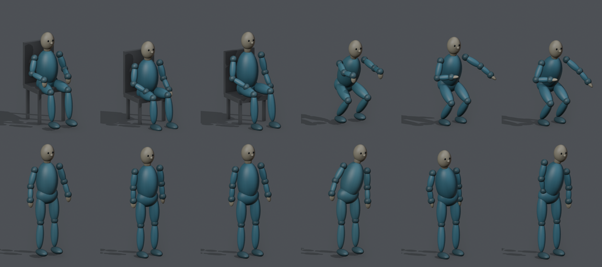
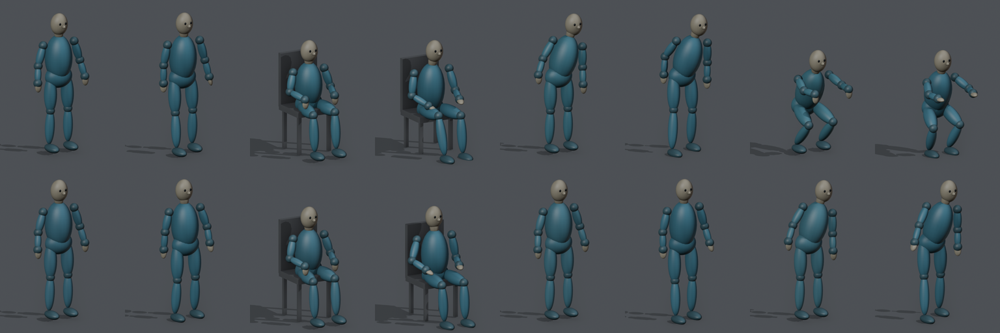
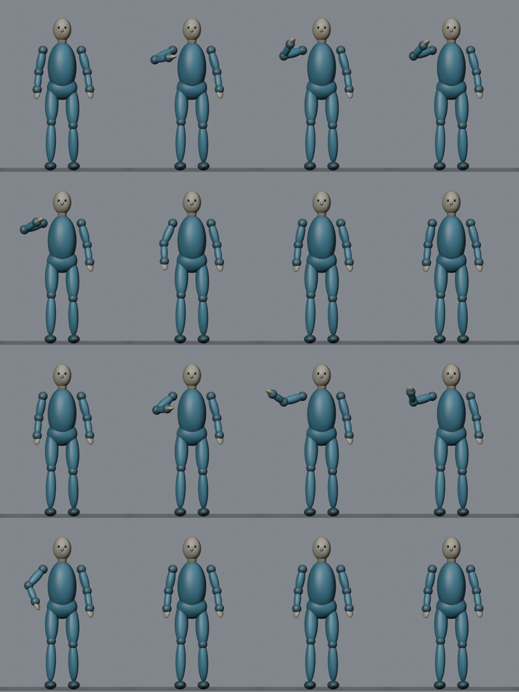
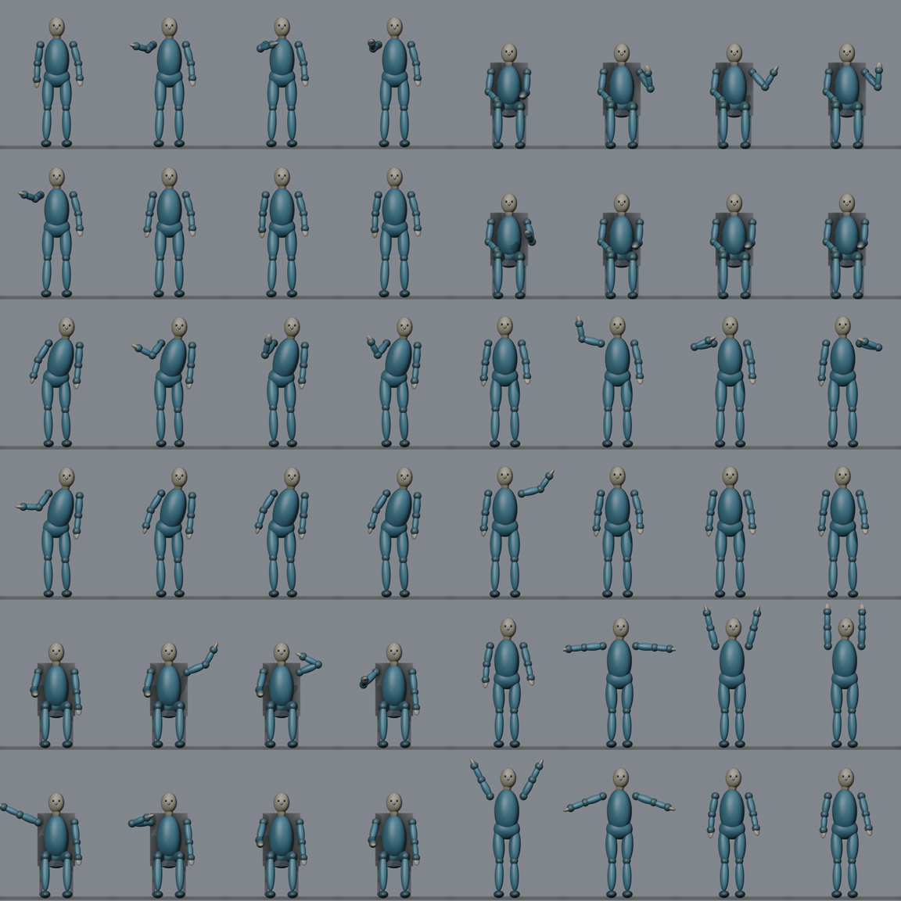
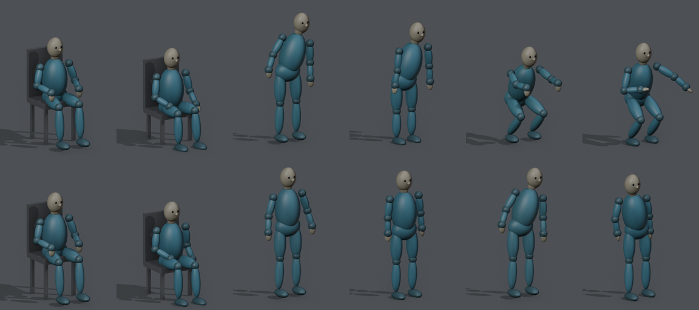

# 실행 결과

이 문서는 벤치마크 v0.2의 실행 결과와, 그 이전 v0.1 마네킹 입력으로 수행한 예비 실험 결과를 정리한 것이다. 본 평가(test-001)의 최종 영상 36개는 평가자 1인(연구자)이 판정하였다. 사례가 12건이므로 신뢰구간이 넓고, 아래 수치는 조건 간 우열의 검정이 아니다.

**공통 실행 조건:**
- 계획 및 검토 모델: Anthropic Claude Sonnet 5.5 (Claude 구독의 CLI 경유)
- 레퍼런스 렌더링: Blender 4.2 Workbench, 576×768, 24 fps
- 최종 영상: ByteDance Seedance 2.0 (fal.ai), 480p, 3:4, 6초, 오디오 없음
- 영상, 레퍼런스, 사례별 원시 기록(`runs/`)은 저장소에 포함하지 않았다.

## v0.2 실행

v0.2 입력은 AI로 생성한 가상 인물의 캐릭터 그림체 이미지 8장(개발 D1–D4, 평가 T1–T4)과 일상적인 요청 20개(개발 8, 평가 12)이다. 실사풍 이미지는 Seedance가 실존 인물의 모습일 수 있다는 콘텐츠 정책으로 거부하여(HTTP 422 `content_policy_violation`) 같은 인물·자세·시점·구도의 캐릭터 그림체로 바꾸었다. 레퍼런스 마네킹은 LLM이 이미지에서 판단한 체형(키, 연령대, 체격)으로 만들고, 판단한 시점과 화면 구도로 렌더링한다. 검증기는 v6이다.

### 개발 실행 dev-009 (기능 시험)

레퍼런스 검증 결과(검증기 판정, 사람 확인 없음):

| 문항 | 이미지 | 요청 | 게이트 결과 |
|---|---|---|---|
| D01 | D1 | 만세 해 | 통과 |
| D02 | D1 | 기지개 켜 | 통과 |
| D03 | D2 | 브이 해 | 차단 (재검토 판단 불가) |
| D04 | D2 | 하품해 | 차단 (재검토 판단 불가) |
| D05 | D3 | 춤 춰 | 통과 (1회 수정 후) |
| D06 | D3 | 돌아봐 | 통과 |
| D07 | D4 | 만세 해 | 통과 |
| D08 | D4 | 브이 해 | 차단 (재검토 판단 불가) |

- 차단 3건은 마네킹에 손가락과 입이 없어 브이 사인과 하품을 레퍼런스로 표현하지 못한 경우이다. 생성을 단계로 나누면서 새로 생기는 실패 유형이다.
- 기능 시험으로 D01–D03의 세 조건(9개 시도)을 실행하여, 차단된 D03 조건 C를 뺀 최종 영상 8개를 생성하였다. 추정 비용은 5.53달러이다.
- 관찰(평가 아님): D01 "만세 해"에서 조건 A 영상은 한 팔만 들었고, 조건 B 영상은 두 팔을 들었으며, B와 같은 레퍼런스를 쓴 조건 C 영상은 한 팔만 들었다.
- LLM 체형 판단 오류: 아동 D2를 청소년·큰 체격(1.6 m)으로, 아동 D4를 청소년으로 판단하였다.
- 첫 개발 실행 dev-006(실사풍 입력, 검증기 v5)에서는 "돌아봐" 레퍼런스의 머리가 계속 카메라를 향해 판단 불가였다. 이후 머리가 어깨 방향을 따라 회전하도록 렌더러를 고쳤고, dev-009에서는 통과하였다.

### 평가 실행 test-001 (본 평가)

- **동결**: 실행 전에 코드·프롬프트(계획·검증·영상 프롬프트 포함)의 SHA-256 지문, 플래너(sonnet), 480p, 비용 상한 42달러를 `run.json`에 기록하였다.
- **레퍼런스 게이트**: 12건 모두 통과하였다. T06(박수)과 T11(점프)은 1회 수정 후 통과하였고, 나머지 10건은 최초 레퍼런스로 통과하였다. 이 10건은 조건 B와 C가 같은 레퍼런스를 쓰므로, 두 조건의 차이는 생성 변동이다.
- **최종 영상**: 12문항 × 3조건(A 직접 I2V, B LLM 레퍼런스 R2V, C 검증 레퍼런스 R2V) = 36개를 모두 생성하였다. 추정 비용은 25.09달러, 영상 1개의 생성 지연은 132–355초이다.
- **체형·시점 판단**: 같은 이미지에서도 요청마다 판단이 달랐다(예: 아동 T1을 세 요청 중 두 번은 청소년으로 판단). T11의 첫 프레임 방향이 입력과 반대였던 것처럼, T4의 시점 방향 판단이 정의와 어긋났을 가능성이 있다.
- **사람 평가**: 평가자 1인이 조건을 숨긴 익명 패키지로 36개 영상을 모두 판정하였다. 판단 불가는 0점으로 센다. 원본 판정은 `runs/test-001/ledger.json`의 `review`, 집계는 `summary.json`에 있다(저장소 미포함).

**요청한 행동의 수행 (R1·S1, 조건별 12건)**

| 조건 | 통과 | 판단 불가 | 실패 | 사례 평균 | 사례 부트스트랩 95% CI |
|---|---:|---|---:|---:|---|
| A 직접 I2V | 11 | 1 (T09 뒤돌아) | 0 | 0.917 | [0.75, 1.00] |
| B LLM 레퍼런스 R2V | 10 | 2 (T03·T12 팔짱 껴) | 0 | 0.833 | [0.58, 1.00] |
| C 검증 레퍼런스 R2V | 11 | 1 (T03 팔짱 껴) | 0 | 0.917 | [0.75, 1.00] |

- 짝지은 차이: B−A −0.083 [−0.33, 0.17], C−A 0.000 [−0.25, 0.25]. 행동군 부트스트랩: A [0.67, 1.00], B [0.50, 1.00], C [0.75, 1.00].
- S1(시작 자세 유지), 외형 보존, 시작 연속성, 시간적 결함 없음은 36개 모두 통과.

**자연스러움 (1–5점)**

| 조건 | 평균 | 중앙값 | T01–T12 |
|---|---:|---:|---|
| A 직접 I2V | 4.17 | 5 | 5, 5, 1, 5, 5, 5, 5, 4, 2, 5, 4, 4 |
| B LLM 레퍼런스 R2V | 2.75 | 2.5 | 2, 1, 1, 5, 1, 3, 2, 4, 3, 5, 5, 1 |
| C 검증 레퍼런스 R2V | 3.33 | 4 | 1, 2, 1, 5, 2, 5, 2, 4, 4, 5, 4, 5 |

- 평가자 메모: 레퍼런스 조건의 여러 영상에서 동작 전후의 전환(B T01·T07, C T02·T05·T07·T11)과 템포(B T02·T06)가 부자연스러움. B T11은 동작 사이에 멈췄다 다시 움직이고 지시하지 않은 동작이 붙음. B T05는 손 흔드는 방향이 이상함. C T08은 동작 직전에 한 번 멈춤. A T09는 지시하지 않은 행동까지 이어서 함. A T12는 동작 전이 조금 부자연스러움.
- 해석(이 평가 세트에 한정): 직접 I2V에서도 R1 실패가 없어 연구 동기로 삼은 실패가 재현되지 않았다. 레퍼런스 방식은 행동 수행률을 높이지 않았고 자연스러움은 낮았다. 이는 레퍼런스의 키프레임 타이밍과 멈춤이 최종 영상에 옮겨진 결과로 볼 수 있다. B와 C는 10건에서 같은 레퍼런스를 썼으므로 두 조건의 차이에는 생성 변동이 포함된다.
- 조건 B와 C의 차이: B는 최초 레퍼런스를 검사 없이 R2V에 넣고, C는 검증기를 통과한 레퍼런스만 쓴다(실패 시 1회 수정·재검토, 그래도 실패하면 차단). test-001에서는 10건이 최초 레퍼런스로 게이트를 통과하여 B와 C가 같은 레퍼런스 영상을 썼다(레퍼런스 해시로 확인). 레퍼런스가 달랐던 것은 T06(박수 쳐: B 통과·3, C 통과·5)과 T11(점프해: B 통과·5, C 통과·4)뿐이며, 두 건 모두 C가 수정본을 썼다.
- 같은 레퍼런스 10건의 차이는 생성 변동이다. T12(팔짱 껴)는 B 판단 불가·1, C 통과·5로 R1까지 갈렸고(주 지표의 B·C 차이는 이 한 건), T01(2/1)·T02(1/2)·T05(1/2)·T09(3/4)는 자연스러움만 달랐다. T03(팔짱 껴)은 두 조건 모두 판단 불가·1이다.
- 결론: 차이가 생길 수 있는 사례가 2건뿐이어서 이번 평가에서는 검증 단계의 효과가 사실상 측정되지 않았다. 또 생성 변동이 커서 반복 생성 없이 1회 생성으로 조건을 비교하는 데에는 한계가 있다. 다음 평가에는 반복 생성과 검증 실패 사례를 포함해야 한다.
- 실패 유형(평가자 메모와 프레임 확인): 단계를 나누어도 실패가 사라지지 않고 유형이 바뀌었다.
  - 레퍼런스 오류: 판단 불가 3건은 모두 팔짱 끼기. T03 레퍼런스는 두 팔뚝이 가슴 앞이 아니라 화면 아래 가장자리에서 겹쳐 일부가 잘렸고, T12 레퍼런스(측면 웅크리기)는 팔뚝이 무릎과 겹쳐 팔짱 모양이 드러나지 않았다. 검증기 v6는 둘 다 통과시켰다. T12는 같은 레퍼런스의 C가 통과(5점)했으므로 B의 판단 불가를 레퍼런스만의 문제로 볼 수는 없다.
  - 부자연스러운 전환: 자연스러움 A 4.17, B 2.75, C 3.33. 평가자 메모는 동작 전후 전환, 템포, 중간 멈춤에 집중.
  - 요청 이상의 동작(직접 I2V): T09는 뒤돈 뒤 화면 밖으로 걸어 나감(판단 불가, 메모 "시키지 않은 행동까지 이어서 함"), T11은 점프 뒤 다시 쪼그려 앉음, T03은 팔짱 전에 한 팔을 옆으로 크게 뻗음. 나머지 A 영상에서는 뚜렷한 추가 행동을 확인하지 못함.
- 레퍼런스에 대한 사람 판정과 검증기 대조는 미실시.

**자동 움직임 크기 (참고):** 각 영상에서 첫 프레임과 이후 각 프레임 사이의 회색조(0–255) 평균 절대 화소 차이를 구하고, 그 최댓값을 영상의 값으로 삼았다(모든 프레임, 원해상도).

| 조건 | 중앙값 | 5 미만인 영상 |
|---|---:|---:|
| A 직접 I2V | 15.1 | 0 |
| B LLM 레퍼런스 R2V | 10.2 | 0 |
| C 검증 레퍼런스 R2V | 10.1 | 1 (T05) |

일어나기(T04, T10), 뒤돌기(T09), 점프(T11)는 세 조건 모두 값이 25 이상이었다. 이 지표는 화면의 변화량만 나타내며 요청한 행동의 수행 여부를 나타내지 않으므로, 조건 간 우열의 근거로 사용하지 않는다.

### 비용

영상 생성 추정 비용은 dev-009 5.53달러, test-001 25.09달러이다. 그 밖에 개발 실행 dev-007에서 0.74달러가 들었고, 이 실행에서 다운로드 오류로 같은 요청이 다시 제출되어 중복 과금 1건(약 0.6달러)이 생겼다. 정확한 청구액은 fal 대시보드를 따른다. 플래너와 검증기는 Claude 구독으로 실행하여 별도 API 비용이 없다.

## 예비 실험 (v0.1 마네킹 입력)

아래는 v0.1의 절차적 마네킹 입력과 관절 수준 요청으로 개발용 8문항(D01–D08)을 문항당 1회 실행한 결과이다. v0.2와 문항 번호가 같아도 내용이 다르다. 개발 과정의 기록이며 성능 평가 결과가 아니다. 최종 영상은 생성하지 않았다.

### 문항

| 문항 | 초기 자세 | 사전 관계 | 요청 |
|---|---|---|---|
| D01 | 서기 | 사전 내 | 오른손 2왕복 흔들기 |
| D02 | 앉기 | 사전 내 | 왼손 1왕복 흔들기 |
| D03 | 기울기 | 사전 내 | 기울인 채 오른손 1왕복 흔들기 |
| D04 | 웅크리기 | 사전 내 | 일어서기 |
| D05 | 서기 | 조합 | 오른손 1왕복 → 왼손 1왕복 |
| D06 | 앉기 | 조합 | 왼손 1왕복 → 오른손 1왕복 |
| D07 | 서기 | 사전 외 | 양팔을 머리 위로 올려 1초 유지 |
| D08 | 기울기 | 사전 외 | 몸통을 세운 뒤 양손을 허리에 얹기 |

### 실행 경과

| 실행 | 구성 | 주요 결과 |
|---|---|---|
| 1차 | LLM 계획 → 렌더링 (자세 정합 없음) | 8건 모두 형식 검사 통과. D08의 기울기 방향이 반대로 추정됨 |
| 1차 사후 분석 | 1차 계획의 초기 자세에 실루엣 정합 적용 | 평균 관절 오차 0.113 → 0.074 m, D08 방향 교정 |
| 2차 | LLM 자세 추정 → 실루엣 정합 → 계획 → 렌더링 → 검증 | 평균 관절 오차 0.068 m. 검증기 개정이 실행 중에 이루어져 게이트 결과는 집계에서 제외 |
| 3차 | 2차와 동일 구성, 동일 코드로 일괄 실행 | 게이트 통과 6건, 차단 2건. 재검토 시 판정이 규칙과 표본에 따라 변동 |
| 4차 | 반복 동작 계획 규칙 추가, 검증기에 손 위치 시계열 제공 | 8건 모두 최초 레퍼런스로 통과. 흔들기 궤적이 요청된 왕복 수와 일치 |

### 초기 자세 정확도

평가 정답과의 관절 오차는 개발 측 분석에서만 산출하며, 이 값은 생성 과정에 제공하지 않는다.

| 지표 | 1차 | 2차 | 3차 | 4차 |
|---|---|---|---|---|
| 평균 관절 오차 | 0.113 m | 0.068 m | 0.077 m | 0.068 m |
| 최대 관절 오차의 평균 | 0.250 m | 0.142 m | 0.183 m | 0.158 m |
| D08 좌우 기울기 (정답 +18°) | −12° | +14° | +7° | +6° |

*그림 1. 실루엣 정합 전후 비교. 각 세 장 묶음은 입력, 정합 전, 정합 후 순서이다. 위 줄은 D02·D04, 아래 줄은 D07·D08이다.*

*그림 2. 2차 실행의 입력 이미지와 렌더 첫 프레임 비교. 각 쌍은 입력, 첫 프레임 순서이다. 위 줄은 D01–D04, 아래 줄은 D05–D08이다.*

### 레퍼런스 검증

**3차 실행 재검토:** 렌더 11건(최초 8건, 수정본 3건)을 재검토한 결과는 다음과 같다.
- 판정 규칙을 개정하자 8건의 판정이 바뀌었다.
- 같은 규칙으로 다시 실행했을 때 일치는 9건이었다.
- 일어서기(D04), 머리 위 유지(D07), 허리에 손 얹기(D08)는 모든 경우에 통과로 판정되었다.

*그림 3. 3차 실행 D01의 정면 시점 8프레임. 위 두 줄은 최초 레퍼런스, 아래 두 줄은 수정본이다.*

**4차 실행:** 흔들기 문항에서 거상한 손의 좌우 위치를 약 0.17초 간격으로 기록하였다(단위 cm, + 는 바깥쪽).

| 문항 | 손의 좌우 위치 궤적 | 요청 |
|---|---|---|
| D01 | 25 → −9 → 24 → −9 → 25 | 2왕복 |
| D02 | 6 → 35 → 10 | 1왕복 |
| D03 | 33 → 3 → 33 | 1왕복 |
| D05 | 오른손 7 → 43 → 5, 왼손 8 → 44 → 10 | 각 1왕복 |
| D06 | 왼손 28 → 48 → 4, 오른손 16 → 49 → 4 | 각 1왕복 |

*그림 4. 4차 실행 흔들기 문항의 정면 시점 프레임. 두 칸씩 D01·D02, D03·D05, D06·D07 순서이다.*

*그림 5. 1차 실행(자세 정합 없음)의 입력 이미지와 렌더 첫 프레임 비교.*

### 레퍼런스 사람 평가 (4차 실행)

4차 실행의 레퍼런스 8건을 평가자 1인(연구자)이 익명 패키지로 평가하였다. 평가자는 입력 이미지, 요청 문장, 레퍼런스 영상만 보았으며 검증기 판정은 보지 않았다.

| 항목 | 결과 |
|---|---|
| 모든 요구 충족 | 8건 중 7건 |
| 판단 불가 포함 | 1건 (D08: "몸통을 똑바로", "세운 뒤") |
| 미충족 판정 | 0건 |
| 자연스러움 (1–5) | 평균 3.9, 최저 2 (D03) |
| 검증기와 요구 단위 일치 | 37건 중 35건 (94.6%) |

불일치 2건은 모두 D08에서 검증기는 충족, 사람은 판단 불가로 판정한 경우이다. 검증기가 모든 요구를 충족으로 판정하여 Cohen's κ는 0으로 계산되며 의미 있는 지표가 아니다. 사람이 미충족으로 판정한 레퍼런스가 없으므로, 검증기가 잘못된 레퍼런스를 놓치는 비율은 이 평가로 측정할 수 없다.
